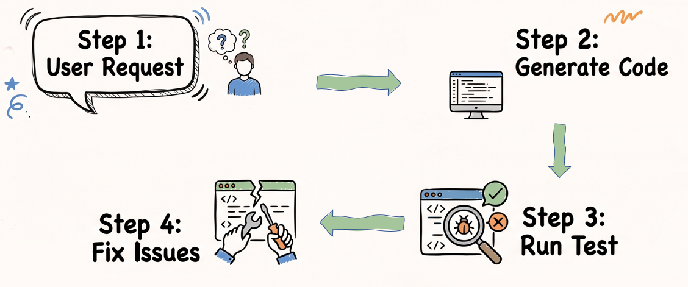
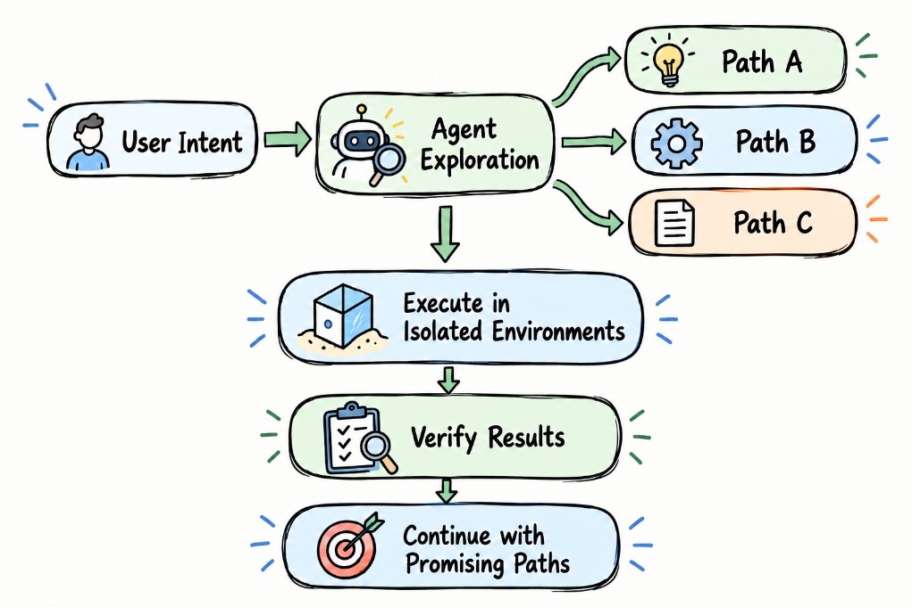
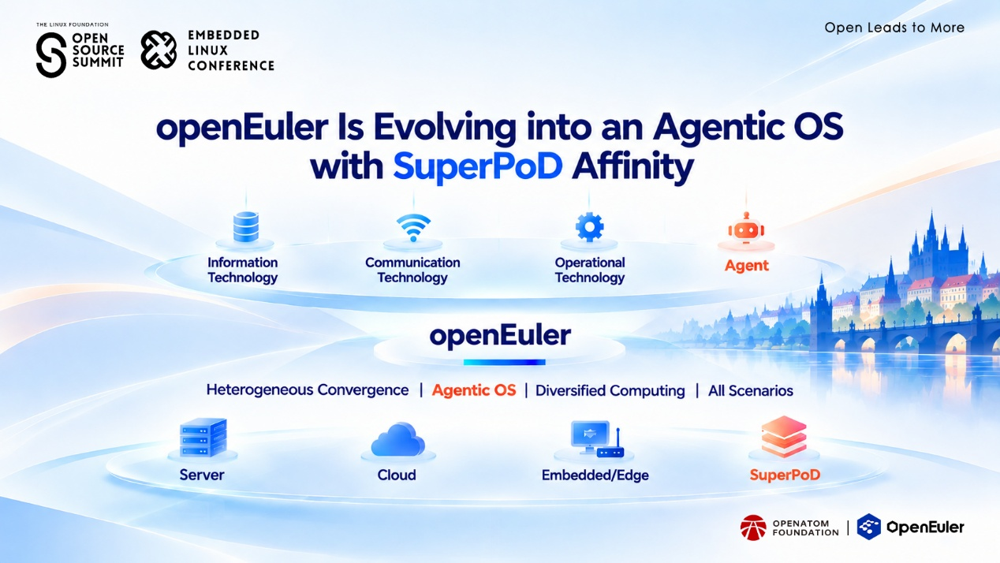
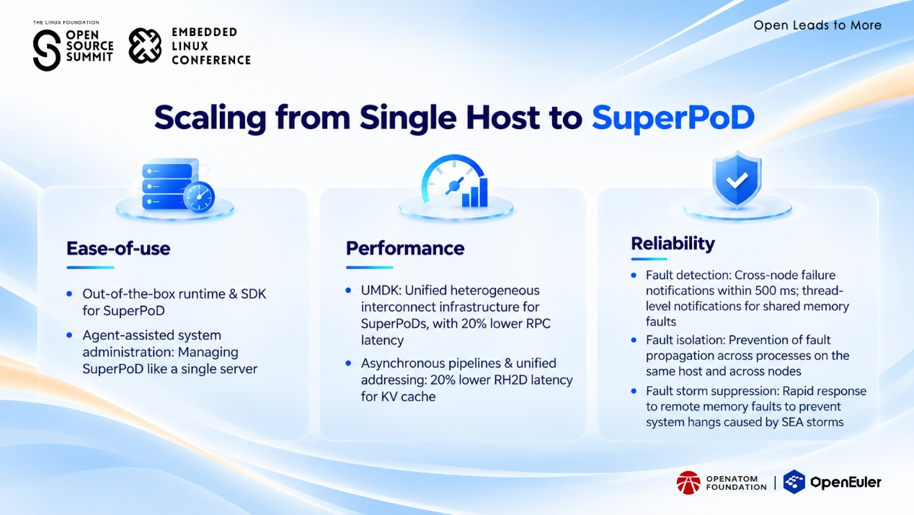

## At a Glance

At Open Source Summit + Embedded Linux Conference Europe 2026, openEuler shared its vision for ***Agentic Scaling with openEuler*** — exploring how OSs need to evolve as AI agents become more capable and workloads extend beyond individual machines.

- AI scaling is moving beyond larger models toward agent-driven execution and system-level intelligence.
- openEuler is evolving into an agentic OS designed to support new AI workloads across increasingly distributed computing environments.
- By combining open ecosystem innovation with SuperPoD-scale infrastructure, openEuler aims to build a more scalable and dependable foundation for agentic AI.

## AI Scaling Is Entering a New Phase

AI systems are evolving from models that generate responses to agents that can reason, use tools, and execute tasks.

This shift introduces a new challenge: scaling AI capability is no longer only about increasing model size or adding more computing resources. Agent workloads bring new execution patterns, including exploring multiple possibilities, coordinating tool usage, and validating intermediate results.

These changes are reshaping the role of OSs.

Traditional OSs manage resources within individual machines. In the agentic AI era, they need to provide a foundation where intelligent workloads can execute reliably across complex and distributed environments.

This is where **agentic scaling** comes in — extending AI capability through the coordination of agents, tools, runtime, and infrastructure.

## 1. What Is Agentic Scaling

AI capability has evolved through different approaches to scaling.

**Model scaling** (pre-training): Improves capability by increasing model size and training resources.

**Test-time scaling** (post-training & inference): Enhances results by allocating additional computation during post-training and inference.

**Agentic scaling**: Introduces a new dimension by enabling systems to explore possibilities, execute tasks, and optimize resource usage based on workload characteristics.

Consider a code agent as an example.

A traditional workflow often follows a single execution path:

With agentic scaling, an agent can explore multiple possible paths in parallel:

Instead of following a single path, the system can explore multiple possibilities, validate them independently, and invest resources in promising paths.

## 2. Why Agentic Scaling Requires a New OS Foundation

Agent workloads introduce new challenges for system design.

More exploration means more execution states, more communication, and greater resource coordination requirements. Without careful system design, exploration can introduce significant overhead.

This creates a new role for the OS: not only managing resources, but enabling intelligent execution.

openEuler is evolving toward an **agentic OS** that connects AI models, runtimes, tools, and infrastructure through system-level optimization.

Open ecosystems provide an important advantage here: **local controllability**.

With control over the model, runtime, tools, and infrastructure stack, developers can perform full-stack co-optimization — improving how different layers work together and making better use of available computing resources.

## 3. Scaling Beyond the Single Host with SuperPoD

As AI workloads become more complex, computing is extending beyond individual machines.

Tightly coupled computing and memory resources are expanding the system boundary toward **SuperPoD-scale infrastructure**, where workloads can leverage resources across multiple nodes as a unified environment.

However, scaling beyond a single host introduces new requirements for the OS:

- simplifying resource management across distributed systems;
- improving communication efficiency;
- ensuring reliable execution when failures occur across nodes.

To support agentic scaling, the OS needs to provide a dependable foundation for this expanded computing environment.

## 4. Building a SuperPoD-Ready Agentic OS

openEuler focuses on three key capabilities to support SuperPoD-scale AI workloads.

### Ease of Use

Developers need ready-to-use runtimes and SDKs, while operators need simpler ways to manage complex infrastructure. With agent-assisted system administration, SuperPoD environments can be managed with a more unified operational experience.

### Performance

Efficient communication is critical for large-scale AI workloads. openEuler improves distributed resource utilization through technologies such as UnifiedBus Memory Development Kit (UMDK), asynchronous pipelines, and unified addressing.

In real-world deployments, these optimizations reduced RPC latency and remote Host-to-Device transfer latency by 20%.

### Reliability

As memory and execution span multiple nodes, failures can potentially propagate across the system.

openEuler focuses on:

- fast fault detection and notification;
- fault isolation to prevent failure propagation;
- fault storm suppression to mitigate SEA storms and prevent system hangs.

These capabilities help create a more dependable environment for distributed AI execution.

## 5. Engineering Certainty Around Uncertain AI Reasoning

AI models are powerful, but their reasoning remains inherently uncertain.

The role of the OS is not to determine whether every model output is correct. Instead, it provides a dependable execution environment around that uncertainty. Through controlled execution, fault isolation, resource management, and verification mechanisms, the OS can help agents operate more reliably.

This is the idea behind engineered certainty: building a stable system foundation that allows uncertain AI reasoning to scale safely.

## Building the Foundation for Agentic AI

Agentic scaling requires more than bigger models.

It requires a new system approach that brings together intelligent execution, scalable infrastructure, and dependable software foundations.

Through its evolution toward an agentic OS, openEuler is connecting open models, agent systems, and SuperPoD-scale infrastructure to support the next stage of AI innovation.
