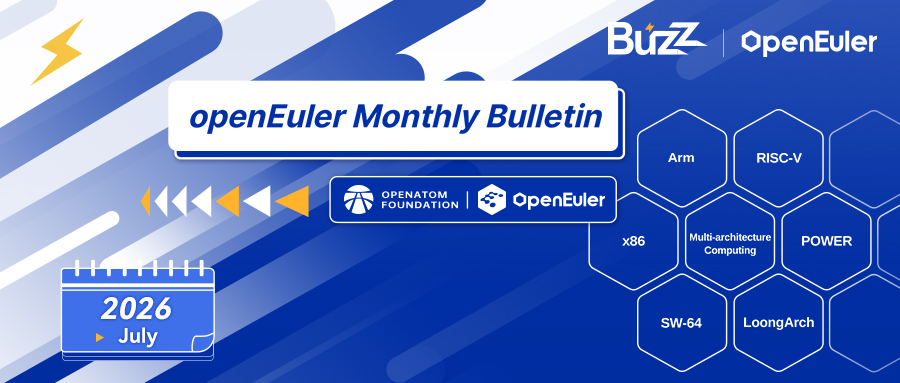
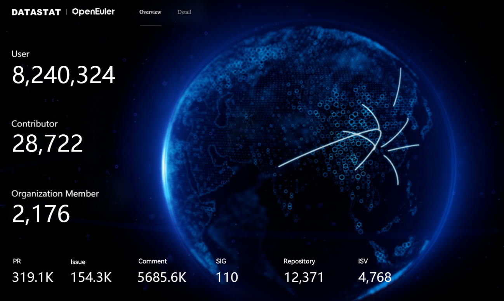
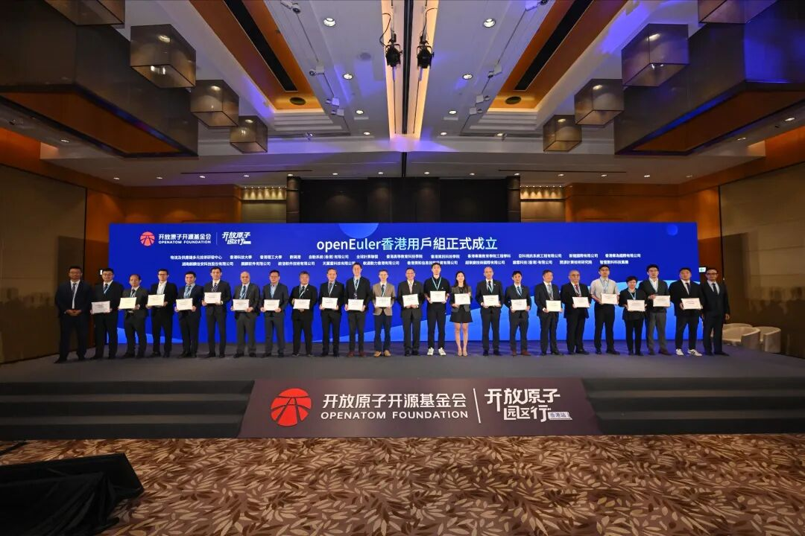
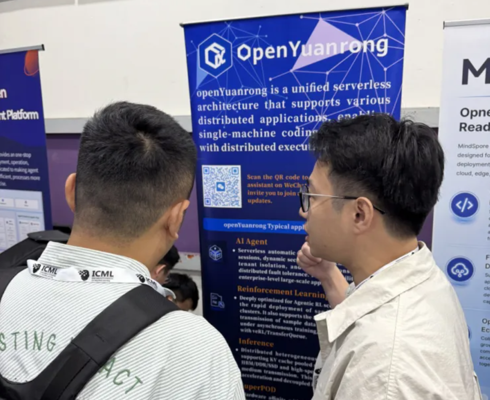
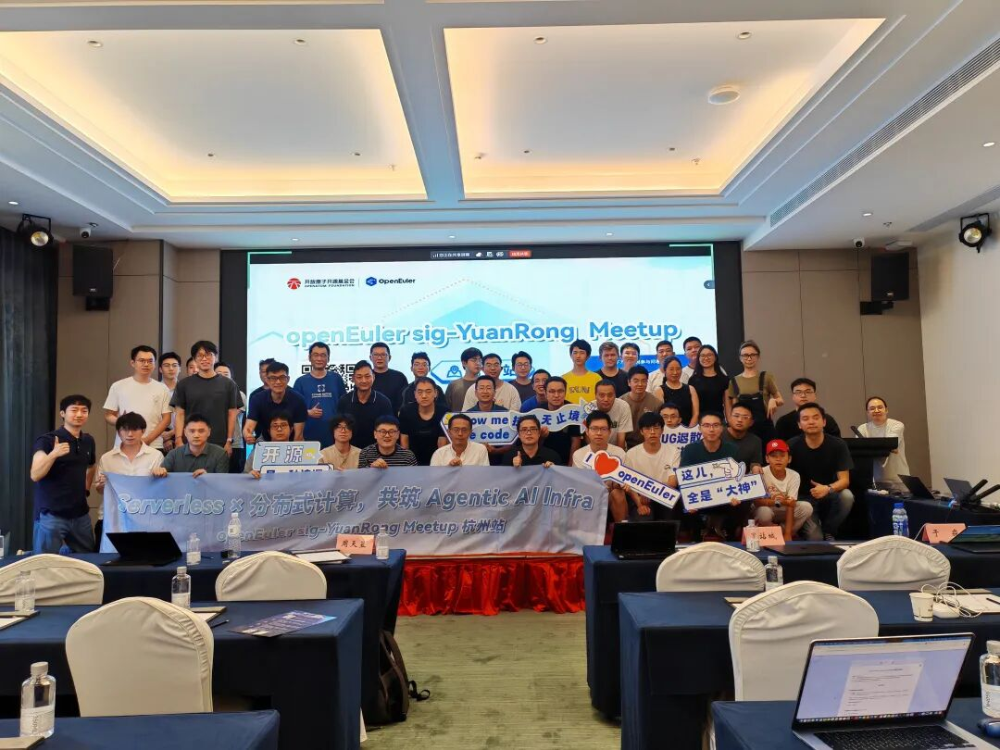
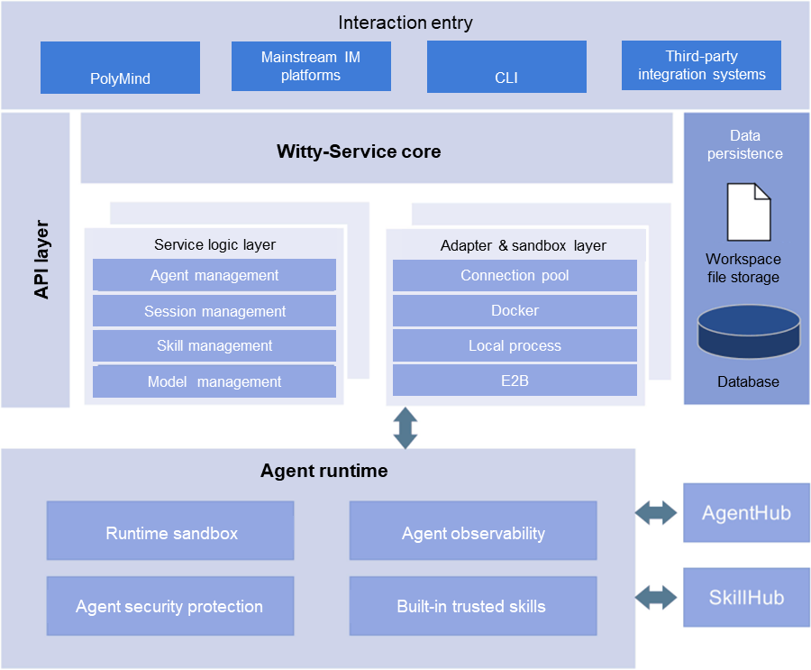
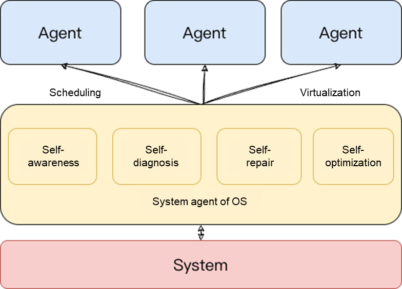
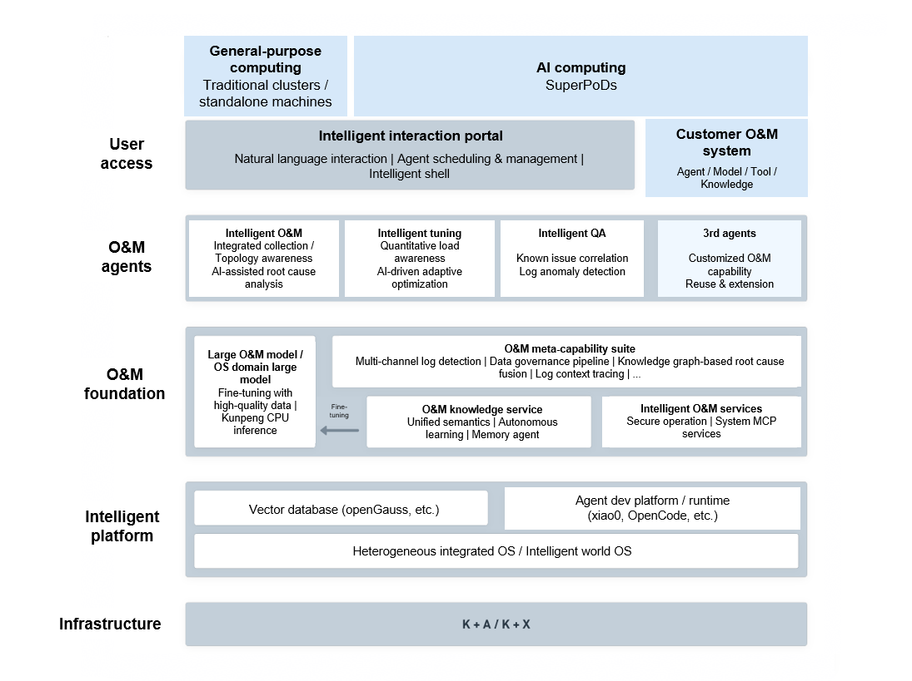

## Overview

In July 2026, the OpenAtom openEuler community (also known as openEuler) continued its steady growth, promoting technological evolution and ecosystem collaboration. By the end of the month, the community had over 8.24 million users, more than 28,000 developers, and 2,176 organization members. In ecosystem development, the community kept advancing its international ecosystem outreach: it joined the OpenAtom "Park Tour" Hong Kong event and facilitated the establishment of the openEuler Hong Kong User Group, further strengthening regional open-source ecosystem connections; the community also appeared at LEAP East 2026 to engage in global open-source technology exchanges and help build an open, collaborative international ecosystem network. In technology innovation, the community continued to explore the convergence of AI with operating systems for improved adaptability to agentic AI, while sustaining its efforts in AI-native software engineering, AI agent interaction platform, system agent, and intelligent tuning to advance intelligent infrastructure.

Overall, the community continued to strengthen its open-source ecosystem connections and intelligent technology innovation capabilities, accelerating the build-out of a next-gen operating system infrastructure for the AI era.

## Community Scale

As of July 31, 2026, the openEuler community had:

- More than 8.24 million users
- More than 28,000 developers
- 2,176 organization members
- 110 SIGs
- 319.1K pull requests
- 154.3K issues
- 5,685.6K comments

*[openEuler DATASTAT](https://datastat.openeuler.org/en/overview) (as of July 31, 2026)*

## Community Events

### OpenAtom "Park Tour" Hong Kong

On July 29, the OpenAtom "Park Tour" Hong Kong event was held, featuring a special session on the internationalization of the open-source ecosystem and the Hong Kong launch of openEuler. Hosted by the OpenAtom Foundation and co-organized by the Hong Kong Logistics and Supply Chain MultiTech R&D Centre (LSCM) and the openEuler community, the event brought together representatives from government agencies, businesses, and universities across Hong Kong to explore technology and innovation collaboration and to support Hong Kong in building an open-source technology hub with global impact.

### openEuler Hong Kong User Group Officially Established

On July 29, the openEuler Hong Kong User Group was officially launched during the OpenAtom "Park Tour" Hong Kong event.

The openEuler community is increasingly involved in China's digital and intelligent infrastructure, while also expanding its global presence. The Hong Kong User Group will add to openEuler's international impact, positioning Hong Kong as a key gateway to the global open-source community where enterprises and developers from around the world can jointly advance an open AI ecosystem.

### openEuler at LEAP East 2026

From July 8 to 10, LEAP East, the international technology and information technology exhibition, made its Asia-Pacific debut. As a regional event under LEAP, the global flagship technology event originating in Saudi Arabia, LEAP East was held under the theme "Into New Worlds", bringing together technology companies, investors, and industry leaders from across the Asia-Pacific, the Middle East, and beyond.

At the event, the openEuler community presented its latest AI technologies and ecosystem practices, with openEuler featured in a series of forums and innovative technology exchanges. The event provided an opportunity to highlight the technical capabilities and industry value of this open-source operating system.

### openYuanrong at ICML 2026

From July 7 to 9, the International Conference on Machine Learning (ICML) 2026 was held in Seoul, South Korea. openYuanrong, an open-source project from the openEuler community, was presented for its latest technologies and ecosystem practices through a series of technical sessions and demonstrations.

During the conference, presentations and demonstrations featuring openYuanrong were delivered for university faculty and students and open-source community partners from China and around the world, covering its latest work in serverless AI, distributed applications, and heterogeneous computing. The presentations focused on key use cases, including how AI infrastructure can efficiently support training, inference, agents, and scientific computing. The project's open-source approach and technical framework attracted broad interest and positive feedback from attendees.

### First openYuanrong Meetup in Hangzhou

On July 25, the openEuler sig-YuanRong Meetup was held in Hangzhou under the theme "Serverless × Distributed Computing, Building Agentic AI Infra Together". The event focused on the evolution of infrastructure in the agentic AI era, with discussions covering the openYuanrong project's technical architecture, enterprise use cases, and future development plans.

Technical experts and developers from enterprises, universities, research institutions, and open-source communities gathered with openYuanrong maintainers to discuss key challenges in scaling AI agent deployment, including compute scheduling, resource management, and security isolation. They also exchanged ideas and practices for building next-generation AI-native infrastructure.

### openEuler Community Generative AI Use and Open Source Contribution Policy Officially Released

Guided by the spirit of openness, collaboration, and innovation, the openEuler community recognizes generative AI and intelligent agents as essential drivers for advancing community technologies. While we allow the use of generative AI tools in making contributions, provided such use is reasonable, transparent, and reviewable, we strictly adhere to the following core principles: open & AI-development-oriented, developer ultimate responsibility, and transparency and traceability.

This policy applies to all forms of contributions submitted to the openEuler community (including but not limited to all code and documentation repositories under the openEuler organization):

- Source code and scripts: including various core code, test cases, and build scripts.
- Technical documents and community content: including API references, deployment guides, release logs, and Wiki pages.
- Configurations and metadata: including Containerfiles/Dockerfiles, and CI/CD configuration files.

## Key Technical Progress

### openYuanrong v0.9.0 Officially Released

On July 8, the openYuanrong team released openYuanrong v0.9.0, with a focus on enhancing support for agentic AI use cases and improving performance and usability across multiple scenarios.

The release brings upgrades across three key areas. For agent workloads, it introduces an enterprise-grade distributed agent runtime, supporting large-scale in-production deployment and efficient operations and maintenance with capabilities such as session-context affinity, multi-tenant isolation, and automatic elastic scaling. For agentic RL, the release improves the sandbox experience with dynamic sandbox route registration and reverse tunneling, enabling bidirectional network communication across heterogeneous clusters. For inference, the release enhances both performance and reliability. NUMA awareness and link warm-up improve the efficiency of distributed data access, while KV cache data transfer is further optimized. The release also supports asynchronous persistent data storage, strengthening data reliability and improving troubleshooting and fault isolation.

### PolyMind Self-Hosted AI Agent Interaction Platform Incubated

As agent technologies evolve rapidly, how to efficiently manage, orchestrate, and run multiple agents while providing a diverse set of tools and skills has become a key challenge for AI infrastructure.

To address this need, openEuler DevStation provides PolyMind, a self-hosted AI agent interaction platform that comes with the agentd service. Incubated by the openEuler community, PolyMind enables AI-powered conversations, agent workflow orchestration, and multi-model management on a unified platform and out of the box.

PolyMind has already made significant progress in areas including agent runtime lifecycle management, skills ecosystem development, unified model management, and automated vulnerability remediation.

### openEuler Agent Infra Intelligent Tuning Engine: 50%+ Analysis Efficiency with Top-Down Identification of OS Performance Bottlenecks and Autonomous Root-Cause Drill-Down

In modern data centers and cloud-native environments, OS performance tuning is critical to maintaining service quality. However, as hardware architectures become increasingly complex — with multi-socket NUMA, heterogeneous computing, and high-speed storage and networking — identifying the root causes of OS performance bottlenecks is becoming exponentially more difficult. This challenge is further amplified by the need for heterogeneous integration in SuperPoDs, where the number of layers across node components increase significantly.

To address these challenges, the openEuler community has introduced an intelligent OS-level tuning engine designed for the agentic era.

### System Agent for Server OSs: System Autonomy & Management Hub

As AI capabilities advance, agents are evolving from single-round conversational tools into core system actors capable of executing commands, modifying files, and managing processes. This capability upgrade enables highly efficient execution, but also introduces challenges in governance and control.

To address these challenges, the openEuler community has introduced a new concept — system agent. It extends beyond enabling a single server or a group of servers to achieve self-awareness, self-diagnosis, self-optimization, and self-healing. At the application layer, it serves a wide range of agent applications, handling agent scheduling and switching. At the system layer, it provides unified management of virtualization, memory, network, and other resources. It is designed to drive the synergy between agents and systems, enabling AI to autonomously manage and optimize real system resources and resolve system-level issues, while also managing and optimizing the growing number of agent applications running on server OSs.

### Witty CLI for Smarter and More Efficient openEuler Systems

Witty's architecture consists of five layers from top to bottom: user access, O&M agents, O&M foundation, intelligent platform, and infrastructure. It supports two types of computing environments: general-purpose computing, including traditional clusters and standalone servers, and AI computing on SuperPoDs.

Within this architecture, Witty CLI serves as the primary intelligent interface for users. It turns the terminal into a conversational interface, allowing users to describe their O&M intent in natural language. Witty CLI then orchestrates the underlying O&M agents, models, and knowledge bases to execute tasks across both general-purpose computing environments and AI computing SuperPoDs.

## Container Image Updates

As of July 31, 2026, 319 application images were adapted based on the openEuler 24.03-LTS-SP4 base image, covering 7 categories. These adaptations covered AI, HPC, cloud, big data, database, storage, and other software categories.

5 new application images were also added. The additions covered AI, cloud, big data, and other software categories.

The images are available on [Docker Hub](https://hub.docker.com/u/openeuler).

## Hardware & Software Compatibility

As of July 31, 2026, a total of 2,769 products had passed openEuler hardware and software compatibility evaluation. 40 products were added in July: 38 from ISVs, 1 from IHVs, and 1 from OSVs.

- [Compatibility list](https://www.openeuler.org/en/compatibility/)

## Security Bulletin

In July 2026, the community published 387 security advisories and addressed 169 vulnerabilities (39 critical, 67 high, and 63 in other severity categories).

The following vulnerabilities have significant impacts and require special attention.

- CVE-2026-44172
- CVE-2026-16349
- CVE-2026-16350
- CVE-2026-16351
- CVE-2026-16352
- CVE-2026-16353
- CVE-2026-16355
- CVE-2026-16356
- CVE-2026-16357
- CVE-2026-16358
- CVE-2026-16359
- CVE-2026-16360
- CVE-2026-16361
- CVE-2026-16362
- CVE-2026-16363
- CVE-2026-16368
- CVE-2026-16369
- CVE-2026-16375
- CVE-2026-16377
- CVE-2026-16381
- CVE-2026-16383
- CVE-2026-16387
- CVE-2026-16390
- CVE-2026-16412
- CVE-2026-55888
- CVE-2026-59083
- CVE-2026-59084
- CVE-2026-15043
- CVE-2026-60082
- CVE-2026-40468
- CVE-2026-13221
- CVE-2026-57433
- CVE-2026-11771
- CVE-2026-12932
- CVE-2026-12996
- CVE-2026-13117
- CVE-2026-14739
- CVE-2026-58264
- CVE-2026-58016

## Vulnerability Protection

The openEuler community routinely fixes vulnerabilities for maintained versions and releases security patches. Users are advised to follow openEuler's official security advisories and promptly install vulnerability patches for protection.

More information: [openEuler Security Advisories](https://www.openeuler.org/en/security/security-bulletins/)

## Thank You for Your Support

We extend a warm invitation to all open-source enthusiasts to join the openEuler community. Whether you are passionate about contributing code, sharing your expertise, or simply engaging in insightful discussions, there is a place for you within our community.

Stay connected with us or check our project repositories for regular updates to stay abreast of the latest developments and breakthroughs.

To suggest an addition or share feedback on the monthly bulletin, contact <contact@openeuler.io>.
