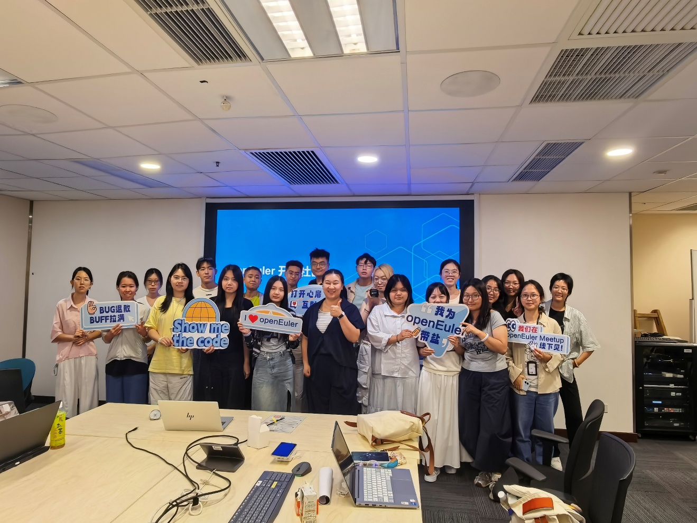
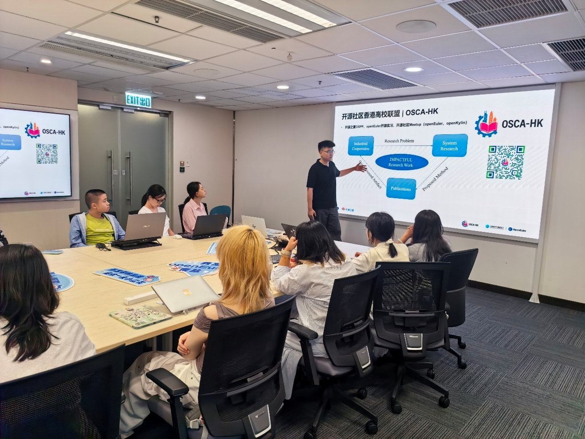
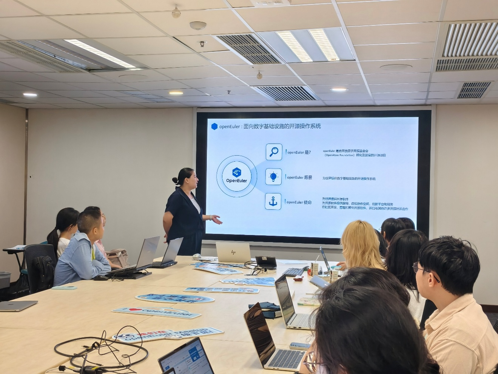
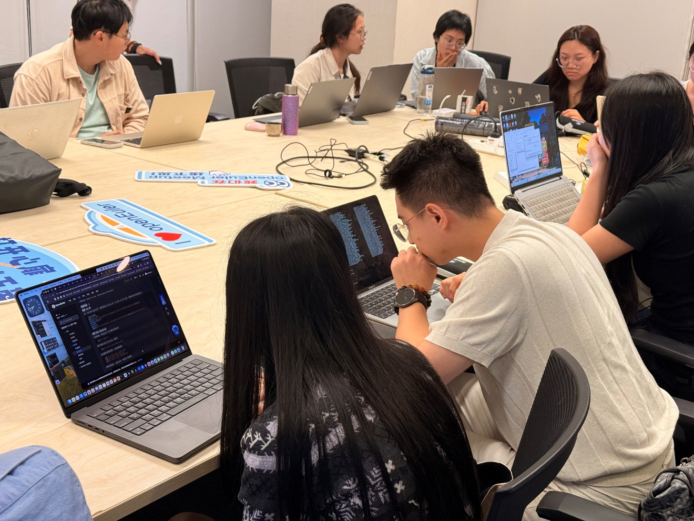
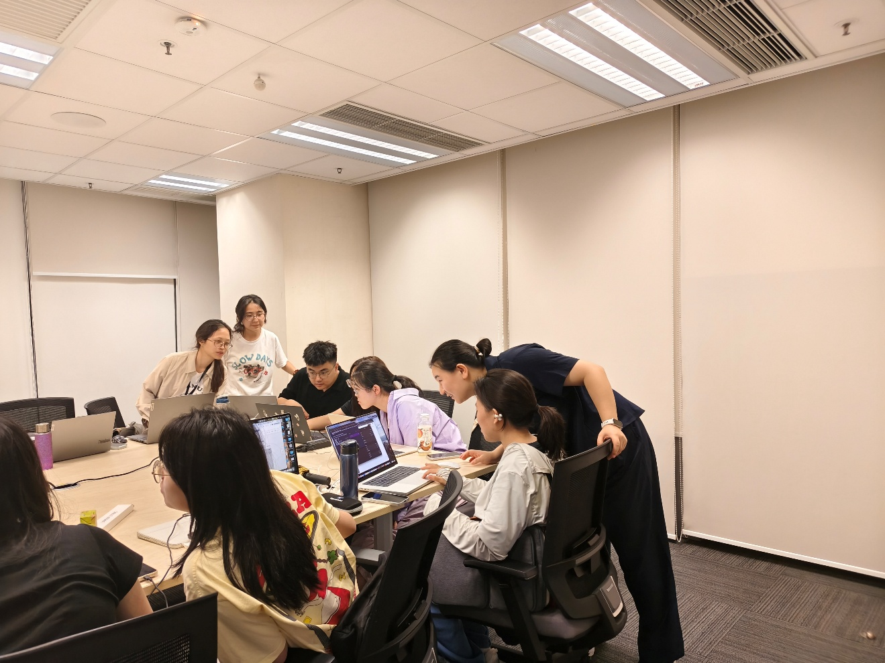
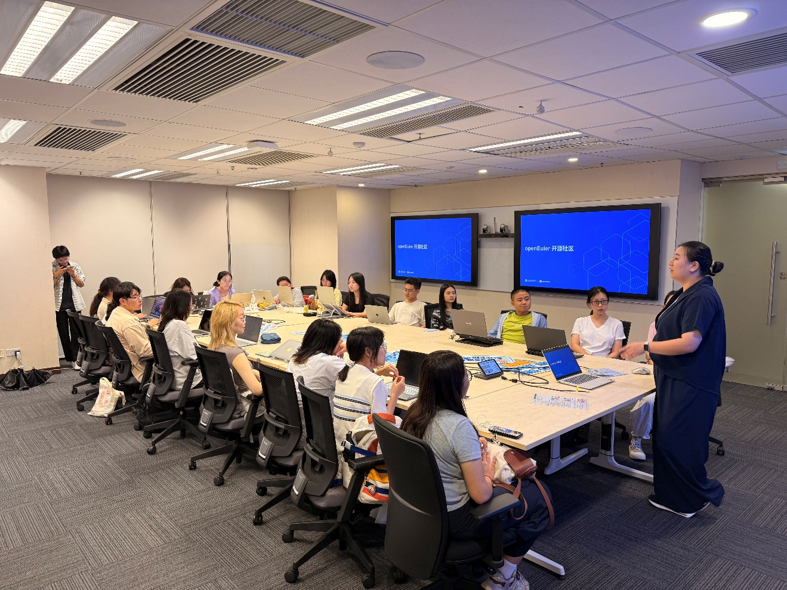

On August 29, the OpenAtom openEuler Workshop Hong Kong was successfully held at City University of Hong Kong. The event was hosted by the openEuler community and organized by the Chinese Students and Scholars Association of City University of Hong Kong (CityU CSSA) and the Open Source College Alliance — Hong Kong (OSCA-HK). The workshop featured two key components: sharing sessions on frontier technologies and openEuler hands-on practices.

The technology sessions introduced participating students to the latest developments in AI and OS kernel security. The hands-on practices guided participants through the complete process of making an open-source contribution — from installing the system to submitting issues and PRs.

## Frontier Technology Sharing: AI Meets openEuler Kernel Security

Li Xiang, a contributor to the openEuler Confidential Computing SIG and a PhD student at City University of Hong Kong, talked about openEuler intelligence in practice, covering community development and academic research. Drawing on open-source community practices in kernel vulnerability detection and mitigation, Li shared his experience and insights from participating in the openEuler community, as well as his exploration of how community development can inform and advance academic research.

Li also shared with the students various ways to participate in open source, including the Open Source Promotion Plan (OSPP), Google Summer of Code (GSoC), and OSCA-HK workshops. He encouraged the students to follow their interests, explore different avenues to participate, and find the path that works best for them.

## openEuler Hands-On: From Scratch to Open-Source Contribution

Now that the participants have a broader view of open-source technologies after the sharing sessions, they can put that knowledge into practice.

Designed for beginners, the openEuler hands-on practices took participants through the complete open-source community workflow, starting with system installation and moving on to identifying, troubleshooting, and reporting issues, and contributing to the community through issues and PRs.

Sun Yunyu, Maintainer of the openEuler Doc SIG, guided participants hands-on. Participants were grouped by their devices of different operating systems and took part in hands-on exercises tailored to each system.

The students promptly shared their feedback with the openEuler community, submitting 22 issues and 2 PRs. Most of the submissions focused on documentation issues and missing steps in the installation process. These real-world user inputs can help the community improve its documentation and user experience. For the students, this was a valuable opportunity to contribute to an open-source project for the first time.

The event also featured a contribution recognition segment, with prizes awarded to participants who made contributions through issue and PR submissions.

## Sustaining Open-Source Collaboration: Everyone Can Contribute

From a technology talk to a system installation, and from identifying an issue to submitting an issue or PR, this Workshop underscored that contributing to open source can start with something as simple as using the technology. Open source is not just for experienced developers — everyday users can make valuable contributions by identifying documentation gaps or workflow issues in real-world use, and turning their feedback into issues, PRs, or other improvements.

The openEuler Workshop Hong Kong brought together technical exploration and hands-on practice, giving students a firsthand look at both emerging developments in AI and OS kernel security and the real-world workflow of contributing to an open-source community. By turning everyday problems encountered in real-world use into concrete contributions, the Workshop helped make open source more accessible to newcomers.

Looking ahead, OSCA-HK expects more such workshops with the openEuler community for university students and developers to learn about, engage with, and contribute to open source.
