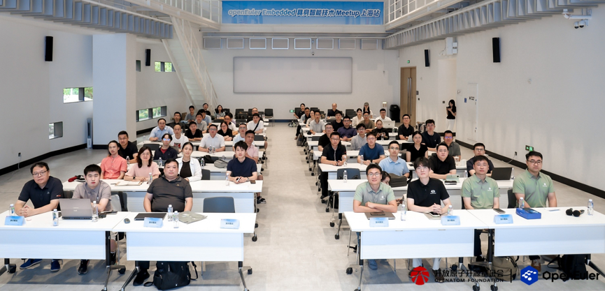
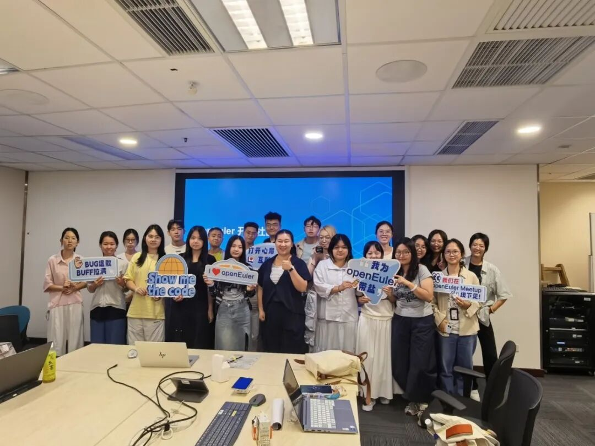
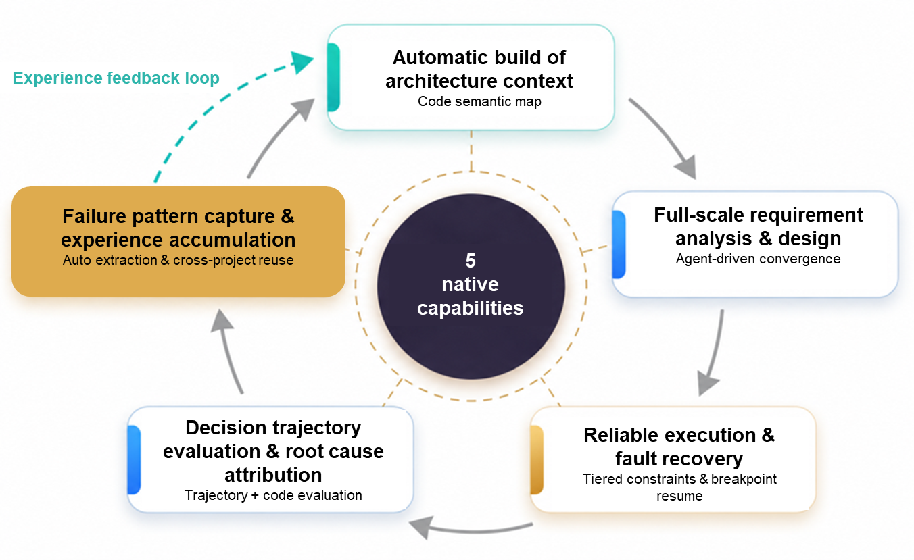
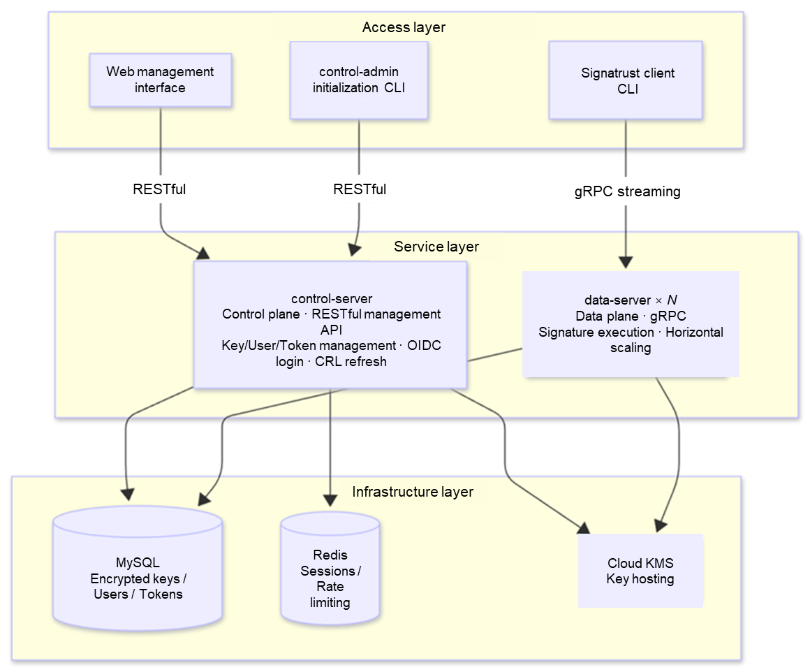
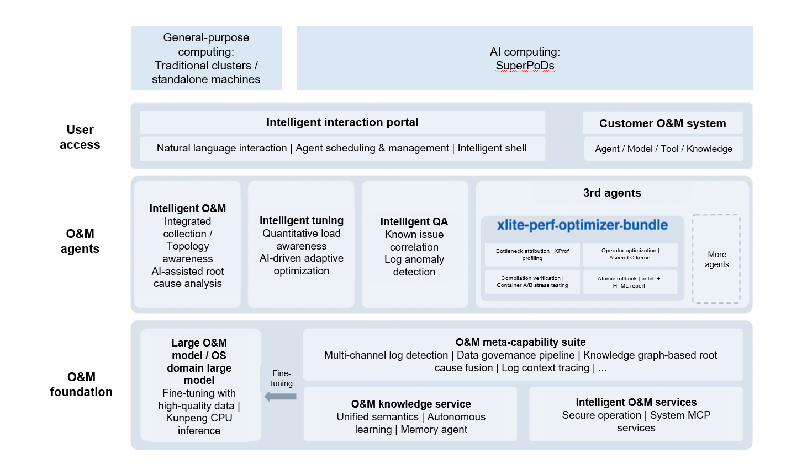

## Overview

In August 2026, the OpenAtom openEuler community (also known as openEuler) continued its steady growth, promoting technological evolution and ecosystem collaboration. By the end of the month, the community had over 9.855 million users, more than 29,000 developers, 2,186 organization members, and 111 SIGs. In ecosystem development, the community continued to foster developer exchanges and promote open-source practices, holding events such as the openEuler Embedded Embodied AI Technology Meetup in Shanghai and the openEuler Workshop in Hong Kong. The community also optimized developer experience by advancing the revision of the *openEuler 24.03 LTS SP4 Quick Start Guide* and building AI-friendly content. In technology innovation, the community continued to deepen the integration of AI and operating systems, delivering multiple practical results in AI-native software engineering, agent infrastructure, AI inference, intelligent O&M, and compute optimization. This includes the release of openYuanrong v0.10.0 and continued progress in Witty, xlite, and other technology practices, further improving AI infrastructure capabilities.

Overall, the community continued to strengthen AI technology innovation, developer services, and ecosystem connection capabilities, accelerating the build-out of an open, collaborative operating system infrastructure for the AI era.

## Community Scale

As of August 31, 2026, the openEuler community had:

- More than 9.855 million users
- More than 29,000 developers
- 2,186 organization members
- 111 SIGs
- 330K pull requests
- 160.9K issues
- 5,951.1K comments

*[openEuler DATASTAT](https://datastat.openeuler.org/en/overview) (as of August 31, 2026)*

## Community Events

### openEuler Embedded Embodied AI Technology Meetup

On August 14, the openEuler Embedded Embodied AI Technology Meetup was successfully held in Shanghai. The event was jointly hosted by the OpenAtom Shanghai Open Source Promotion Center and the openEuler community, co-organized by the Shanghai Artificial Intelligence Association and the Shanghai Humanoid Robot Innovation Incubator, and supported by the Agibot AIMA Developer Community.

The event brought together technical experts and developers from open-source communities, research institutions, and industry to exchange insights on embodied AI operating systems, robotics infrastructure, cluster-based collaborative inference, task-free learning, autonomous drone swarms, and industrial applications.

### openEuler Workshop Hong Kong

On August 29, the openEuler Workshop Hong Kong was successfully held at City University of Hong Kong. The event was hosted by the openEuler community and organized by the Chinese Students and Scholars Association of City University of Hong Kong (CityU CSSA) and the Open Source College Alliance — Hong Kong (OSCA-HK). The workshop featured two key components: sharing sessions on frontier technologies and hands-on openEuler practices.

The technology sessions introduced participant students to the latest developments in AI and operating system kernel security. The hands-on practices guided participants through the complete process of making an open-source contribution — from installing the system to submitting issues and PRs — enabling even those new to open source to gain hands-on experience and make their first real contribution to the community.

### openEuler Development Experience Collection Campaign

As the openEuler community continues to grow, more and more developers are using openEuler to develop systems, deploy applications, and implement projects, accumulating valuable hands-on experience and practical solutions along the way.

To foster technical exchange and knowledge sharing among developers, the openEuler community has launched a call for development experience. Developers are invited to share their real-world experiences with openEuler, including challenges they encountered, how they addressed them, and the insights they gained. This sharing of practical experience and proven solutions can inspire more developers and contribute to the openEuler ecosystem.

### openEuler 24.03 LTS SP4 Quick Start Guide Revised

The *openEuler 24.03 LTS SP4 Quick Start Guide* is designed for O&M personnel and administrators who are new to openEuler. This guide covers the entire process from downloading the installation image and installing the system to logging in and verifying the system, helping users to get started with the operating system.

In a survey conducted last year, some users noted that the community documentation was not sufficiently beginner-friendly due to the lack of step-by-step, illustrated guides. Others found the content difficult to understand and noted that some key steps were missing.

In response, the openEuler community has organized a targeted beginner-focused review of the guide, identifying and addressing pain points encountered during hands-on use. In light of the growing importance of AI, the community has also selected the guide as a pilot for GEO-based content restructuring. The purpose is to improve the documentation's discoverability and machine readability, making it easier for both developers and AI systems to search, retrieve, and understand.

## Key Technical Progress

### AI-Native Software Engineering Paradigm and AET Project

In 2026, AI has evolved from a coding assistant into an active participant in software engineering. Yet a counterintuitive reality is becoming increasingly difficult to ignore: while AI has pushed the boundaries of what is possible, it has also introduced new challenges in scale, efficiency, and quality.

To address these challenges, the openEuler Intelligence SIG has proposed the AI-Native Software Engineering paradigm and set up the Agentic Engineering Team (AET), an open-source project designed to accelerate the adoption of enterprise-grade AI coding solutions and enable reliable, controllable, and evolvable software delivery.

### Official MACA SDK Docker Image on openEuler Now Provided

MetaX Accelerated Computing Architecture (MACA or MXMACA) is a heterogeneous computing software stack developed by MetaX for its C500 series general-purpose computing GPUs. MACA provides a runtime, compiler, operator libraries, and a complete toolchain to help developers rapidly build AI training, inference, and HPC applications on MetaX GPUs.

The openEuler Intelligence SIG now provides an official MACA SDK Docker image built on openEuler. With the image, users can quickly set up a MACA SDK runtime environment on a host with MetaX drivers already installed.

### openYuanrong v0.10.0 Officially Released, Adding Agentic RL and Inference Upgrades

On August 21, the openYuanrong team officially released openYuanrong v0.10.0. The update introduces automatic function sleep and wake-up for agentic RL, adds SSH/HTTP request forwarding to the frontend gateway, and scales elastic session scheduling to support up to 100,000 sessions. For inference, the release improves memory efficiency through cold-data rebalancing in the data system, while enhancing system reliability with dynamic log sampling and node fault recovery in seconds.

### Signatrust, a Next-Gen C/S Architecture Signature Service Platform

Package signing is the first line of defense for software supply chain security. However, traditional signing approaches often rely on separate tools for different package formats, leave private keys scattered across environments, and lack centralized management.

Signatrust (Signature + Trust + Rust) is an open-source signing service platform developed by the openEuler community. Implemented in Rust, Signatrust adopts a control-plane/data-plane-separated C/S architecture to unify multiple signing scenarios — including RPM/SRPM, kernel modules, EFI, CMS, and IMA — on a single platform. Private keys are never transmitted off the server, encrypted data is stored in the database, and KMS provides an additional layer of protection.

### xlite Operator Optimization with openEuler Witty: 80%+ Faster TTFT

xlite is a high-performance inference operator library and acceleration engine for Ascend NPUs. Integrated into the vLLM ecosystem through the vllm-ascend plugin, xlite provides low-level operator optimization and graph fusion capabilities for deploying large models on Ascend hardware. In simple terms, vLLM handles scheduling and serving, vllm-ascend provides Ascend support, while xlite focuses on optimizing every operator and computation path to fully leverage the NPU's performance.

To accelerate xlite performance optimization amid complex code structures and optimization paths, the openEuler community's open-source xlite-perf-optimizer-bundle agent was used. By deploying this agent, developers can automate the analysis, development, and validation of operators in an openEuler environment, significantly simplifying the process and accelerating optimization.

## Container Image Updates

As of August 31, 2026, 6 application images were updated based on the openEuler 24.03-LTS-SP4 base image. These updates covered AI, cloud, database, and other software categories.

16 new application images were also added. The additions covered HPC, database, and other software categories.

The images are available on [Docker Hub](https://hub.docker.com/u/openeuler).

## Hardware & Software Compatibility

As of August 31, 2026, a total of 2,813 products had passed openEuler hardware and software compatibility evaluation. 44 products were added in August: 23 from ISVs, 19 from IHVs, and 2 from OSVs.

- [Compatibility list](https://www.openeuler.org/en/compatibility/)

## Security Bulletin

In August 2026, the community published 403 security advisories and addressed 152 vulnerabilities (39 critical, 67 high, and 46 in other severity categories).

The following vulnerabilities have significant impacts and require special attention.

- CVE-2026-75143
- CVE-2026-74964
- CVE-2026-74943
- CVE-2026-74953
- CVE-2026-74963
- CVE-2026-74969
- CVE-2026-74987
- CVE-2026-74959
- CVE-2026-74990
- CVE-2026-74967
- CVE-2026-74974
- CVE-2026-74957
- CVE-2026-74960
- CVE-2026-27820
- CVE-2026-73193
- CVE-2026-6791
- CVE-2026-34191
- CVE-2026-32327
- CVE-2026-16389

## Vulnerability Protection

The openEuler community routinely fixes vulnerabilities for maintained versions and releases security patches. Users are advised to follow openEuler's official security advisories and promptly install vulnerability patches for protection.

More information: [openEuler Security Advisories](https://www.openeuler.org/en/security/security-bulletins/)

## Thank You for Your Support

We extend a warm invitation to all open-source enthusiasts to join the openEuler community. Whether you are passionate about contributing code, sharing your expertise, or simply engaging in insightful discussions, there is a place for you within our community.

Stay connected with us or check our project repositories for regular updates to stay abreast of the latest developments and breakthroughs.

To suggest an addition or share feedback on the monthly bulletin, contact <contact@openeuler.io>.
