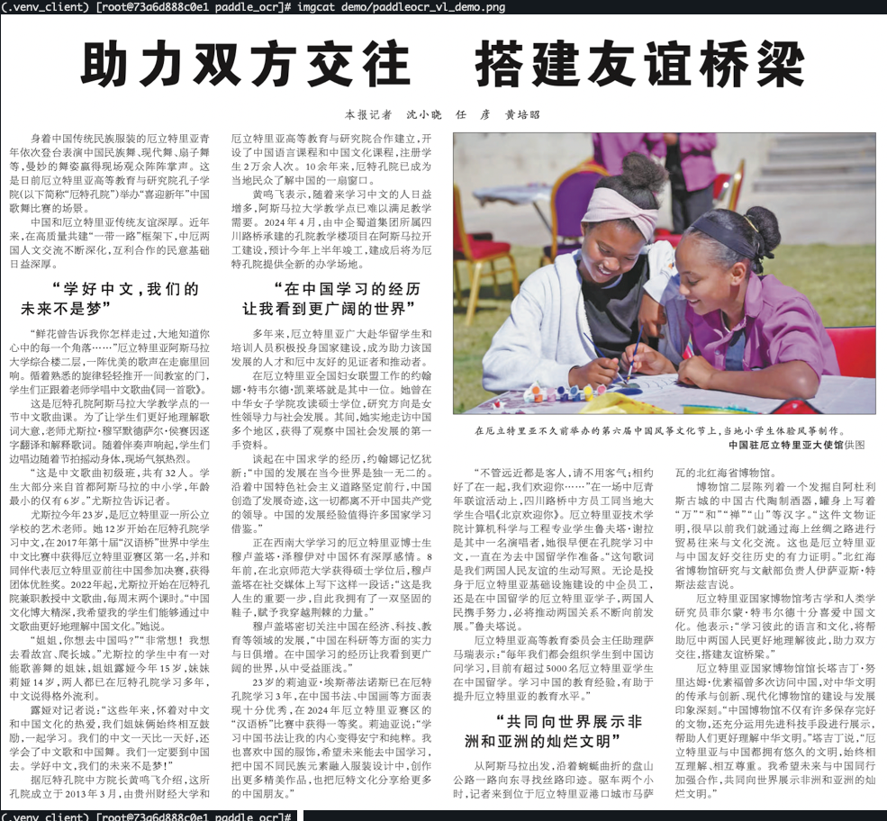
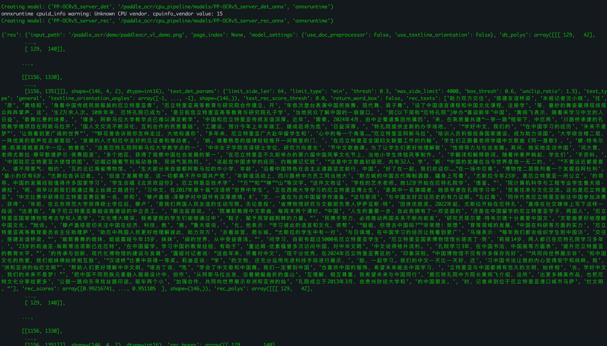

## 一、前言

当前Agent场景下，Agent经常要处理截图、拍照、扫描件，图中文字提取仍是关键一步。和直接让多模态大模型读字相比，专用 OCR 通常更快、更省算力，纯读字也更稳，CPU 就能部署，所以在检索、票据、截图问答这类日常链路里更常见；复杂版面、表格和公式，再交给文档解析或 VLM。

PaddleOCR 有 PP-OCR, PP-Structure, PP-ChatOCR, PaddleOCR-VL等产线， 通用OCR: PP-OCR先定位文字再识别，模型小，CPU 就能部署； PP-StructureV3 在 OCR 之上做版面、表格、公式，适合把扫描件整理成 Markdown，硬件要求和通用 OCR 接近；  PaddleOCR-VL-1.6 换成 0.9B 视觉语言模型，按页做文档理解，复杂版面更强，但推理走生成，需要 NPU 或 GPU。  

本文先从PP-OCR开始实测，尝试在**OpenAtom openEuler**（简称：“openEuler”或“开源欧拉”）24.03 上，部署 **PP-OCRv5**和 **PP-OCRv6**，使用鲲鹏CPU，在同一套进程池、同一份数据集，测试批量吞吐和单页时延，关注**PP-OCRv5**和 **PP-OCRv6的**性能，不涉及准确率和具体环境配置细节，具体安装流程可以参考文末附带的官方教程。

## 二、性能测试路线


| 变量               | 预期作用     |
| ---------------- | -------- |
| 并发 `c`           | 同时处理多少页  |
| 请求数 `n`          | 一次压测打多少页 |
| 线程 `cpu_threads` | 单进程内部并行  |


指标是 **pages/s**（一页图一次请求，和 VL 压测的 req/s 同口径）和端到端时延。不涉及 TTFT / tok/s指标。

## 三、环境准备


### 3.1 环境与版本


| 组件                 | 版本                                       |
| ------------------ | ---------------------------------------- |
| 操作系统               | openEuler 24.03 LTS（aarch64）             |
| CPU                | 鲲鹏 920 A2                                |
| 内存                 | 约 880GiB，DDR5-4800                       |
| Python             | 3.10                                     |
| Paddle / PaddleOCR | 3.2.0 / 3.7.0                            |
| 推理引擎               | ONNX Runtime（CPU）                        |
| 模型                 | PP-OCRv5_server、PP-OCRv6_medium（检测 + 识别） |
| 数据集                | OmniDocBench子集                           |


> 注意，如果环境里安装了`paddle-custom-npu`，导入 Paddle 前需要把 NPU 插件隔开，否则会自动使用NPU设备。


### 3.2 冒烟测试

官方样例图：[样例图](https://paddle-model-ecology.bj.bcebos.com/paddlex/imgs/demo_image/paddleocr_vl_demo.png)



> 官方 demo 图，用来确认识别链路能跑通。

冒烟测试：

```bash
source /paddle_ocr/.venv_client/bin/activate
export PADDLE_PDX_DISABLE_MODEL_SOURCE_CHECK=True

python << 'EOF'
from paddleocr import PaddleOCR

ocr = PaddleOCR(
    text_detection_model_name="PP-OCRv5_server_det",
    text_detection_model_dir="/paddle_ocr/cpu_pipeline/models/PP-OCRv5_server_det_onnx",
    text_recognition_model_name="PP-OCRv5_server_rec",
    text_recognition_model_dir="/paddle_ocr/cpu_pipeline/models/PP-OCRv5_server_rec_onnx",
    engine="onnxruntime",
    device="cpu",
    cpu_threads=8,
    enable_mkldnn=False,
    use_doc_orientation_classify=False,
    use_doc_unwarping=False,
    use_textline_orientation=False,
)

output = ocr.predict("/paddle_ocr/demo/paddleocr_vl_demo.png")
for i, res in enumerate(output):
    res.print()
print("SMOKE_OK")
EOF
```

跑通标志：终端打印 `SMOKE_OK`，并能看到识别出的文字行，实测如下：



## 四、压测约定

矩阵只用 OmniDocBench 子集（全量 1651 页中抽 40 页）。一页图一次请求，warmup 2 页，请求一次打满。

并发用进程池，每进程一份识别实例。`n = max(2, ceil(1.5×c))`。


| 参数      | 取值                                           |
| ------- | -------------------------------------------- |
| 引擎      | ONNX Runtime，CPU；v5 与 v6 各跑一遍                |
| `c` 并发数 | 1 / 2 / 4 / 8 / 12 / 16 / 20 / 24            |
| n 请求数   | `max(2, ceil(1.5×c))` → 2/3/6/12/18/24/30/36 |
| 数据集     | OmniDocBench subset40                        |


## 五、测试矩阵与结果

本文压测使用多进程的方式并发：主进程按并发 `c` 拉起进程池，每个子进程加载一份检测 + 识别（ONNX Runtime，CPU），直接对本地图片做 `predict()`。v5、v6 压力对齐：同一份 OmniDocBench subset40、同一组 `c` / `n`、warmup 2 页、请求一次打满。

### 5.1 压测步骤

以 c=12、n=18 为例。

```bash
# PP-OCRv5：
source /paddle_ocr/.venv_client/bin/activate

/paddle_ocr/.venv_client/bin/python /paddle_ocr/cpu_pipeline/bench_cpu_pipeline.py \
  --dataset /paddle_ocr/datasets/OmniDocBench/omnidocbench_subset40.jsonl \
  --c 12 \
  --n 18 \
  --warmup 2 \
  --det-dir /paddle_ocr/cpu_pipeline/models/PP-OCRv5_server_det_onnx \
  --rec-dir /paddle_ocr/cpu_pipeline/models/PP-OCRv5_server_rec_onnx \
  --out-json /paddle_ocr/bench_results/matrix_cpu_pipeline/by_cell/c12_n18.json

# PP-OCRv6：
source /paddle_ocr/.venv_v6serve/bin/activate

/paddle_ocr/.venv_v6serve/bin/python /paddle_ocr/v6serve/bench_v6_pipeline.py \
  --dataset /paddle_ocr/datasets/OmniDocBench/omnidocbench_subset40.jsonl \
  --c 12 \
  --n 18 \
  --warmup 2 \
  --det-dir /paddle_ocr/v6serve/models/PP-OCRv6_medium_det_onnx \
  --rec-dir /paddle_ocr/v6serve/models/PP-OCRv6_medium_rec_onnx \
  --out-json /paddle_ocr/bench_results/matrix_cpu_v6pipeline/by_cell/c12_n18.json
```

每个子进程里的识别实例等价于冒烟时的 `PaddleOCR(..., engine="onnxruntime", device="cpu")`，并关掉方向 / 矫正 / 行方向。`cpu_threads = max(1, min(16, nproc/c))`。进程用 `spawn` 启动，避免 fork 后再加载 Paddle。

### 5.2 测试结果

PP-OCRv5：


| c 并发数 | n 请求数 | pages/s | median E2E | p95     |
| ----- | ----- | ------- | ---------- | ------- |
| 1     | 2     | 0.26    | 3832ms     | 4077ms  |
| 2     | 3     | 0.39    | 3920ms     | 4336ms  |
| 4     | 6     | 0.36    | 4951ms     | 13854ms |
| 8     | 12    | 0.47    | 15127ms    | 20870ms |
| 12    | 18    | 0.58    | 14641ms    | 25299ms |
| 16    | 24    | 0.33    | 19838ms    | 52351ms |
| 20    | 30    | 0.40    | 19522ms    | 51131ms |
| 24    | 36    | 0.42    | 23961ms    | 56184ms |


PP-OCRv6：


| c 并发数 | n 请求数 | pages/s | median E2E | p95     |
| ----- | ----- | ------- | ---------- | ------- |
| 1     | 2     | 0.33    | 3021ms     | 3143ms  |
| 2     | 3     | 0.51    | 3046ms     | 3083ms  |
| 4     | 6     | 0.40    | 3288ms     | 12846ms |
| 8     | 12    | 0.54    | 13327ms    | 18504ms |
| 12    | 18    | 0.70    | 13078ms    | 21775ms |
| 16    | 24    | 0.16    | 21378ms    | 51130ms |
| 20    | 30    | 0.20    | 17876ms    | 49242ms |
| 24    | 36    | 0.23    | 19460ms    | 47653ms |


> 注意，不同环境下和压测方式下对压测结果结果都有影响，以上数据仅供参考。

同一台机器、同一套进程池。v6 低并发中位约 **3.0s**（v5 约 3.8～3.9s），吞吐在 **c=12 见顶 0.70 pages/s**（v5 为 0.58），大约快两成。两边都是 c=12 最好，再往上时延拉长、pages/s 回落；c≥16 时 v6 吞吐掉得更明显，批量仍宜停在 c=12 附近。

## 六、总结

1. 要在 openEuler 和鲲鹏 CPU 上做传统 OCR，PP-OCRv5 / v6 加 ONNX Runtime 都能跑通。同样环境、同样压法，**v6 峰值更高、低并发更省时**（c=12：0.70 vs 0.58 pages/s；c=1 中位约 3.0s vs 3.8s）。
2. 批量吞吐把并发放在 **c=12 附近**；要单页时延低的话，把 c 留在 1～2。c≥16 两边都会掉，v6 掉得更明显。
3. 这是检测加识别，复杂版面、公式、跨栏解析不能按 PaddleOCR-VL-1.6 的效果来预期。
4. 下一篇文章将会基于相同环境，实测 PaddleOCR-VL-1.6 在 CPU 和 NPU 上运行的性能，以上实测数据可以作为对比。


### 参考链接

- [PaddleOCR 通用 OCR](https://www.paddleocr.ai/latest/version3.x/pipeline_usage/OCR.html)  
- [OmniDocBench](https://huggingface.co/datasets/opendatalab/OmniDocBench)

