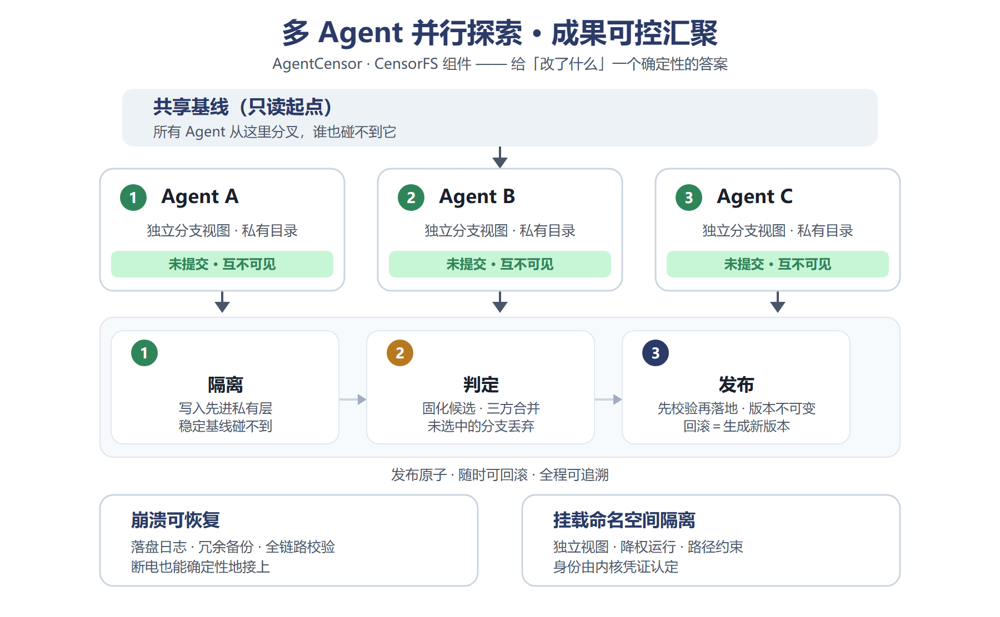
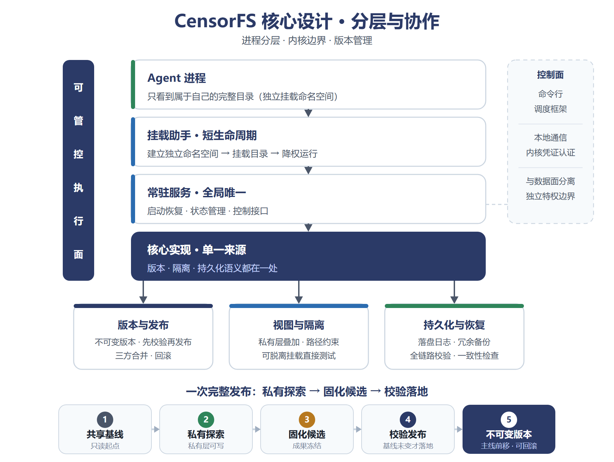
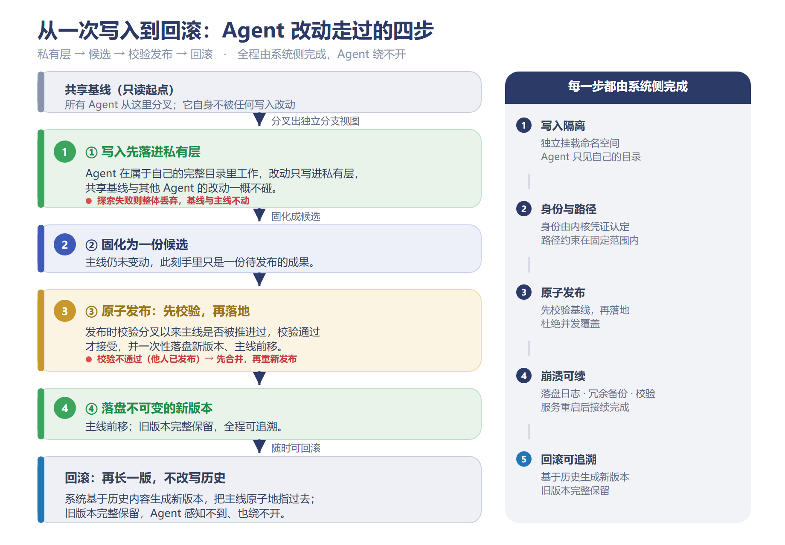
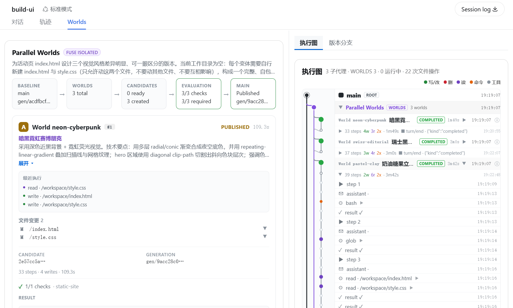
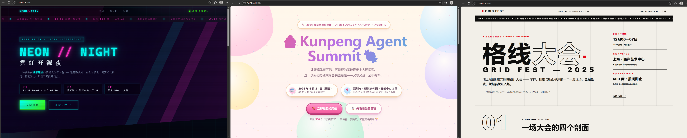
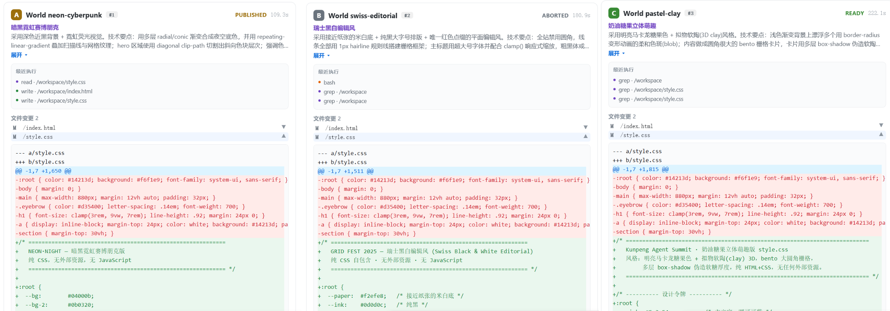

> 当 Agent 开始直接修改你的工作区，谁来给它配一层隔离与回滚？CensorFS 只做一件事：写入真正落地之前，先把它放进一层看得见、随时可以丢弃的私有空间。—— CensorFS · AgentCensor 的「隔离与可逆」组件

在 OpenAtom openEuler（简称：“openEuler”或“开源欧拉”）【Agent 可观测 & 治理】系列的开篇文章《[Agent 可观测 & 治理系列 | AgentCensor：一套为 Agent 而生的治理底座](https://mp.weixin.qq.com/s/wrvf77xEHsbSXtut3pOX5w)》中，我们提出过一个判断：把生产环境的写入权限交给 Agent 时，需要给它配一层**可管控的执行面**——每一次写入都要先经过隔离、留痕与判定，再决定要不要真正落地。AgentCensor 用几个组件拼起了这层执行面，其中负责「隔离与可逆」、并回答「它改了什么」的，正是 **CensorFS**，本篇对它做一次详细拆解。

## 01 同一个工作区，多个写入者：冲突从哪里来

先看一个再普通不过的场景：为了让 Agent 比较三种实现方案的优劣，我们让它并行起三个 subagent，各给一套独立思路，同时对着同一个工程目录动手。结果往往不是三份方案的对照，而是一团纠缠——有人覆盖了别人改到一半的文件，有人跑到一半崩溃，在真实工作区里留下一堆半成品；即使当场没出事，事后也很难分清一个改动出自谁、为了哪个任务。

需要隔离的场合并不止这一种。同一个工作区上出现并发写入者，大致有三种情形：

- 一个 Agent 自己分叉——为并行比较方案或反复试错，今天主流的编码 Agent 都支持起多个 subagent；
- 多个 Agent（或多个会话）同时在一个仓库上工作；
- 人和 Agent 共用同一个工作目录。

三种情形的严重程度不同，撞上的却是同一个结构性问题：**写入是并发的，而工作区只有一份**。目前社区最常用的应对办法是「一个任务一个分支、一个工作目录」（git worktree 这一类做法），它简单有效，但也有自己的边界。

回到故障本身。起因各异，缺口却落在同一个位置：**破坏发生在 Agent 那一串工具调用的内部**。把「请你小心」写进提示词拦不住它；能兜底的还是文件这一层——写完了吗、写进了哪里、能不能回到写之前，这三个问题答不上来，Agent 的探索与改造就始终带着不确定性。

在 AgentCensor 要管的几件事里，第一件就是「隔离与可逆」：

- 写入能不能先待在一层别人看不见、随时可以丢弃的私有空间里，确认之后再落地？
- 发布能不能落成一笔随时可退的记录，让每一次改动都有迹可循？

在 AgentCensor 的分工里，这件事由 **CensorFS** 承担。

## 02 CensorFS 的答案：先隔离，后发布

CensorFS 的做法是：Agent 看到的还是熟悉的目录结构，每一次写入却先落进只属于它的私有层。多个 Agent 在同一目录下分叉出各自独立的分支视图，未提交的结果彼此看不见。探索结束，成果先固化成候选，失败的探索直接丢弃、主线不受影响；最后由三方合并汇聚成果，需要时可随时回滚。



图1 CensorFS 多 Agent 并行探索与成果汇聚

选在哪一层做这件事，决定了它能不能真的兜住。CensorFS 把隔离与回滚放进文件系统这一层，理由不复杂——这一层离写入最近，也最难被绕过。换成你能拿到的东西，是四条：

- **① 所有写入都在保护范围内。** Agent 不只是改代码，还要执行命令、装依赖、生成产物、写缓存与日志；落在这一层就一并覆盖，不必逐一枚举。
- **② 提示词拦不住的动作，这里拦得住。** 应用层与提示词层的约束都依赖 Agent 配合，而绕过正是它的强项；内核的命名空间与凭证边界不吃这一套。
- **③ 进程崩了、断电了，改动也丢不了。** 写入先落盘、先记日志、带校验、重启后接续——这些保证只能在持久化层拿到。
- **④ Agent 和调度框架都不用改。** POSIX 是编译器、脚本、IDE、shell 的公共接口，语义放在这一层；对调度框架而言，CensorFS 只是一层可以直接插入的组件（分层见图2）。

具体到 CensorFS，这套能力收敛在三件事上：**写入只落在私有层**（每个 Agent 拿到自己的目录视图，碰不到基线，也碰不到别人的改动）、**发布是一次带校验的原子提交**（基线被推进过就拒绝，历史不可改写）、**中途断掉也能确定性接续**（先记日志、关键结构冗余、全链路校验）。三者共用同一份核心实现——版本、隔离、持久化各写一处、彼此复用，全部由系统侧完成。

这套实现组织成分层结构（图2）：最上层是 Agent 进程，只看得到自己的目录；中间的系统侧组件负责建立隔离环境、维护状态与控制接口；版本、隔离、持久化的语义收敛在同一份实现；命令行与调度框架作为控制面接入，与数据面分离。



图2 CensorFS 核心设计：分层与协作

这套「先固化候选、再原子发布」的机制，让 CensorFS 能够回答「改了什么」。它怎么走完一次完整改动、又能用到哪些场景，下一节展开；文末还有一套实操案例。

## 03 一次改动怎么走，能用在哪儿

这几层串起来，就是一次改动的完整链路——写入、发布、回滚都在系统侧完成：

- **写入。** 系统在只读基线之上叠一层私有层，合并成完整目录挂给 Agent；改动只落在这一层，共享基线与别人的私有层一概不碰，身份与路径在这一步由内核框定。
- **发布。** 先固化成候选，此时主线未动；落地时校验「分叉以来主线有没有被别人推进过」，通过才一次性落盘一个不可变版本、主线前移。别人抢先发了就先合并再重发——并发提交不会被静默覆盖。
- **回滚。** 系统基于历史内容生成一个新版本，再把主线原子地指过去，旧版本完整保留；「哪一版、从哪来、回到哪」全程可查。整个动作在系统层完成，Agent 既感知不到，也绕不过去。



图3 CensorFS 的一次写入：从私有层到原子发布，再到回滚


隔离、可逆、可恢复这三件事，最终都落在磁盘记录和内核边界上，成为 Agent 绕不开的硬约束。CensorFS 对 AgentCensor「隔离与可逆」这一块的交付，靠的就是这个。

落到日常开发，最常用的是五个场景：

- **多分支并行探索** —— 多个 Agent 同时修改同一个工程，各自在独立的分支视图里工作，互不可见、互不干扰；
- **推测执行与失败试验** —— Agent 可以反复启动私有探索去验证想法，失败的探索整体丢弃，主线内容与版本记录毫发无损；
- **受控成果发布** —— 探索结果先固化为候选，发布时校验基线未被他人推进，防止并发提交被静默覆盖；
- **多 Agent 成果汇聚** —— 以最近共同祖先为基准做逐路径的三方合并，把不同路线的改动汇聚到一起，出现冲突时保持目标分支不变；
- **版本审计与回滚** —— 每次发布都生成不可变版本，回滚以新版本落地、历史完整保留，全程可追溯。

概括来说：探索可以放开，主线始终可控；已经发生的改动，随时可以退回。

## 04 实测：三个 subagent 并行产出，只发一版**

前文列了五个场景，这里把「多分支并行」与「受控发布」两者落到一个最简实例。

**示例背景** 我们以 DeepSeek Harness 为例：要给一个开源项目做一版网页首页，又不想一开始就把风格锁死，于是同时起三个 subagent，各给一套独立的交互方向：深色霓虹数据屏风、极简留白风、富信息文档风。三个 subagent 并行，各自在自己的私有目录里改 index.html 与 style.css，互不可见、也碰不到共享基线；等三份候选出炉，我们挑一版发布，剩下两份丢弃。全程不改原本的共享文件。

**执行步骤** CensorFS 原生面向鲲鹏 AArch64 与 openEuler 系统，Rust 编写，安装后统一以 `censorfs <子命令>` 调用，具体参数以 `censorfs --help` 与 README 为准。构建与启动服务是：

```bash
# 构建只有一条命令
bash scripts/build-openeuler-aarch64.sh --install-deps

# 导入首页素材为 main 基线，并启动后台服务（命令行与插件都经它读写）
export CENSORFS_STORAGE_ROOT=/data/homepage-demo/.censorfs
censorfs init --import-root /data/homepage-demo/import --branch main
censorfs daemon
```

三个 subagent 并行产出，通过 DeepSeek Harness 的 `/explore` 一条命令，从同一个 main 基线拉起三个完整、隔离、可运行的世界：

```text
/explore 3 为活动页 index.html 设计三个视觉风格差异明显、可一眼区分的版本。每个变体为实现自己的版本可同时修改 index.html 与 style.css，但不要动其他文件、不要互相影响。
```

- 每个 world 都在自己专属的挂载命名空间里工作，subagent 看到的目录就是它的私有层，与别人改到一半的文件、共享基线完全隔离；
- 每份探索成果会先固化成一份不可变候选，并在独立的只读视图里跑验证（本场景为逐份解析各候选的 index.html）；
- 三种风格、三份候选互不干扰——各出一版，由我们决定最终选哪个方案。



图4 三个 subagent 在 DSH 的「Parallel Worlds」面板里并行：BASELINE → WORLDS → CANDIDATES → EVALUATION → MAIN 五个状态实时联动，每个世界各带「发布 / 放弃」按钮；右侧执行图可以看到相互隔离、谁先完成、候选是否就绪



图5 三份候选各成一版——深色霓虹数据屏风、极简留白风、富信息文档风（同一份 index.html 与 style.css，三条彼此独立的改写路径）



图6 三份候选在同一路径上的实际文件变更：三个 world 各自改了 style.css 的不同片段，彼此的改动没有重叠


我们比较完三份候选（图4—图6），选中深色这一版，只发布它，其余两份丢弃。这一步不一定要敲命令——Web UI 里每份候选都自带「发布 / 放弃」按钮，可以根据情况自行决策；也同样支持下面的命令行操作：

```text
/censorfs-publish <run-id> <variant-id>     # 发布选中候选：校验基线未被推进，防并发覆盖
/censorfs-abort <run-id>                    # 丢弃其余候选（也可指定单个 variant）
```

这一步中的发布动作都会先校验基线版本，别人先落地的成果不会被静默覆盖。

体检与审计走同一条命令行（命令行提供底层构件，探索与发布本身由 DeepSeek Harness 承载）：

```bash
censorfs head main            # 查看当前版本头
censorfs generation <gen>     # 查看某个历史版本，留作审计
censorfs fsck                 # 一致性体检（--repair 修复）
```

发布落地后，主线由 vN 前移到 vN+1——落盘一个全新的不可变版本，可回滚、可审计，原本的共享文件全程未动；这正好对应图1里「并行探索、成果汇聚」那件事。

**实测状态** 上述流程（三个 subagent 并行产出 → 各自候选 → 只读验证 → 校验后发布 → 主线内容更新为选中版本）已在 openEuler 24.03 AArch64 真机跑通。未发布时主线始终保持原版本——每个 subagent 的探索都不会自动发布，发布是一次显式的、可回退的决策。

## 05 回到全景：AgentCensor 里的一块拼图

CensorFS 作为一个会隔离、能回滚、可恢复的闭环，是 AgentCensor 这个更大框架里的一块拼图，共同把 Agent 安全落地的工程设施补充完整。在这片拼图里，CensorFS 只做一件事：隔离与可逆，也就是弄清 Agent「改了什么」。至于看得见、说得清的证据链（CensorScope），和拦得住、判得准的同步拦截（CensorGuard），系列里会各自拆开细讲。

## 结语

回到开篇那个问题：当 Agent 开始直接修改你的工作区，谁来给它配一层隔离与回滚。CensorFS 给出的答案是：写入先落进私有层，发布是一次带校验的原子提交，回滚由系统生成一个新版本完成。整套机制都放在内核边界与文件系统落盘这一层，于是隔离成为绕不开的硬约束，崩溃后的状态也能被确定性接续。

它的价值在于把「多 Agent 并行」从「能跑起来」推进到「跑得稳、收得住」：结果可以并行探索，收敛只落回一个可信版本。留给你的，是把想法放开去试的空间，和随时退得回来的余地。


**欢迎加入我们**

CensorFS 已在 GitCode 开源，仓库中提供了完整的构建脚本、systemd 部署文件与集成验证脚本。如果你正在构建 AI Agent、代码执行平台或多租户 Harness，欢迎基于示例流程跑一遍：隔离、原子发布、回滚，几步就能验证。

代码仓：[https://gitcode.com/openeuler/AgentCensor](https://gitcode.com/openeuler/AgentCensor)

开发 & 维护 SIG：sig-DevStation

欢迎添加下方 openEuler 小助手，由小助手邀请你加入 DevStation 交流群。

