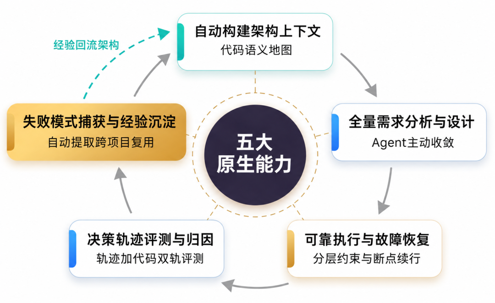
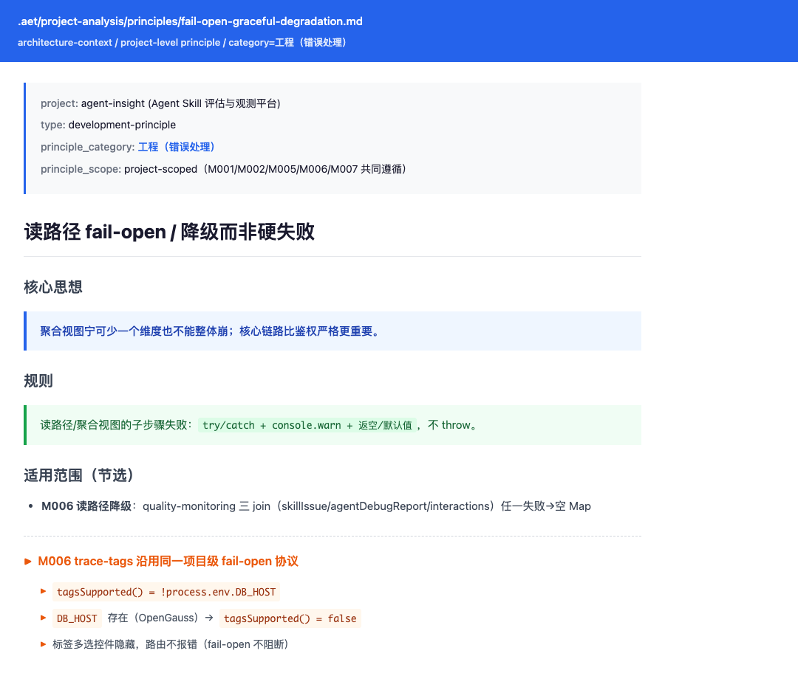
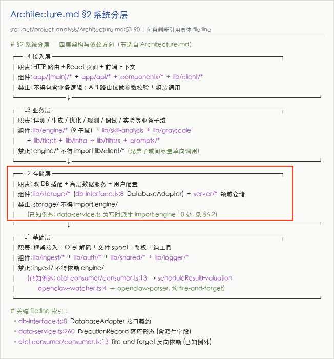
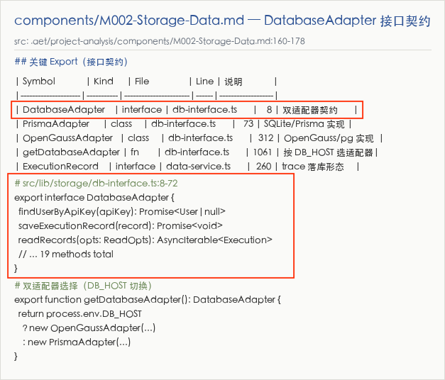
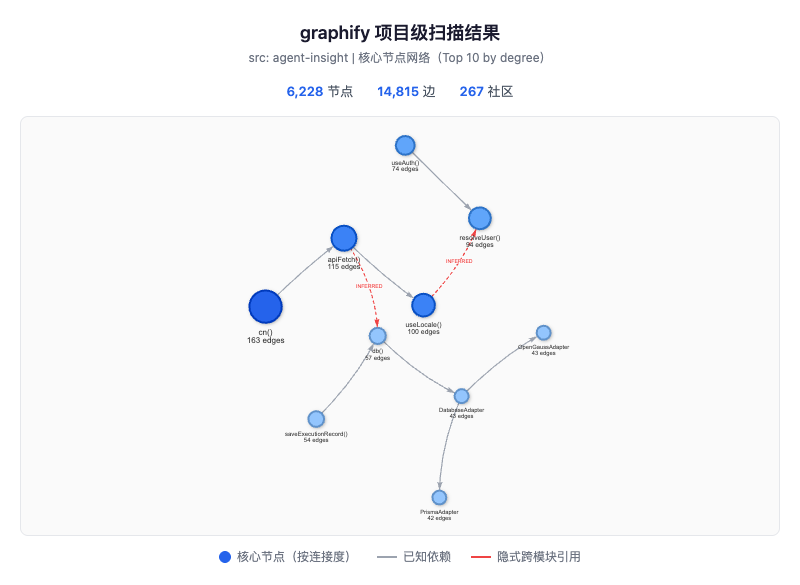

## 01 背景介绍

上一篇文章“[openEuler Agent Infra企业级编码方案（一）：基于AI原生软件工程范式，实现企业级软件交付可靠、可控、可演进](https://mp.weixin.qq.com/s/tjHbA0V3UnxRSv7XlVgdKQ)”介绍了OpenAtom openEuler（简称 “openEuler” 或 “开源欧拉”） Agent Infra项目中的企业级编码方案围绕AI Agent认知特性构建的五项原生能力。其中第一项是自动构建架构上下文，让Agent在写代码之前就拿到当前项目的语义地图，知道“项目当前是什么样、哪些边界不能越过”。本篇展开说明这项能力，包括它解决什么问题、如何应用于需求分析、功能设计和代码实现，以及如何使用AET框架自动完成架构上下文的构建。



仓库链接：<https://atomgit.com/openeuler/agentic-engineering-team>

## 02 实际案例：让编码Agent直接开发需求，无法有效利用架构级信息与约束

架构上下文是从当前代码和文档中提取出的模块职责、依赖方向、接口契约、项目级原则，是一套可供Agent引用和检验的结构化文档，一个典型项目的架构上下文由如下几个文件组成：

```text
.aet/project-analysis/
├── Overview.md                       # 项目目标、技术栈和外部系统
├── Architecture.md                   # 系统边界、分层、依赖方向和核心数据流
├── Modules.md                        # 模块ID、职责、路径、依赖关系和不应改动状态
├── SKILL.md                          # 整套分析结果的入口和索引
├── components/                       # 组件级架构上下文
│   ├── M001.md                       # 组件1的接口契约、实现约束等描述 
│   ├── M002.md                       # 组件2的接口契约、实现约束等描述 
│   └── ....      
└── principles/                       # 项目级原则
    ├── fail-open-graceful-degradation.md  # 原则1
    ├── ....    
```

顶层四份文档提供项目基线，`components/`记录每个模块的接口契约与实现约束，`principles/`记录跨模块复用的项目级原则。

当缺少架构上下文时，Agent拿到需求后会直接探索代码仓，如读取文件、解析AST、检查import关系，但这些信息并不能完全揭示架构关系。它还需要知道：

* 项目如何分层，模块之间允许怎样依赖，哪些跨层依赖被禁止。

* 哪些目录、接口和数据模型不能随意修改。

* 哪些职责属于不同模块，不能为了复用而合并或跨越边界。

* 数据库等基础设施的差异由哪一层封装，业务层不能直接依赖哪些具体实现。

这些约束分散在代码、注释、设计文档和历史review记录中，而且有些只作为团队约定俗成的隐性架构原则存在。Agent能够读到代码，不代表它能在一次任务中识别全部架构关系与约束。缺少架构上下文时，生成的代码可能通过编译和局部测试，却把问题留给后续review或重构。

例如，openEuler Agent Insight 项目有一项需求：为Agent上报的“关联Trace”增加搜索及过滤能力，包含模糊搜索、按时间筛选和按业务标签筛选，业务标签是用户为 trace（执行记录）打上的自定义分类标签，用于业务维度的筛选和归类。AET在实现该需求时，采用两种方式进行对比测试：一种方式是在开发前先构建架构上下文，另一种方式直接进入需求实现。通过对同一需求的实现对比，发现没有架构上下文时，实现的代码会破坏架构约束，需要在实现完成后依赖review检查发现。

### 2.1 没有识别既有门控机制：业务标签筛选走错了降级路径

需求涉及“切换数据库到OpenGauss时是否启用业务标签筛选”。需要根据使用的数据库类型判断是否启用业务标签：使用SQLite数据库启用业务标签功能，前端显示标签控件，使用其他数据库不启用业务标签功能，前端隐藏标签控件——这就是项目的fail\-open降级，这是一种韧性设计模式：当某个功能不可用时，系统只关闭该功能，其余部分继续正常工作，而不是整个系统崩溃。该需求中，当标签维度缺失时只关掉标签筛选功能，关键词搜索和时间筛选功能继续可用，不让整个页面因为一个维度不可用而崩溃。`tagsSupported()`函数就是标记是否使用业务标签的检查门控：使用SQLite数据库时，`tagsSupported()`返回true，其他数据库返回false。项目使用OpenGauss数据库，因此`tagsSupported()`返回false，标签相关功能不可用。所有调用标签相关的函数都需要先调用`tagsSupported()`函数。  

没有架构上下文的分支在实现需求时，没有利用既有统一接口`tagsSupported()`，前端按通用思路，实现按业务标签过滤时，返回了“显示错误提示”，人工验证检查后才正确地实现了fail\-open机制，隐藏了业务标签过滤功能。有架构上下文的分支在实现需求时，在设计阶段就把`tagsSupported()`写入接口契约，代码实现沿用项目已有的fail\-open降级方式。

```text
无架构上下文                                  有架构上下文
──────────                                  ──────────
Agent读代码：只看到“fail-open”字样             Agent读架构上下文：tagsSupported()是门控
     ↓                                            ↓
设计：只提出“报错信息明确”                      设计：把tagsSupported()写进接口契约
     ↓                                            ↓
实现：前端显示错误提示                          实现：前端按设计走fail-open，标签控件自动隐藏
     ↓                                            ↓
review：人工事后发现并替换                      决策：引用到具体源码文件和行号
```


> ./aet/project\-analysis/*`principles/fail-open-graceful-degradation.md`**记录了架构上下文中项目级fail\-open协议：读路径子步骤失败时降级返空而非throw。trace\-tag业务标签筛选功能需要遵从这个fail\-open协议——**`tagsSupported()`**返回false时标签功能静默关闭，不阻断其他筛选。*

### 2.2 没有识别系统分层约束：实现模糊搜索功能绕过统一适配层

缺少架构上下文的分支在实现Agent Insight需求的模糊搜索功能时，绕过DatabaseAdapter适配层，直接访问数据库获取数据，破坏了系统分层约束。

```text
无架构上下文                                  有架构上下文
──────────                                  ──────────
Agent按通用做法实现                            Agent读架构上下文：查询必须经过Adapter
     ↓                                            ↓
实现：直接访问数据库                          设计：明确“查询必须经过Adapter”
     ↓                                            ↓
绕过DatabaseAdapter适配层                  实现：所有查询经过DatabaseAdapter
     ↓                                            ↓
review：人工事后发现并替换                   验证：grep确认没有访问数据库特有写法
```

“查询必须经过`DatabaseAdapter`”并不是一条临时补充的规则，它同时来自架构上下文的Architecture.md中系统分层约束和组件级文件M002\-Storage\-Data.md中接口契约。



> [*Architecture.md*](http://Architecture.md)*：**记录四层架构、依赖方向、禁止依赖和对应的源码文件与行号索引。*

在`Architecture.md`文件中约定：DatabaseAdapter 是 L2存储层对外提供的接口，L3业务层必须通过DatabaseAdapter访问L2存储层数据库。



> *components/M002\-Storage\-Data.md: 记录DatabaseAdapter及适配器选择逻辑。*


在组件`M002-Storage-Data.md`中接口契约为：DatabaseAdapter 是数据库访问统一接口，所有数据库操作都通过DatabaseAdapter 接口调用，业务层不可以绕过DatabaseAdapter 接口直接调用 OpenGauss 特有 API。

没有架构上下文的分支直接访问数据库，绕过了项目已有的`DatabaseAdapter接口`，在review阶段修正。有架构上下文的分支先把“查询必须经过`DatabaseAdapter`”写入设计，再检查代码中是否出现被禁止的数据库特有写法。

这两个问题都不是语法错误。代码之所以走偏，是因为Agent没有在设计和实现之前拿到项目已经存在的模块边界及约束信息。

## 03 原因：代码可见，不等于架构约束可见

没有架构上下文时，编码Agent通常用四类方式理解项目：

1. **读取文件、列出目录、执行命令**：适合从入口文件开始探索，但结果依赖起点和阅读路径，离起点较远的依赖容易被遗漏。

2. **跨文件搜索**：grep或ripgrep可以定位符号、字符串和注释，但只能找到显式存在且搜索条件命中的信息。

3. **向量索引和语言服务器**：向量索引提供语义召回，LSP提供符号级跳转，两者主要回答“代码在哪里、如何连接”。

4. **规则文件和项目文档**：可以记录模块归属、依赖方向和编码规范，但需要判断内容是否仍与当前代码一致。

这些工具仍然有用，问题在于它们提供的是一次任务中的局部发现，而不是一份可以被需求、设计和实现共同引用的项目基线。模块职责、依赖纪律、接口兼容语义和降级规则不会自动从import关系中显现出来。

因此，缺少架构上下文时容易出现三类问题：

* **局部盲区**：只看到需求附近的文件，没有沿依赖路径识别受影响模块；

* **越界改动**：为了统一或复用，修改了本次任务不应触碰的模块或接口；

* **破坏依赖**：绕过既有分层和适配层，引入新的跨层引用或实现方言。

这类改动不一定立即触发测试失败。接口仍可调用、局部功能仍能运行，但原有前置条件已经被改变。等到后续需求或重构依赖这项约束时，维护者才会看到回归，问题与最初改动之间的因果链也更难定位。

## 04 AET的解法：构建架构上下文，让Agent先读懂边界

AET把自动构建架构上下文（Architecture Context）做成一项独立能力。它从当前代码中提取模块职责、依赖方向、接口契约和项目级原则，生成`.aet/project-analysis/`下的结构化文档。每条架构判断都需要标明对应的源码文件和具体行号；如果文档与当前代码冲突，以当前代码为事实来源。

架构上下文不是用一份长文档替代代码阅读，而是给Agent提供两层输入：

* **项目级事实基线**：说明项目有哪些模块、模块承担什么职责、模块之间如何依赖、哪些接口和原则需要保持；

* **任务级修改围栏**：按当前需求把项目边界投影成“允许修改、禁止修改、条件修改”的文件和接口清单。

有了这两层输入，需求分析、功能设计和代码实现可以基于同一份项目理解开展工作。

### 4.1 需求分析：识别涉及模块和兼容边界

需求分析阶段读取`Modules.md`、项目级原则和相关组件文档，确定需求涉及哪些模块、哪些模块不应改动、哪些接口必须保持兼容。输出不只是功能列表，还包括边界声明、业务规则和验收条件。

在前述案例中，`tagsSupported()`门控机制对应的fail\-open原则在这一阶段进入需求约束，业务标签筛选不再被当作一个孤立的前端控件问题。

### 4.2 功能设计：把架构事实转成接口决策

功能设计阶段根据`Architecture.md`检查方案是否符合项目分层，再从`components/*.md`读取相关接口的签名、错误约定和兼容语义，判断应该复用、新增还是修改接口。

在模糊搜索案例中，“查询必须经过`DatabaseAdapter`”会进入设计方案，而不是等实现完成后再由reviewer发现。

### 4.3 代码实现：把设计边界转成文件级围栏

代码实现阶段读取本次任务的“允许修改、禁止修改、条件修改”清单，逐文件确认改动范围。禁止依赖、数据库特有API等模式类约束可以用静态搜索检查；接口兼容性和运行行为仍需要测试与review验证。

三个阶段的关系是：需求分析把架构事实转成边界声明，功能设计把边界声明转成设计决策，代码实现把设计决策转成文件级改动和验证项。这样可以避免三个阶段分别探索代码、形成不同的项目理解。

## 05 AET如何构建架构上下文

AET通过三个步骤构建架构上下文：先生成代码图谱，再基于代码图谱构建全局架构上下文，最后结合代码图谱和全局架构上下文生成组件级上下文。

```text
代码图谱                    全局架构上下文                 组件级架构上下文
────────                  ────────────                 ────────────
静态扫描与关系提取    →     图谱导航 + 并行深度阅读    →    组件深入分析 + 原则提炼
（graphify输出）             （Overview / Architecture /     （components/*.md
                              Modules / SKILL）                + principles/*.md）
```

### 5.1 第一步：生成代码图谱

AET首次分析项目时，使用静态分析工具graphify扫描代码仓，覆盖三类对象：

* **源码**：解析文件的import/export、类和函数，建立调用与引用关系；

* **配置**：识别TypeScript、构建、数据库和前端样式等配置文件；

* **目录与文档**：识别目录结构以及已有README、docs和ADR。

图谱输出包括God Nodes（核心抽象节点）、Top Communities（自然模块聚集）、Surprising Connections（隐式跨模块引用）和Top Files（高密度定义文件）。



> *graphify对Agent Insight项目的扫描结果：6,228个节点、14,815条边、267个社区（彼此调用频繁的节点簇）。图中展示连接度最高的10个核心节点（节点大小按边数缩放），灰色实线为已知依赖，红色虚线为隐式跨模块引用（INFERRED）。*

代码图谱回答“哪些节点值得读、哪些路径需要追踪”。它是后续深度阅读的导航输入，不直接作为需求或设计Spec。

### 5.2 第二步：基于代码图谱构建全局架构上下文

代码图谱可以展示文件、符号和调用关系，但模块职责、分层原因和接口兼容语义仍需要结合代码内容判断。AET以图谱结果为导航，并行执行四类深度阅读：

* **入口与配置分析**：读取启动文件、依赖配置、环境变量、构建配置、CI和Dockerfile；

* **核心业务流程分析**：沿调用链追踪3至5条主流程，记录触发条件、参与模块、状态流转和数据变化；

* **系统边界与横切关注点分析**：分析外部集成、中间件、错误处理、日志、认证和插件机制；

* **模块结构与依赖分析**：读取模块入口、import关系和共享类型。

模块粒度不是纯粹的代码事实。分析阶段会给出至少两种粒度方案，由人确认最终边界。确认后，全局架构上下文写入`.aet/project-analysis/`，Agent Insight项目的实际目录结构如下：

```text
.aet/project-analysis/
├── Overview.md                       # 项目目标、技术栈和外部系统
├── Architecture.md                   # 系统边界、分层、依赖方向和核心数据流
├── Modules.md                        # 模块ID、职责、路径、依赖关系和不应改动状态
├── SKILL.md                          # 整套分析结果的入口和索引
├── components/                       # 组件级架构上下文
│   ├── M001-Ingest.md                # 数据接入层
│   ├── M002-Storage-Data.md          # 存储与数据服务
│   ├── M003-General-Agent-Runtime.md # 通用Agent运行时
│   ├── M004-Skill-Lifecycle.md       # Skill生命周期
│   ├── M005-Evaluation-Experiment.md # 评测与实验
│   ├── M006-Observability-Quality.md # 观测与质量
│   ├── M007-Auth-Config.md           # 鉴权与配置
│   ├── M008-Frontend-Shell.md        # 前端外壳
│   └── M009-External-Scripts.md      # 外部集成与脚本
└── principles/                       # 项目级原则
    ├── fail-open-graceful-degradation.md  # 读路径降级
    ├── comments-why-not-what.md           # 注释写WHY
    ├── concurrency-nested-limits.md       # 并发限流
    ├── globalthis-hmr-stable-state.md     # HMR状态稳定
    ├── incident-driven-constants.md       # 常量引用事故
    ├── llm-judge-deterministic-aggregate.md # LLM判断代码算分
    ├── multi-gate-verification.md         # 多门验证
    ├── registry-strategy-extensibility.md # 注册表扩展
    ├── self-healing-startup.md            # 启动自愈
    ├── structural-constraints-not-prompt.md # 代码约束非prompt
    └── write-time-denormalization.md      # 写时派生
```

顶层四份文档提供项目基线，`components/`记录每个模块的接口契约与实现约束，`principles/`记录跨模块复用的项目级原则。

三份核心文档生成后会进入独立上下文校验。校验任务不继承生成阶段的分析记忆，重新核对每条架构判断所引用的源码文件和行号、模块依赖、跨模块引用，以及文档之间的模块ID和层级命名。发现不一致时先修正文档，再次校验；耗时较长时可由人决定是否跳过该阶段。

### 5.3 第三步：结合图谱和全局上下文构建组件级上下文

全局架构上下文说明项目如何分层、模块如何连接。组件级上下文继续回答每个模块对外暴露什么、内部状态如何流转、实现时必须遵守哪些约束。

AET根据模块依赖和职责确定分析优先级：High级模块分析export签名、调用链和设计模式；Medium级模块覆盖公共接口和关键流程；Low级模块主要记录接口契约和依赖关系。组件文档写入`components/{ModuleID}-{ModuleName}.md`。

完成组件分析后，AET从代码图谱、全局文档和组件文档中提取跨模块重复出现的规则，按主题写入`principles/*.md`。每条原则需要附带对应的源码文件和行号，避免把单个模块的实现习惯直接扩大为项目级规则。

至此，代码图谱负责导航，全局架构上下文负责描述模块、分层和依赖，组件级上下文负责记录接口与实现约束。三类产物共同组成后续需求、设计和实现阶段读取的项目基线。

## 06 总结：差距不在Agent是否更聪明，而在起点是否有“架构上下文”

**两份实现的差距不在“Agent是否更聪明”，而在起点是否有一份“架构上下文”作为事实基线。**

把两个例子的差异展开看：

* **隐性事实是否被前置**：没有架构上下文时，“系统分层约束”和“fail\-open机制”需要由Agent在任务中自行发现；有架构上下文时，相关模块职责、接口契约和项目原则已经写入`.aet/project-analysis/`，可以在需求开始时直接引用。

* **拦截时机是否提前**：没有架构上下文时，越界和返工依赖reviewer在实现完成后兜底；有架构上下文时，兼容约束和业务规则先进入需求分析，再在功能设计中转成模块变更和接口决策。

* **约束是否可以检查**：没有架构上下文时，分层约定、适配层边界和数据库方言禁令主要依靠reviewer经验判断；有架构上下文时，约束可以追溯到代码行，其中禁止依赖、特定API等模式类规则还可以通过静态搜索检查。

架构上下文不会取代代码阅读、LSP、grep、测试或review。它解决的是这些工具之前缺少的共同起点：先把模块职责、依赖方向和接口契约变成带代码证据的项目基线，再按任务投影为修改围栏，让Agent在改代码之前先读懂项目边界。


欢迎参与 sig-anse，分享使用心得、反馈问题或贡献代码，与生态伙伴共同探索 openEuler 与 AI 的更多创新可能！

🔹代码仓：<https://atomgit.com/openeuler/agentic-engineering-team>

🔹开发小组： sig-anse
