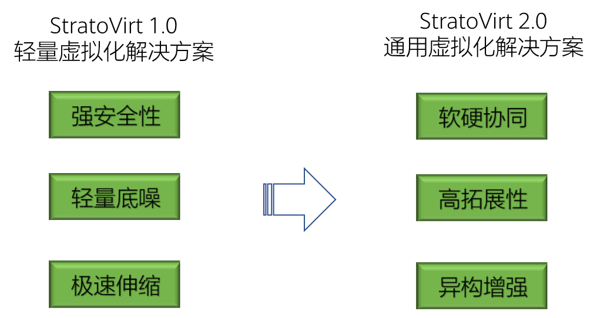
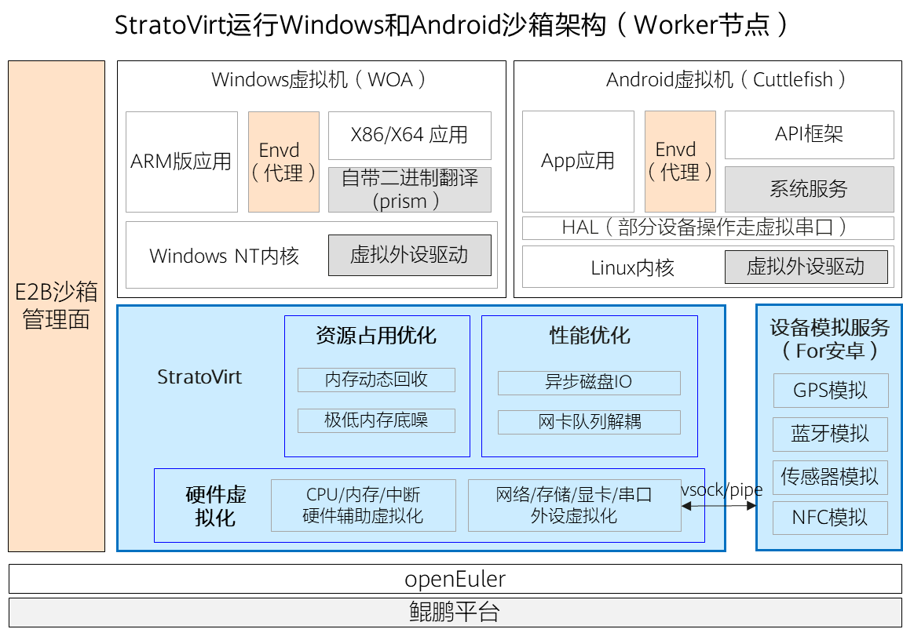
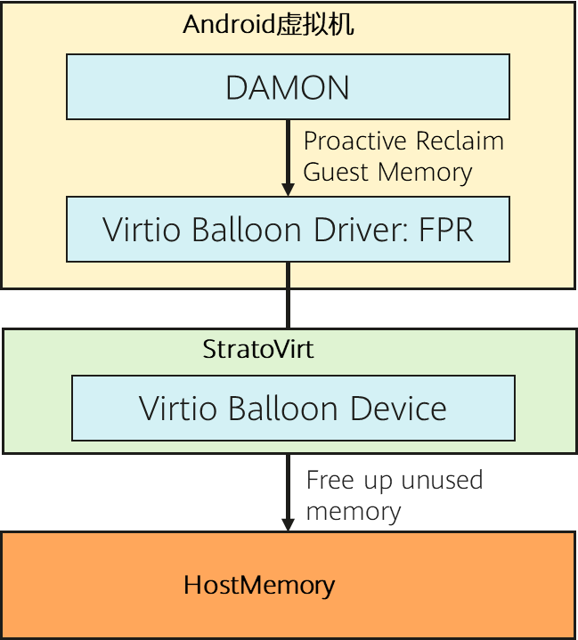

## 摘要
随着智能体从代码执行逐步走向移动应用操作与桌面软件自动化，沙箱环境也从以 Linux 为主，扩展至开源鸿蒙、Android 和 Windows 等多种操作系统。面向多样化的运行环境需求，OpenAtom openEuler（简称“openEuler”或“开源欧拉”）社区开源的 StratoVirt，凭借轻量化设计和丰富的虚拟设备支持，为构建兼顾隔离性、资源效率与多场景适配能力的智能体沙箱提供了底层运行时选择。

本文将介绍如何将 StratoVirt 集成至 E2B 沙箱系统，并结合 Cuttlefish 构建 Android 智能体沙箱方案。通过 Android 沙箱快照、内存回收及网络资源预热等优化，方案提升了环境创建与复用效率，并改善了单机部署密度。

仓库链接：[https://gitcode.com/openeuler/stratovirt](https://gitcode.com/openeuler/stratovirt)

## 一、背景介绍

如果要训练一个智能体，完成“帮用户在电商 App 里把指定商品找出来并下单”的任务。它不仅要能思考出操作步骤，还要能真正打开 App、搜索、点击、填收货地址。每一次动作之后屏幕变成什么样，就是它收到的反馈。

这样的模型要练出来，需要在真实环境中进行大量的交互。一天几十万次、上百万次，每一次都在一台“手机”上完成。每一轮练完之后，环境还要回到干净状态，继续下一轮。决定智能体训练速度的已经不仅是推理侧的算力，还有另一面：能同时开多少台“手机”，每台多久能起来，以及不同任务之间会不会互相干扰。

智能体的训练瓶颈也体现在了环境这一侧，业界通过构建智能体沙箱系统满足智能体对海量环境的需求。同时，沙箱环境需求正从 Linux 扩展到开源鸿蒙、Android 与 Windows。OpenAtom openEuler（简称 “openEuler” 或 “开源欧拉”） 社区开源的 StratoVirt 是基于 Rust 语言构建的轻量虚拟机运行时，以多元的虚拟设备生态，成为兼顾安全轻量与多场景支持的沙箱运行时底座。

针对目前业界主流沙箱系统普遍不支持 Android 沙箱的痛点，我们把 StratoVirt 集成进 E2B 沙箱系统，构建了一套商用的 Android 智能体沙箱解决方案。另外，我们实现了 Android 沙箱快照和内存回收能力，单沙箱启动时间低于80ms，部署密度也得到显著提升。

StratoVirt 仓库链接：[https://gitcode.com/openeuler/stratovirt](https://gitcode.com/openeuler/stratovirt)

## 二、Agent 的环境不止 Linux

过去说起“Agent 沙箱”，大家默认指的是一个隔离的 Linux 环境。这个印象不算错，只是已经不够用了。按 Agent 要做的事来分，沙箱里面运行的系统至少有三类：

1. Linux 沙箱：跑代码、调工具、做数据分析。由于这类沙箱占比最大，沙箱部署密度非常关键，一台机器内要能同时部署上千个互不干扰的环境。

2. 移动应用沙箱（比如开源鸿蒙和 Android ）：让 Agent 操作真实的移动应用，拼的是沙箱环境真实性。以 Android 沙箱为例，必须是真正的 AOSP（Android Open Source Project） 系统，有真实的图形渲染、真实的输入事件。如果拿模拟出来的 UI 结构去训练，模型在沙箱里学会的东西，到了真机上多半用不了。

3. Windows 沙箱：对应桌面端 Agent 或者企业软件自动化，拼的是沙箱环境完整度。Windows 要从 UEFI 启动、要走 ACPI、要有图形输出。只要缺一个，Windows 就跑不起来。

### Android 沙箱在 RL 后训练里的作用

具体到强化学习的后训练阶段，Android 沙箱在两个场景发挥作用。

1. 当 Agent 的实操场地。模型在真实的 App 里点击、滑动、输入，系统把每一步的截图、界面层级、操作结果回传，这些既是对局数据，也是算奖励的依据。

2. 给大模型生成的 App 当验证场地。现在越来越多的模型能直接写出一整个 Android 应用。应用能不能运行、安装后会不会导致系统崩溃、界面渲染对不对，只有真机说了算。

两种负载对底层环境提出的要求可以归纳成四个字：真、多、快、净。环境要够真，数量要够多，重置要够快，环境要够干净且彼此隔离彻底。后训练场景下，一般会并发启动数千个 Android 沙箱，海量沙箱的并发启动效率直接影响了后训练端到端时间以及推理侧异构算力的利用率。

### Android 沙箱对运行时底座的要求

推荐使用 Cuttlefish 方案搭建运行虚拟的 Android 环境。该方案由官方维护和发布，依赖虚拟机，仿真程度最佳。另外有一个开源发布的 Redroid 项目，基于容器环境，其仿真程度不如官方 Cuttlefish 方案，持续演进和维护成本也高。

使用 Cuttlefish 方案，需要 VMM（虚拟机监视器） 提供多种设备：一条 PCIe 总线，用来挂载各种 virtio 设备；一块 virtio\-gpu，因为 Android 要真的渲染画面；多路 virtio\-serial 通道，分别对应 logcat、sensor 模拟和其他宿主侧服务的管道；还有 vhost\-vsock，ADB 和虚拟机内部的 daemon 靠它通信。缺任何一项，系统都起不来。

Firecracker 和 Cloud Hypervisor 都属于业界主流的轻量化 VMM 解决方案，而以上虚拟设备恰恰是 Firecracker 主动裁剪的部分，也是 Cloud Hypervisor 覆盖不全的部分。

## 三、StratoVirt 简介

把智能体沙箱当成一套基础设施来看，VMM 是底下直接承载业务运行的那层。它决定了沙箱环境能不能跑起来，业界很多 VMM 方案为了轻量把设备砍干净，能跑的场景就只剩最朴素的那一种。StratoVirt 是 openEuler 社区开源的 VMM，具备多元的虚拟设备生态，Linux、Android、Windows 三类负载都能撑住，同时通过深度编译优化，保持了极低的虚拟化内存底噪。其在社区保持着活跃的开发和维护状态，面向全场景持续完善功能和性能。

### StratoVirt 的架构优势

StratoVirt 特别的地方在于“一个 VMM、两种形态”。microVM 形态下，它把设备模型精简到最小，开销向 Firecracker 看齐（内存底噪 &lt; 5M），适合最普通的 Linux 沙箱；通用 VM 模式下，它提供完整的 PCIe 设备体系、virtio\-gpu、UEFI 启动、vsock，以及快照与内存复用能力，Android 和 Windows 走的正是后一条路。

AArch64 上的完整支持也很关键。Cuttlefish 的实际部署大多跑在 AArch64 节点上，如果 VMM 在这块支持不到位，虚拟机内部应用的性能和兼容性都要打折扣。所以在需要同时覆盖 Linux、Android、Windows 的 Agent 沙箱场景里，StratoVirt 是一个既够轻、设备又够全的选择。

## 四、Android 沙箱解决方案：E2B + StratoVirt + Cuttlefish

选对了 VMM，解决的只是“跑得起来、足够轻量”的问题。要让几千个 Android 环境像一个平台那样运转 —— 能创建、能连接、能快照、能回收，还需要上面那层编排。这套组合里，三个组件分工很清楚。

StratoVirt 提供底层虚拟化能力，本文第三节已经展开说明。

Cuttlefish 管真实性，提供原生的 AOSP，由官方维护和发布，仿真程度最佳。

E2B 管状态与编排。它把沙箱变成可以编程操作的对象：模板怎么构建、沙箱怎么创建和销毁、生命周期怎么管、网络怎么隔离、状态怎么快照和恢复、对外怎么暴露 SDK。训练侧的代码只要调接口拿到一个环境，不用关心底下那台虚拟机是怎么起来的。整条链路也因此很清晰：训练框架或 Agent 调用 E2B 的 SDK 和 API，请求落到工作节点的 orchestrator，由它驱动 StratoVirt 拉起 Cuttlefish 虚拟机，最后把一台模拟的“手机”交到训练程序手里。

回到本文第二节的四个字：真、多、快、净。下面按这四条，看这套组合具体是怎么落地的。

### 真：原生系统，多版本并存

沙箱里跑的是真正的 AOSP 镜像，图形渲染、输入事件、网络栈都是真的，Agent 在里面练出来的操作，能直接迁移到真机。目前支持 Android 14、15、16 三个版本。这三个版本对宿主侧的依赖并不一样：Android 14 中，Cuttlefish 依赖宿主侧 config\_server 服务，通过 vsock 向 Guest 下发部分运行时配置；Android 15/16 中该服务被取消，相关配置能力拆分至启动参数及各 Host 侧组件，同时新增 secure\_env 服务，用于为 Guest 提供 KeyMint 等安全相关能力。不处理这些差异，表现出来就是“某个版本莫名其妙起不来”。

### 多：把密度做上去

我们深度优化了通用 VM 模式下的 StratoVirt 虚拟化内存底噪，包括调整编译参数、模块化按需编译等。其内存底噪同样达成了 5M 级别。传统 QEMU 方案底噪在几十M级别。

此外我们实现了沙箱内存回收能力。StratoVirt 支持 virtio\-balloon FPR \(free page reporting\) 能力，配合沙箱内 DAMON 机制，及时把沙箱内冷页回收释放，整体内存超分 50% 以上。具体来说：

1. 对于空闲内存：StratoVirt 通过 Balloon FPR 释放虚拟机内部空闲内存。

2. 对于 PageCache：虚拟机内 DAMON 模块负责按照区域块粒度扫描虚拟机内PageCache，冷 PageCache 释放归还给 Guest 内存子系统，成为空闲内存；这部分内存进一步可以通过 Balloon FPR 释放。

### 快：百毫秒级环境就绪

启动速度也是 RL 训练里影响很大的一环。一套训练流程中，模型经常需要从一个干净环境开始操作。如果每次都从零开始初始化环境，一轮训练下来光等环境就要耗掉大量时间。

E2B 基于 StratoVirt 提供的 Android 沙箱快照能力，通过 SDK 对业务层提供模板制作和从模板拉起沙箱的能力。在 Android 系统初始化完毕之后拍下快照、把当前状态持久化为可复用的模板。此后多个沙箱可基于同一个模板拉起，原地恢复继续跑。有了这个能力，环境回滚、轨迹分支、脏状态清理都退化成一次快照调用，沙箱启动时间从 40s 优化到百毫秒级（Android 沙箱依赖主机侧多个模拟服务进程，且虚拟磁盘不止 1 个，启动流程会比 Linux 沙箱重，优化难度更大）。

以上流程有个技术问题，Cuttlefish 镜像会保存宿主机侧模拟服务的端口号等状态，而不同沙箱的宿主机侧模拟服务是独立不共享的，因此 Cuttlefish 的快照无法直接拉起不同的沙箱。为了解决这个问题，我们在 E2B 里实现了模拟服务流量分发代理，以沙箱的 vsock CID 作为标识进行流量分发。

另外，我们对 CNI 网络资源进行了池化预热。沙箱创建时直接分配，不用同步等待网络初始化。

### 净：隔离与网络治理

隔离分两层。一层是虚拟机：每个沙箱是独立的 OS，内核级隔离，一个沙箱里的崩溃不会溢出到邻居。另一层是网络：每个沙箱有独立的网络命名空间，彼此不可见。每个沙箱配独立出口代理，沙箱能不能访问外网、用哪个 DNS，都可以按需配置。

再真实的环境，看不见也没用。每个沙箱都提供 ADB 通道，走 vsock，不占用公网端口；还有虚拟机内的 daemon 接口，可以执行进程、读写文件。截图和流式画面都能通过 ADB 通道取到，这些画面信息既是智能体的输入，也是训练时的观测指标。

## 五、落地：Android 沙箱在 RL 后训练中的应用

这套方案将在大模型 RL 后训练流程中投入使用。从方案角度看，前面说的两类负载均可支持。做 Agent 实操训练时，一批环境先按模板批量拉起，训练过程中靠 Checkpoint 在关键节点做状态分支，状态脏了可以回滚到快照节点。给模型生成的 App 做验证时，快速拉起沙箱，起来就能安装、运行，验完直接销毁，结果和截图回传给训练侧。

技术指标上，单机密度提升了 50%，单实例准备时间从分钟级降到百毫秒级。

## 六、写在最后

Android 只是这套方案落地的第一个场景。我们已经把 E2B 沙箱的操作系统类型抽象成了并列的三类：Linux、Android、Windows。这意味着当业务需要桌面端 Agent、需要 Windows 应用的自动化测试时，不必从头搭一套，而是复用同一条底座。这也是把 VMM 摆在选型最前面的原因。如果底座只支持 Linux，每增加一个场景，就要多维护一套基础设施、多养一个技术栈、多做一次集成。StratoVirt 把这些场景收进了同一个底座。

Agent 的能力边界，正在从“能想清楚”转向“能做成事”。而“做成事”的前提，是有足够多、足够真、足够干净、还能随时倒带的练习场地。把地基做宽非常重要 —— 宽到能同时承载 Linux、Android 和 Windows 等全场景沙箱环境。

最后，欢迎大家参与 StratoVirt 社区建设，同时也欢迎更多的沙箱解决方案集成 StratoVirt。

