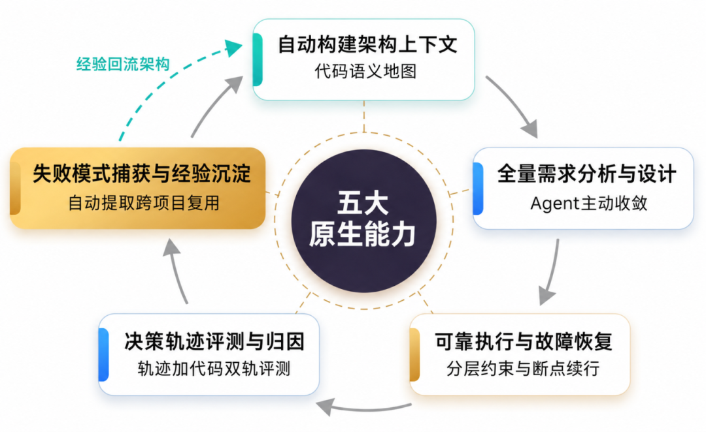
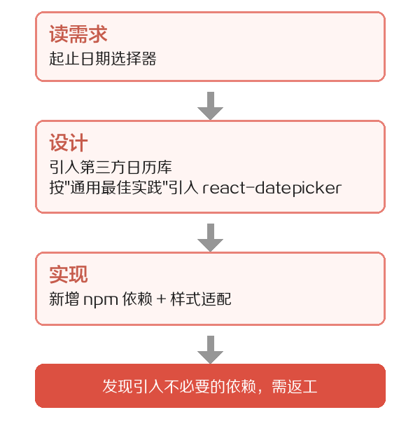
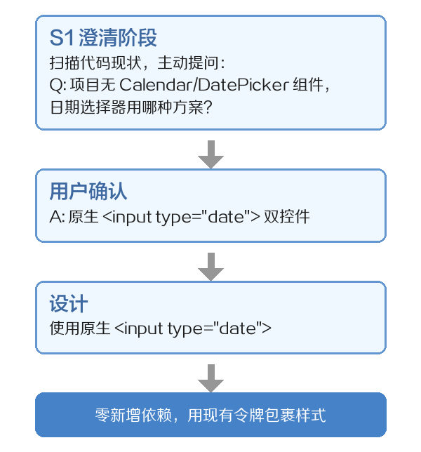
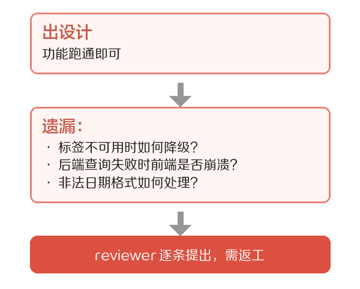
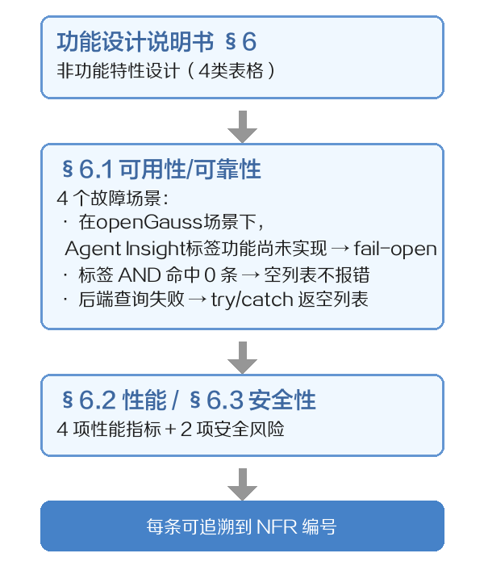
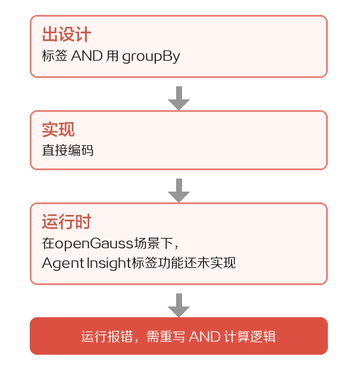
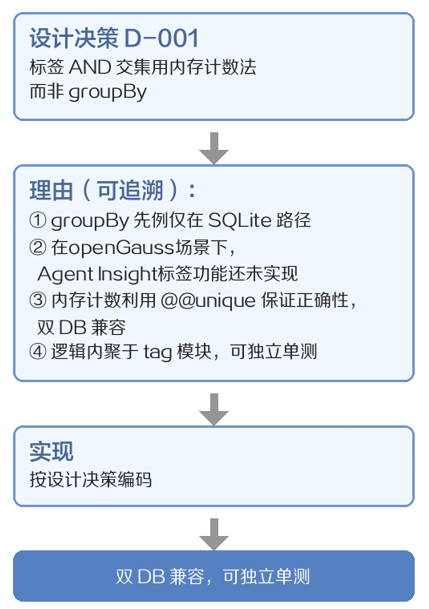
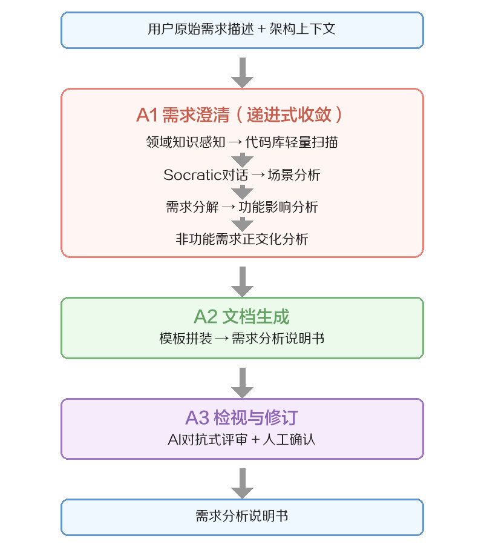
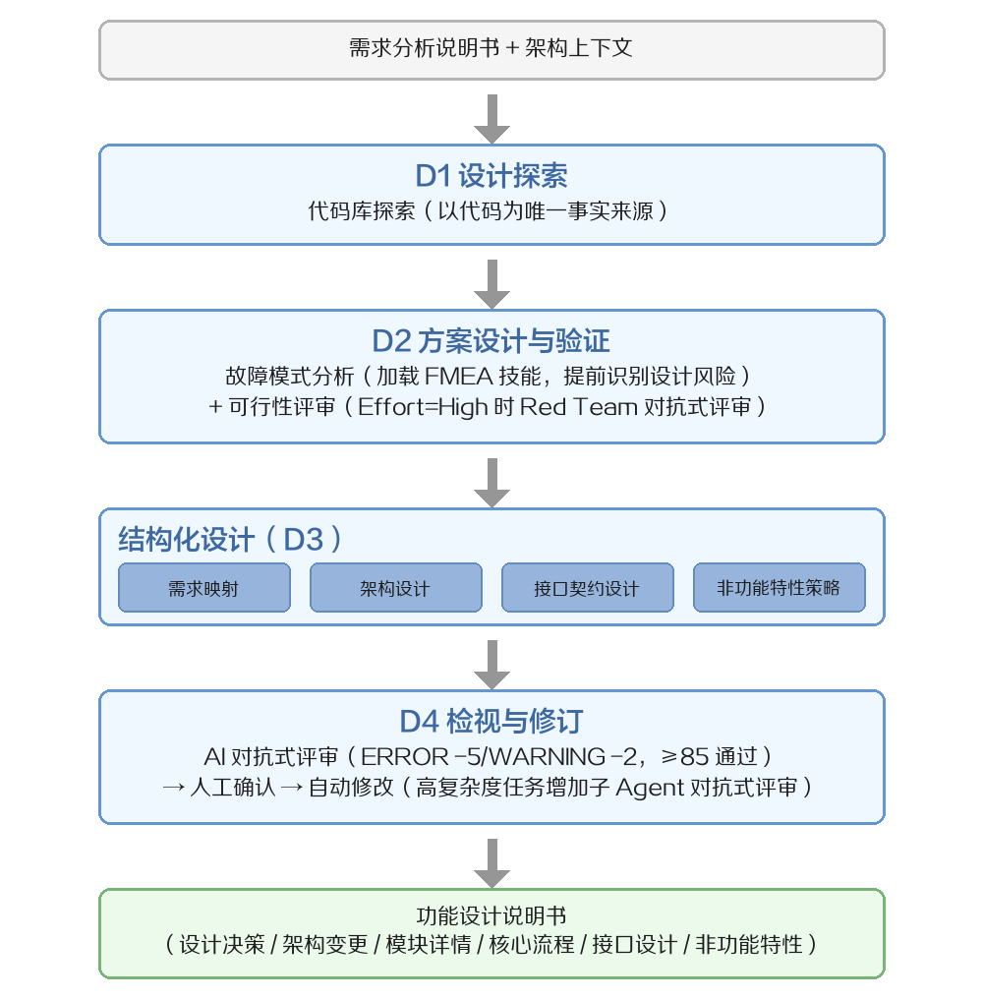

在前面文章《[openEuler Agent Infra企业级编码方案（二）：自动构建架构上下文，让Agent在改代码前读懂项目边界](https://mp.weixin.qq.com/s/cD8AEFMLsqGWLESVe2TfoQ)》介绍了OpenAtom openEuler（简称 “openEuler” 或 “开源欧拉”） 中的企业级编码方案AET如何自动构建架构上下文，让Agent在改代码之前先读懂架构规范、全局/模块视图。架构上下文解决了“Agent能看到项目架构是什么”的问题，看到架构规范、模块边界，但这不等于能做出正确的设计。本篇将展开说明第二项能力——全量需求分析与功能设计：把“需求分析→功能设计”的方法论做成可复用Skill，让Agent不再凭直觉出设计。



## 01 背景：Agent缺的不是出设计的速度，而是设计方法论

AI直接进行设计，往往只看功能路径，容易遗漏边缘场景、非功能特性和设计决策的追溯。错误方案传递到编码和测试，造成后续返工。AET的解决方案是：将需求分析、功能设计拆分成两段独立流程，“需求分析→功能设计”的方法论做成两个可复用Skill，——需求分析阶段消除歧义、补全场景，产出需求分析说明书；功能设计阶段覆盖架构、接口和非功能特性策略，产出功能设计说明书。两段流程都内置AI对抗式评审与人工确认的闭环，最终交付Spec（需求分析说明书 + 功能设计说明书）。

## 02 实际案例：让Agent直接开发需求，代码实现出了什么问题

Agent Insight项目有一项需求：为Agent上报的“关联Trace”增加搜索及过滤能力，包含模糊搜索、按时间筛选和按业务标签筛选，业务标签是用户为Trace（执行记录）打上的自定义分类标签，用于业务维护的筛选和归类。

当Agent拿到这个需求后直接编码的返工率比较高，具体表现为三类问题：

* 没有消除歧义：需求说“起止日期选择器”，但没说用什么方案——Agent引入第三方日历库，而实际上项目用原生`<input type="date">`就够了；

* 缺少非功能特性设计：Agent只覆盖功能路径，未考虑当Agent Insight标签功能不可用时的降级行为、SQLite contains全表扫描的性能约束；

* 没有检视闭环：Agent直接选了一种数据库查询方案，没有检视该方案是否在所有部署环境下都可行，到实现时才发现在openGauss环境下Agent Insight还未支持实现标签功能。

AET在实现该需求时，先按需求分析与功能设计方法论产出Spec（需求分析说明书 + 功能设计说明书）再实现代码，通过方法论执行过程中的澄清与检视，避免了上述三类问题。

### 2.1 没有消除歧义 → 引入不必要的依赖

需求涉及“起止日期选择器”，但没有说明具体实现方案，有无需求分析设计方法论将产生不同的结果：

**没有方法论：**



没有方法论时，Agent按“通用最佳实践”引入第三方日历库。这个改动会新增npm依赖、需要样式适配、增加包体积，而需求实际上只需要一个简单的日期范围选择。

**有方法论：**



有方法论时，AET的需求分析Skill在第一阶段会扫描代码现状，识别需求中的歧义点。Skill在代码扫描中发现`src/components/ui`下没有Calendar或DatePicker组件，需求未指定实现方案，AET主动提出澄清：

> Q: src/components/ui下无Calendar/DatePicker组件，Trace页用的是timeFilter字符串预设、无日期范围选择器。需求要求“起止日期选择器”。日期选择器用哪种方案？  
> A: 原生`<input type="date">`双控件。

这段澄清被记录在需求分析说明书的附录中，成为后续设计和实现的约束依据。

### 2.2 缺少非功能特性设计 → 遗漏降级行为与性能约束

在没有方法论时，Agent的设计只覆盖功能路径，非功能特性全部缺失。

**没有方法论：**



非功能特性设计是AI设计里最容易缺失的部分。Agent不会主动写“在openGauss场景下，Agent Insight还未实现标签功能”——这属于异常路径的降级设计；不会写“SQLite contains为全表扫描，无FTS索引”——这属于性能分析。

**有方法论：**



有方法论时，AET生成功能设计说明书的非功能特性部分被拆成可用性/可靠性、性能、安全性和其他四类。以可用性为例，实际产出的功能设计说明书列出了4个故障场景：

|**故障/风险场景**|**触发条件**|**应对策略**|**设计决策**|
|---|---|---|---|
|在部署openGauss场景中，Agent Insight业务标签功能尚未实现|当使用openGauss时，Agent Insight业务标签功能尚未实现|前端隐藏相关控件；后端忽略相关参数不报错|优雅降级，保持其他功能可用|
|筛选条件组合后无匹配结果|用户选择了多个筛选条件但无数据满足|返回空列表，不报错|返回空结果而非报错，用户体验更好|
|后端查询异常|数据库异常或网络错误|捕获异常，返回空列表，前端不崩溃|降级处理，保证系统稳定性|
|时间范围输入非法|用户输入的开始时间晚于结束时间|前端禁用提交按钮；后端兜底校验|前后端双重防护，前端优先|

### 2.3 没有检视闭环 → 设计决策缺乏追溯

没有方法论时，Agent出的设计直接进入代码，设计决策没有“为什么选这个方案”的记录，也就无法追溯。

**没有方法论：**



Agent产出的设计直接进入编码，只有“做了什么”而没有“为什么这么做”——选型依据、方案取舍、与需求的对应关系都没有留痕，事后既无法验证设计是否覆盖了需求，需求变更时也找不到相关的设计决策。

**有方法论：**



有方法论时，AET生成的功能设计说明书包含设计决策记录，每条都有“决策内容+理由”。以D\-001设计决策为例：

> **D\-001 标签AND交集用内存计数法而非groupBy**  
> 理由：①代码仓虽有\`prismaRaw.executionSkill.groupBy\`先例（Prisma ORM的分组查询方法），但仅在SQLite数据库环境下可用；②在openGauss场景下，Agent Insight尚未实现标签功能；③内存计数法利用数据库的\`@@unique\(\[executionId, tagId\]\)\`唯一约束保证正确性，两种数据库环境都兼容；④逻辑内聚于tag模块，可独立单元测试。

每条设计决策都能追溯回需求分析说明书的对应条目，不存在无源的设计变更。

## 03 原因：可见的代码无法替代需求分析与功能设计的认知过程

前一节介绍的缺少方法论时的三类问题，主要是因为Agent理解需求的如下四类方式存在局限：

1. **直接读需求描述**：可以提取功能关键词，但无法识别隐含的边界和非功能约束；

2. **探索代码仓**：可以发现既有接口和模块结构，但无法判断哪些设计决策是必须的、哪些是可以改变的；

3. **参考通用最佳实践**：可以产出格式完整的设计文档，但无法适配项目的分层、依赖方向和接口风格；

4. **依赖模型直觉**：可以补全缺失的细节，但补全方向可能与项目约束冲突。

这些方式仍然有用，问题在于它们提供的是一次任务中的局部发现，而不是一套可以被需求分析和设计共同引用的方法论基线。范围控制、非功能特性设计、检视闭环不会自动从需求描述中显现出来。

**根因在于：需求分析与功能设计是两个独立的认知过程，需要不同的方法论支撑。** 需求分析需要消除歧义、补全场景；功能设计需要覆盖架构、接口和非功能特性策略。两者不能合并为“直接出设计”这一步。

## 04 AET的解法：把设计方法论系统化，做成可复用Skill

AET把“需求分析→功能设计”做成两项独立能力，每项都有明确的输入、流程和输出，并对输出结果进行“AI对抗式评审→人工确认→自动修改”的检视闭环。两段流程共享同一份架构上下文，确保需求和设计阶段对项目的架构理解是统一的。

### 4.1 需求分析：递进式需求收敛产出可校验的需求说明书

需求分析阶段先把用户的原始描述转成结构化的需求分析说明书。这一阶段只澄清问题、生成需求文档，不直接做技术方案。核心是递进式需求收敛：先通过领域资产感知与代码库轻量扫描建立事实基础，再以多轮追问、场景映射、功能影响及非功能需求正交化分析方法逐步消除歧义，补全需求。



在实现层面，需求分析Skill（`skills/aet-req-analysis/SKILL.md`）把流程拆成三个阶段。A1阶段采用“初心”（Shoshin）原则——用自然提问而非检查清单来澄清需求，保持开放、好奇、不带预设的态度，直到所有歧义被消除。A1阶段包含四个子步骤：

* **A1.1 Socratic对话**：Agent以初心姿态提问，不限定单一方向，根据新信息随时调整。在Agent Insight案例中，Socratic对话产出了14轮澄清Q&amp;A，覆盖了在openGauss场景下的Agent Insight标签兼容策略、AND/OR语义冲突、日期选择器方案、内联控件去重、折叠阈值等关键决策点；

* **A1.2 场景分析**：识别业务场景和用例。案例中识别出2个场景（SC\-001检索筛选目标Trace、SC\-002管理已选Trace集合）和2个用例（UC\-001、UC\-002），每个用例都列出了基本事件、扩展/备选/异常事件；

* **A1.3 需求分解**：将场景分解为功能性和非功能性需求条目，采用EARS语法（Easy Approach to Requirements Syntax，一种使用“当\[条件\]时，系统应\[行为\]”等标准化句式编写需求的方法）确保每条需求可验证。案例中产出3条功能性需求（FR\-001组合检索筛选、FR\-002已选常驻区管理、FR\-003筛选状态保持）和4条非功能性需求（NFR\-001性能、NFR\-002可靠性、NFR\-003可维护性、NFR\-004兼容性）；

* **A1.4 功能影响分析**：对照项目已有的模块职责（从架构上下文中获取），判断每个需求会影响哪些模块，并标注影响类型。影响类型分为三类：改（修改现有模块）、增（新增模块）、复用（复用现有模块不改动）。例如案例中识别出6项功能影响：F\-001后端路由扩展（改）、F\-002前端筛选控件（改）、F\-003标签查询能力（复用）、F\-004已选常驻区（改）、F\-005跨页全选（改）、F\-006筛选状态保持（增）。这一步的目的是让后续设计阶段明确知道哪些模块需要改动、哪些模块需要保护。

A2阶段按模板拼装文档。需求分析说明书的模板（`skills/aet-req-analysis/references/_templates/req-analysis/artifact.md`）由8个组件拼装：基本信息（5W2H澄清表）、场景分析、用例分析、需求列表、功能影响、数据约束、验收方案、附录（澄清记录+关键决策）。

A3阶段进入检视。检视规则采用三级严重度评分（ERROR扣5分/WARNING扣2分/INFO扣0分），总分≥85分通过。

以Agent Insight案例需求的实际产出为例，需求分析说明书包含：

```text
需求分析说明书产出（227行）：
├→ §1 基本信息：5W2H澄清表（Who/When/What/Why/Where/How Much/How）
├→ §2 场景分析：SC-001 + SC-002
├→ §3 用例分析：UC-001 + UC-002（含Mermaid用例图）
├→ §4 需求列表：3 FR + 4 NFR（EARS语法）
├→ §5 功能影响：F-001 ~ F-006
├→ §6 数据约束：DC-001 ~ DC-006
├→ §7 验收方案：AC-001 ~ AC-012（12条验收准则）
└→ §8 附录：14轮澄清Q&A + 4条关键决策
```

### 4.2 功能设计：结构化设计与多层风险验证，系统化形成可追溯的设计说明书

功能设计阶段读取已经确认的需求分析说明书和架构上下文，把“系统应该满足什么”转成“系统应该如何改变”。核心是**结构化设计与多层风险验证**：基于代码探索和故障模式分析生成结构化设计方案，覆盖需求映射、架构设计、接口契约设计和非功能特性策略选型，高复杂度任务增加子Agent对抗式评审。



功能设计Skill（`skills/aet-req-design/SKILL.md`）把流程拆成四个阶段。D1阶段以代码为唯一事实来源，根据工作量（Low/Medium/High）调整分析深度。D2阶段包含故障模式分析（如果项目提供了故障模式库，自动加载`aet-fmea-analysis`技能，提前识别设计风险）和可行性评审（工作量=High时加载Red Team对抗式评审，验证设计是否可行）。D3阶段按模板拼装文档，将设计方案转化为结构化的功能设计说明书。D4阶段进入检视闭环，通过AI对抗式评审和人工确认确保设计质量。

以Agent Insight案例需求的实际产出为例，生成的功能设计说明书包含：

```text
功能设计说明书产出（387行）：
├→ §1 设计概要：实现思路 + 3条设计决策（D-001/D-002/D-003）
├→ §2 架构设计：
│   ├→ 2.1 变更总览（Mermaid四色图：绿=新增/黄=修改/红=保护/灰=不涉及）
│   ├→ 2.2 模块变更表（8个模块：2修改+1新增+2保护+3不涉及）
│   └→ 2.3 模块详情（4个模块的功能设计+非功能设计+风险缓解）
├→ §3 核心流程：3个Mermaid时序/状态图
├→ §4 算法设计：标签AND交集（内存计数法，含复杂度分析）
├→ §5 接口设计：1个外部接口 + 5个内部接口 + 4个配置常量
└→ §6 非功能特性设计：可用性(4场景) + 性能(4指标) + 安全性(2风险) + 其他(4项)
```

### 4.3 “AI对抗式评审→人工确认→自动修改”的三层闭环

两段流程都内置了评审、检视、闭环流程：**AI对抗式评审+用户评审**的双重机制。

* **AI对抗式评审**：按预设checklist核对产出，采用三级严重度评分（ERROR扣5分/WARNING扣2分/INFO扣0分），总分≥85分通过。发现缺范围、缺非功能特性、未追溯到架构事实等问题时直接打回。高复杂度任务还会增加子Agent对抗式评审，从不同角度挑战设计方案的合理性；

* **人工确认**：通过AI对抗式评审后，由人对关键决策做最终签字——需求边界、非目标、验收条件、设计决策、模块变更、非功能特性都需要人背书；

* **自动修改**：评审失败时回到流程重新生成，而不是把错误假设一路带到实现阶段。

检视流水线（`skills/aet-req-review/SKILL.md`）采用五阶段门控：R1子Agent门控评估→R2产出物修订→R3用户门控与修订→R4子Agent重新门控→R5结束。支持“全量通过/有条件通过/不通过”三级评定。

这个闭环把“早发现、早修正”做成默认机制：Agent的每一份Spec都要先过AI对抗式评审，再经人工确认批准，最后才能进入下一阶段。错误假设在Spec阶段就被拦下，而不是在代码review阶段才暴露。

## 05 AET如何实现需求分析与功能设计

AET通过三层架构实现需求分析与功能设计能力：Skill层负责流程编排，模板层负责文档结构，检查表层负责质量门控。

### 5.1 Skill层：流程编排与阶段控制

需求分析和功能设计分别由两个独立Skill承担：

* `skills/aet-req-analysis/SKILL.md`：需求分析Skill，三阶段流水线（A1澄清→A2生成→A3检视）；

* `skills/aet-req-design/SKILL.md`：功能设计Skill，四阶段流水线（D1探索→D2设计验证→D3生成→D4检视）。

两个Skill都遵循“铁律”：不完成当前阶段，不进入下一阶段。需求分析阶段禁止做设计决策（不规定具体实现路径）。

### 5.2 模板层：组件化文档结构

需求分析说明书和功能设计说明书都采用组件化模板。以需求分析说明书为例，其模板（`skills/aet-req-analysis/references/_templates/req-analysis/artifact.md`）由以下组件拼装：

```text
skills/aet-req-analysis/references/_templates/req-analysis/
├── artifact.md                    # 主模板，定义文档结构和组件拼装顺序
├── checklist.md                   # 检视检查表
└── components/
    ├── metadata.md                # 元数据（名称/类型/描述/版本/基准提交）
    ├── basic-information.aet.md   # 基本信息（5W2H澄清表）
    ├── scenario-analysis.aet.md   # 场景分析（用例图 + 用例表）
    ├── requirements-list.aet.md   # 需求列表（FR/NFR，EARS语法）
    ├── business-rules.aet.md      # 业务规则（BC-*，可判定语言）
    ├── data-constraints.aet.md    # 数据约束（DC-*，逻辑语义）
    ├── functional-impact.aet.md   # 功能影响（F-*，新增/修改）
    ├── acceptance-plan.aet.md     # 验收计划（AC-*，覆盖所有核心需求）
    └── clarification-records.aet.md # 澄清记录（保留原始Q&A）
```

模板中的`<!-- condition: -->`指令控制组件的生成条件：Low复杂度的需求可以跳过部分组件，Medium复杂度按需生成，High复杂度则全量生成。这种机制确保方法论的严格程度与需求复杂度匹配。

功能设计说明书的模板结构类似（`skills/aet-req-design/references/_templates/req-design/`），额外包含设计决策表、模块变更图（Mermaid四色图：绿=新增/黄=修改/红=保护/灰=不涉及）、非功能特性设计表和需求分解表。

### 5.3 检查层：AI对抗式评审与质量门控

检视检查表是闭环的关键。需求分析检查表（`checklist.md`）覆盖元数据完整性、场景分析覆盖度、需求条目可验证性、业务规则可判定性、验收计划覆盖度等维度。功能设计检查表在此基础上增加设计决策质量、模块变更合理性、接口契约完整性、非功能特性覆盖度等维度。

需求分析检查表和功能设计检查表都采用相同的评分机制：

|严重度|扣分|典型问题|
|---|---|---|
|ERROR|\-5|内容自相矛盾、需求规定实现路径、设计决策无理由|
|WARNING|\-2|描述模糊、性能指标未分解、安全措施不具体|
|INFO|\-0|元数据不完整、编号不规范|

总分≥85分通过，70\-84分有条件通过（需记录遗留项），&lt;70分打回重新生成。AI对抗式评审确保每一份Spec在人工确认之前已经过多维度自动检查，降低人工评审的认知负担。

## 06 总结：从“凭直觉出设计”到“按方法论出设计”

**有无方法论的差距不在Agent是否更聪明，而在设计过程是否可追溯、可校验、可维护。**

没有方法论时，Agent直接出设计，容易出现三类问题：没有消除歧义导致引入不必要的依赖、缺少非功能特性设计导致遗漏降级行为与性能约束、没有检视闭环导致设计决策缺乏追溯。这些问题在编码阶段才会暴露，返工成本高。

有方法论时，AET把“需求分析→功能设计”拆成两段独立流程：

* **需求分析阶段**：通过递进式需求收敛消除歧义、补全场景，产出需求分析说明书

* **功能设计阶段**：通过结构化设计与多层风险验证覆盖架构、接口和非功能特性策略，产出功能设计说明书

两段流程都内置AI对抗式评审与人工确认的闭环，确保设计质量。

**实际效果**：在Agent Insight项目的实际案例需求中，AET通过方法论产出了227行需求分析说明书和387行功能设计说明书，识别出14轮澄清问题、3条设计决策、6项功能影响。非功能需求方面，识别出4条非功能性需求（性能、可靠性、可维护性、兼容性），功能设计说明书中覆盖了4个故障场景的降级策略、4项性能指标、2项安全风险分析。最终实现阶段4个源码文件全部符合功能设计要求，23个新增单测全部通过，验证阶段12条验收准则全部通过。

AET的需求分析与功能设计方法论提升了Agent在设计阶段的质量：让Agent做设计时不再凭直觉，而是按可执行的方法论生成Spec（需求分析说明书+功能设计说明书）。

欢迎参与sig-anse，分享使用心得、反馈问题或贡献代码，与生态伙伴共同探索openEuler 与AET的更多创新可能！

🔹代码仓： <https://atomgit.com/openeuler/agentic-engineering-team>

🔹开发小组： sig-anse