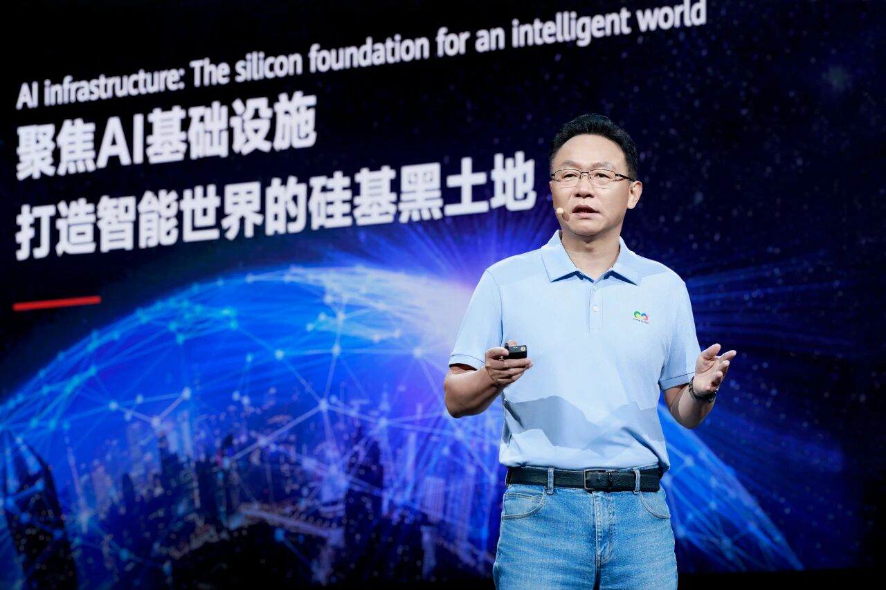
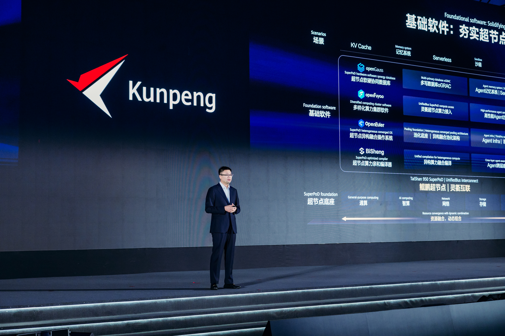
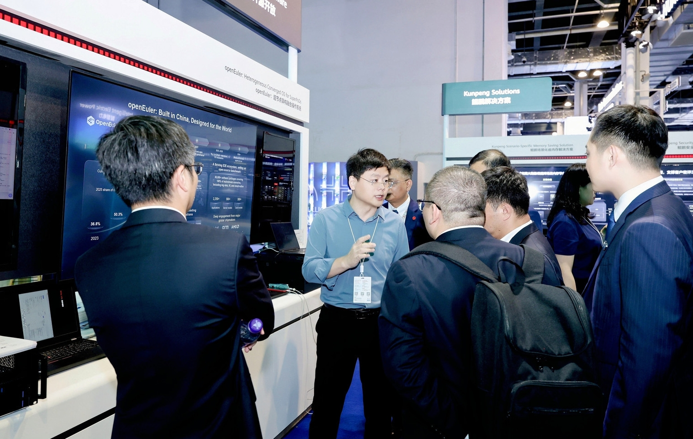

2026年9 月 17-19 日华为全联接大会 2026（HUAWEI CONNECT 2026）在上海世博展览馆举行。 OpenAtom openEuler（简称：“openEuler”或“开源欧拉”）作为开源操作系统领域的关键力量深度参与其中。高层演讲、技术实践、生态成果与合作案例，展现开源操作系统如何打破行业壁垒，从算力基础设施协同到多产业场景适配，openEuler 正联接起软硬件厂商、企业用户与开发者，用开放协作推动产业资源深度整合，为各领域融合发展提供新路径。  

## 01创新引领，开源开放，共创智能世界生态新选择

华为副董事长、轮值董事长汪涛在主题演讲中表示，openEuler 历经七年发展，已赋能万千企业应用，服务全球多个国家和地区，推动构建全球开源新生态，开创了中国开源发展的新范式。openEuler 装机量也已超过2000万套，成为中国服务器操作系统第一份额。

华为副董事长、轮值董事长 汪涛发表主题演讲  

## 02 鲲鹏，为更先进的数智世界而计算

本次鲲鹏计算产业峰会上，华为鲲鹏计算产品线总裁李义在主题演讲中明确 AgenticAI 时代基础软件的双重核心使命：向下夯实超节点算力底座，向上支撑智能体高效运行。openEuler 与 openGauss、openFuyao 等基础软件开源软硬件协同体系，全方位适配 Agentic AI 产业演进趋势。

openEuler 在超节点操作系统与 Agentic AI 基础设施方向通过异构融合、资源池化、系统级高并发沙箱、弹性内存等关键能力。通过软硬协同设计，构建面向 Agent 场景的低时延、高可靠基础设施，持续推进面向 Agentic 演进的 OS 生态建设。

华为鲲鹏计算产品线总裁 李义发表主题演讲  

## 03 鲲鹏展区：全景解读openEuler超节点OS

除了专题演讲环节以外，openEuler 在华为全联接大会 2026 现场设立展览展示。
在生态层面，openEuler 持续推进产业协同，目前已有麒麟软件、麒麟信安、统信软件等25家厂商基于 openEuler 推出商业发行版，并广泛应用于金融、能源、制造等关键行业。在技术层面，openEuler 基于灵衢面向超节点场景持续演进，围绕池化底座与 Agent Infra 两大方向推进技术创新，释放大规模异构计算能力，为通用计算与智能计算场景提供更加高效的系统支撑。

在池化底座方向，openEuler 基于鲲鹏超节点服务器，构建场景化调度与资源池化能力，实现超节点资源的透明使用与有效算力最优，通过内存统一编址、分级存储池化，把内存利用率提升10%；异构非对称网络，将端到端推理时延降低10%。

在 Agent 基础设施方向，openEuler 通过高性能 RPC、通智算协同调度以及系统级高并发沙箱能力，降低 Agent Tool 调用时延并提升系统整体吞吐。为 Agentic AI 打造完整的超节点算力操作系统底座。

openEuler社区执行总监 刘飞在展位前讲解

华为全联接大会2026 虽已落幕，但 openEuler 的征程不止步，此次大会让全球直观看到其开源生态的无限潜力和 openEuler 核心技术的持续创新。

Agentic AI 正在推动基础设施进入新的演进阶段，操作系统也将从传统资源管理平台逐步演进为AI时代的智能基础设施底座。openEuler 将持续围绕超节点、资源池化与系统级沙箱等方向展开创新，构建面向未来 AI 时代的 Agent Infra 能力，持续提升鲲鹏生态在 Agentic 时代的技术竞争力与产业影响力。

