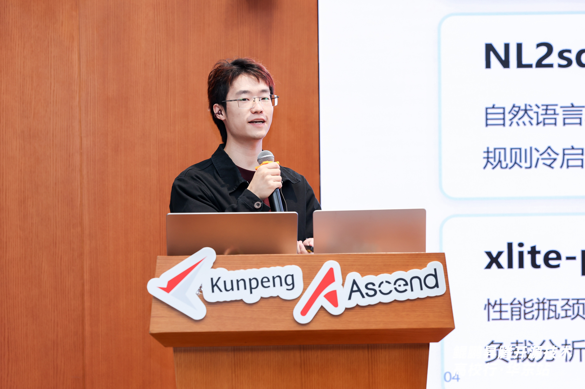
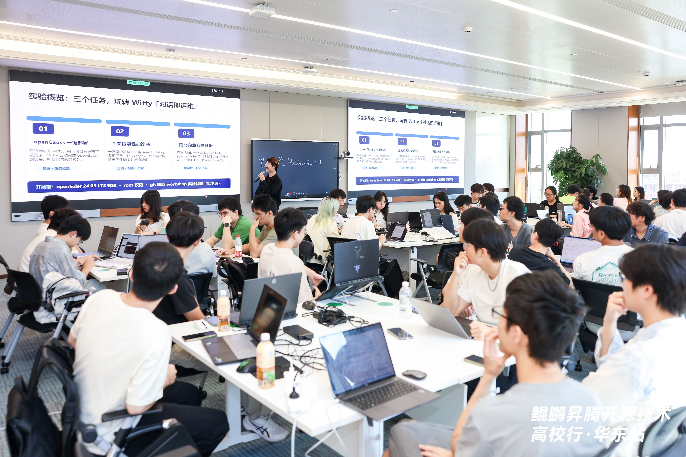

2026年9月12日，鲲鹏昇腾开源技术高校行·华东站在上海成功举办。近200名高校学子与来自各开源社区的技术专家齐聚一堂，围绕AI时代的技术创新与开源实践展开交流，共同探索算力基础设施与操作系统技术发展的新方向。

OpenAtom openEuler（简称：“openEuler”或“开源欧拉”）社区携面向超节点OS的系统智能自治解决方案Witty亮相，通过议题分享与Workshop实操，让同学们从“听懂”到“上手”，近距离感受AI时代操作系统运维的范式变革。

## Witty：面向超节点OS的系统智能自治解决方案

openEuler SIG-Intelligence Committer唐舒楠在分享中介绍，Witty是openEuler社区面向超节点OS打造的系统智能自治解决方案，依托社区在多路日志检测、数据治理、根因知识图谱等方面的长期积累，为主流大模型提供操作系统垂域的系统智能能力。

该方案以“用户接入—运维智能体—运维底座”三层架构，将自然语言指令转化为可执行的运维任务：shennong-crash-agent 实现内核崩溃的分钟级诊断闭环，面向超节点的witty-ub-agent能在5分钟内完成10GB日志的故障定位定界，openEuler-ops-agent覆盖16个场景的运维任务。Witty正沿着L1智能诊断到L4系统自治的路线持续演进，相关能力已在开源社区开放共建。

## Workshop：基于openEuler Witty智能运维实践

在Workshop实操中，唐舒楠带领同学们在openEuler环境上完成了Witty智能运维动手实验，亲身感受“对话即运维”：一句自然语言，即可让Witty自动完成数据库部署、慢查询根因诊断与优化、硬件兼容性分析并生成报告，将过去依赖专业知识与繁琐操作的运维任务，变为一次轻松的对话交互。实验现场气氛热烈，同学们围绕诊断结论与优化思路与专家深入交流。

超节点OS的智能自治是一条需要长期共建的道路，openEuler社区将持续开放Witty相关能力，期待更多高校开发者加入SIG-Intelligence，在真实的代码、案例与场景中，共同推动操作系统运维从“人工经验”走向“系统自治”，为数字基础设施筑牢智能底座。