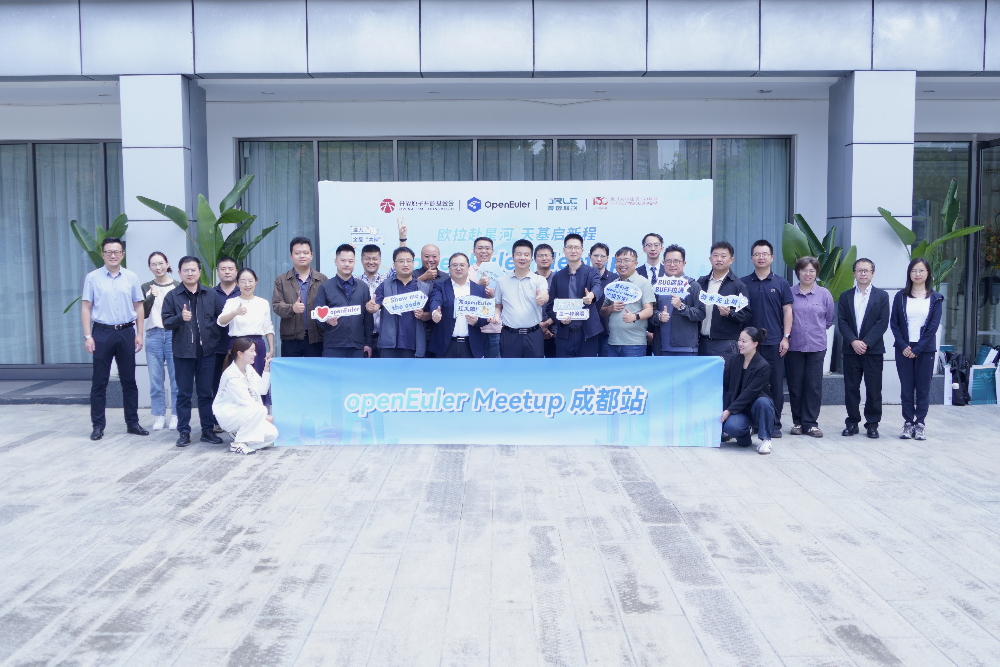
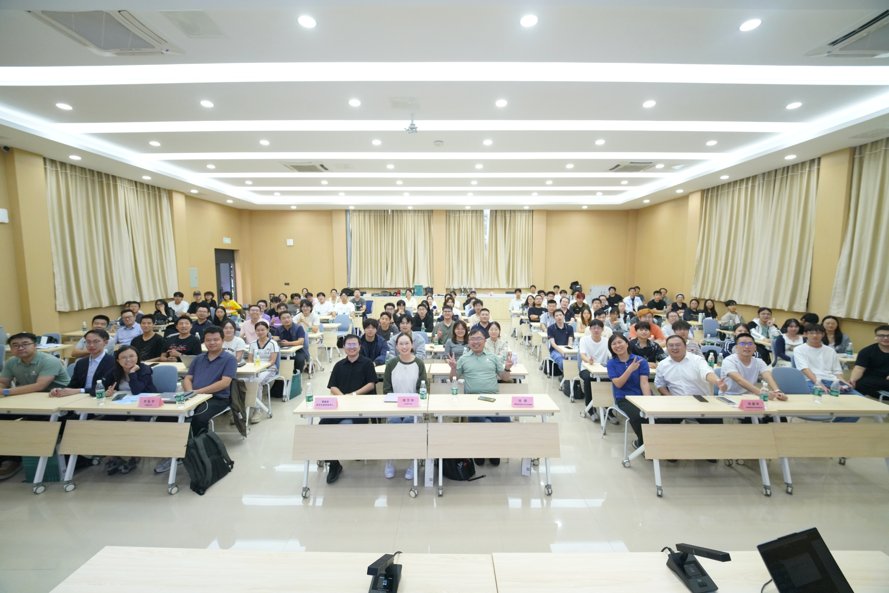

2026 年 9 月 26 日，由 OpenAtom openEuler（简称："openEuler"或"开源欧拉"）社区主办，成都菁蓉联创科技有限公司、四川大学电子信息学院协办的 2026 openEuler Meetup 成都站活动于四川大学望江校区顺利举办。本次活动以太空计算与操作系统为核心主题，汇聚相关主管部门代表、行业专家、高校学者、产业伙伴，围绕太空新基建、智能算力底座、星载操作系统、生态协同等关键方向开展深度交流研讨，共同探索操作系统在商业航天、太空计算领域的创新落地路径。

## 聚焦太空新基建，共话产业发展新机遇

本次活动邀请相关主管部门到场开展政策解读，结合国家太空计算发展导向，向在场产学研各界分享政策方向与产业引导思路。与会嘉宾围绕太空新基建浪潮下智能算力底座的建设思路与发展路径，立足国家大力推进太空新基建、太空计算的时代背景剖析上下游产业链面临的机遇和挑战，并就如何推动上下游产业链实现全域实践协同发展展开充分的思想碰撞。

现场嘉宾各抒己见，充分表达产业诉求与行业观点，围绕当前产业发展中的痛点问题共同探讨解决方案，搭建起航天产业、操作系统开源社区、高校科研力量之间高效沟通的桥梁。

## 多维技术实践分享，共探太空计算发展

技术分享环节，多嘉宾围绕太空计算与操作系统核心主题，带来精彩主题报告，从嵌入式操作系统、基础设施、空间开发系统到星载操作系统等不同方向，分享前沿技术成果与实践经验。

openEuler 社区技术委员会委员任慰带来《openEuler Embedded 最新的变化以及面向商业航天场景的准备》主题分享，介绍 openEuler 嵌入式版本的最新演进，详解社区面向商业航天场景开展的技术储备与适配工作；openEuler 社区Embedded SIG committer & ROS SIG maintainer胡万明作《面向 AI 时代的基础设施进展与规划》报告，剖析人工智能浪潮之下，底层基础设施的技术进展，分享未来整体规划方向；航天九院研发中心蔡鑫奇带来《鸿域 OS1.5 发展实践与空间开发系统架构探索》，立足产业落地，分享鸿域OS1.5 的建设成果，对空间开发系统架构开展深度探索；成都菁蓉联创科技有限公司郑国玲分享《基于 openEuler 的星载操作系统技术路线与特点》，结合实际项目实践，解读基于 openEuler 打造星载操作系统的技术路线以及核心技术特性；北京邮电大学/一苇宇航李弘宇作《面向多域融合的开源卫星操作系统》报告，聚焦多域融合发展趋势，探讨如何构建有效应对低轨卫星星座规模化、动态化、融合化安全挑战的体系架构。

本次 openEuler Meetup 成都站恰逢四川大学 130 周年校庆，既是一场产学研用深度对话的技术交流盛会，也为校庆增添了 openEuler 操作系统生态与航天 / 太空计算产业融合创新的浓厚氛围。活动将 openEuler 操作系统生态与太空计算、商业航天产业紧密联结，通过政策解读、议题研讨、技术报告的多元形式，打通高校科研、航天单位、开源社区、产业企业的沟通渠道，为太空计算产业上下游协同创新凝聚共识。未来，openEuler 社区也将持续深耕航天等关键行业场景，携手更多伙伴，持续完善技术能力，共建繁荣的开源操作系统产业生态。