## 1、概述

2026年9月，OpenAtom openEuler（简称"openEuler"或"开源欧拉"）社区持续推进技术创新与生态建设协同发展，社区规模和活跃度稳步提升。截至9月底，社区用户累计超过1000万，开发者超过2.9万名，单位成员达2199家，SIG组112个，社区贡献持续积累。

在社区运营与生态建设方面，openEuler 26.09创新版本正式发布，进一步深化全场景创新；社区举办2026 openEuler Meetup成都站，并深度参与华为全联接大会2026等活动，持续拓展产业合作与开源生态连接。

在技术方面，社区持续深化AI与操作系统融合，围绕智能运维、Agent开发与治理、AI推理、算力优化及具身智能等方向推进技术创新，SkillHub、KPBot等项目持续丰富社区AI技术生态，推动操作系统智能化能力与应用实践不断发展。

整体来看，openEuler社区持续推进版本演进与技术实践，积极开展开源交流与产业合作，社区技术创新与生态建设稳步推进。

（本月报阅读时长约8分钟）

## 2、社区规模

截至2026年9月30日，openEuler 社区用户累计超过1000万，超过2.9万名开发者在社区持续贡献。社区单位成员达2199家，SIG组112个，累计产生340.8K个PR、167.5K条Issue、6225.4K条Comment。

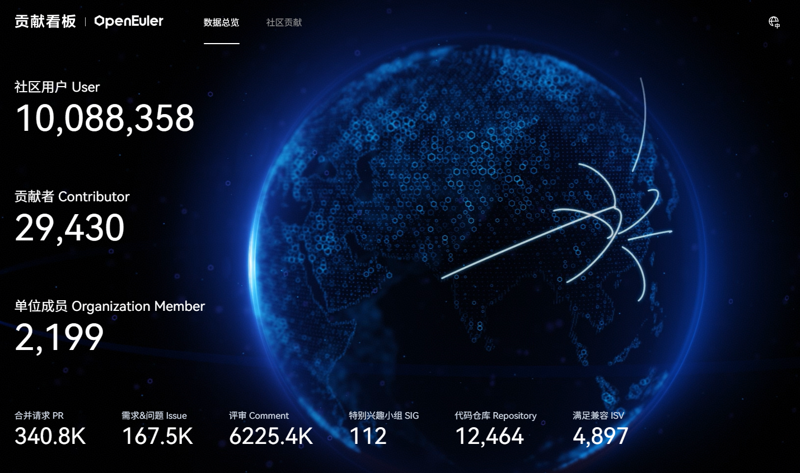

*社区贡献看板（截至2026/09/30）*

## 3、社区事件

### openEuler 26.09 创新版本发布，深化全场景创新

9月30日，openEuler 26.09 创新版本正式发布。作为汇聚全球开发者的创新平台，openEuler 持续在多样性算力、基础技术、全场景覆盖及生态服务等领域深耕。本次发布 6.6 与 6.18 双内核创新版本，AI 场景新增 Agent 可观测、SkillHub、上下文管理、KV Cache 协同加速、模型加载优化等特性；面向开发者和用户，增强 DevStation 智能开发者工作站开箱即用的能力，为开发者和用户带来全新体验。感谢来自社区834名开发者的贡献和支持，让我们携手同行，共建更好的openEuler。

下载链接：<https://www.openeuler.org/zh/download/>

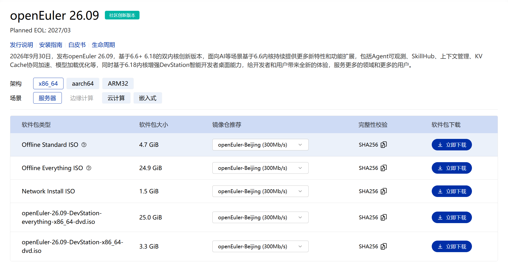

### 2026 openEuler Meetup 成都站圆满举办

9 月 26 日，由openEuler社区主办，成都菁蓉联创科技有限公司、四川大学电子信息学院协办的 2026 openEuler Meetup 成都站活动于四川大学望江校区顺利举办。本次活动以太空计算与操作系统为核心主题，汇聚相关主管部门代表、行业专家、高校学者、产业伙伴，围绕太空新基建、智能算力底座、星载操作系统、生态协同等关键方向开展深度交流研讨，共同探索操作系统在商业航天、太空计算领域的创新落地路径。

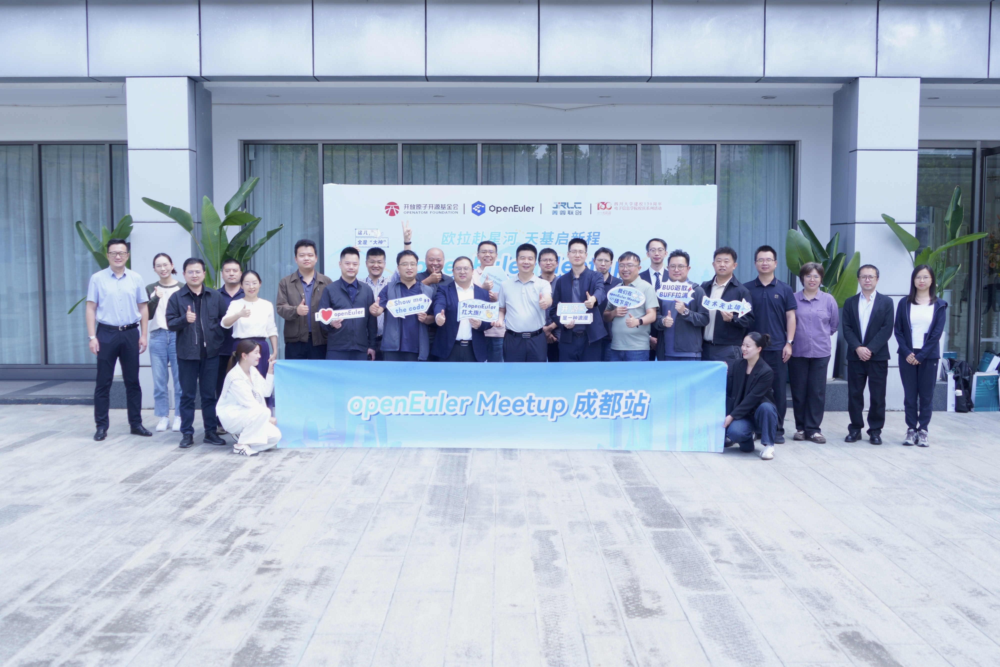

阅读原文：[聚焦操作系统技术 共探太空计算发展 | 2026 openEuler Meetup 成都站圆满举办](https://mp.weixin.qq.com/s/oAQIsqPWaEjp4pE9mWmp7A)

### openEuler 深度参与华为全联接大会 2026，以开源力量推动产业深度融合

9 月 17-19 日，华为全联接大会 2026（HUAWEI CONNECT 2026）在上海举行。openEuler作为开源操作系统领域的关键力量深度参与其中。高层演讲、技术实践、生态成果与合作案例，展现开源操作系统如何打破行业壁垒，从算力基础设施协同到多产业场景适配，openEuler 正联接起软硬件厂商、企业用户与开发者，用开放协作推动产业资源深度整合，为各领域融合发展提供新路径。

华为副董事长、轮值董事长汪涛在主题演讲中表示，openEuler 历经七年发展，已赋能万千企业应用，服务全球多个国家和地区，推动构建全球开源新生态，开创了中国开源发展的新范式。**openEuler 装机量也已超过2000万套，成为中国服务器操作系统第一份额。**

阅读原文：[openEuler 深度参与华为全联接大会 2026，以开源力量推动产业深度融合](https://mp.weixin.qq.com/s/e2X3p9cNvJNZwtGMdpoTXg)

### openEuler 社区参与第二十届中国社区卫生服务发展论坛

9月17日，由中国社区卫生协会主办、致公党中央社会服务部指导的第二十届中国社区卫生服务发展论坛在辽宁大连召开。openEuler用户委员会主席、软通动力助理副总裁王军，作为openEuler项目群代表出席"协同共建健康社区"专题会议，并发表"开源聚力·AI原生，openEuler驱动医疗数智化创新"主题报告，分享openEuler在基层医疗、社区健康服务领域的创新实践。

阅读原文：[AI原生赋能基层医疗 openEuler驱动医疗数智化创新](https://mp.weixin.qq.com/s/q52NPIKPOw60zoUg56zeZQ)

### 南网数字亮相中国—东盟博览会 AI赋能能源数智金融新范式

9月17日-21日，第23届中国—东盟博览会在南宁国际会展中心举办，金融展区以"AI赋能金融合作，AI助力安全治理"为主题设置四大特色展区。作为能源央企代表，南网数字携手 openEuler社区，深度参与东盟博览会金融展区，与五大国有商业银行以及头部全国股份制商业银行同台展出，携南方能源行业可信数据空间、EgenCo·萃智平台等创新成果参展。展台前人头攒动，观展客商直观感受电力数据如何经由AI智能体协同，转化为可信赖的风控决策依据。

阅读原文：[南网数字亮相中国—东盟博览会 AI赋能能源数智金融新范式](https://mp.weixin.qq.com/s/0Bn-gPc4h60JGzjIiV0POg)

### openEuler 24.03 LTS SP4 RISC-V 发布，持续完善 RVA23 服务器生态支持

openEuler 社区正式发布 openEuler 24.03 LTS SP4 RISC-V RVA23 版本。作为 openEuler 24.03 系列第二个面向 RVA23 标准的长期支持 SP 版本，SP4 进一步完善了 RISC-V Server Platform 相关规范特性支持，并新增对进迭时空 V100、蓝芯算力 LX500 等服务器平台的基础支持。

本次版本围绕 RVA23 软件栈、RVCK 内核同源和标准服务器平台适配持续推进。用户态方面，x264、OpenSSL 3.5、Snappy 等关键组件进一步引入 RVV、Zbb、Zicond、Zvk 等指令扩展优化；内核与硬件方面，RVCK 继续完善指令集扩展、向量加密、KVM 虚拟化、IOMMU、RAS、ACPI、标准化外设及硬件平台支持等 RISC-V 服务器基础能力，并新增进迭时空 V100、蓝芯算力 LX500 平台基础支持，完善 K1 系列、超睿科技 DP1000、TH1520、SG2042 等平台适配。

下载链接：<https://www.openeuler.org/zh/download/>

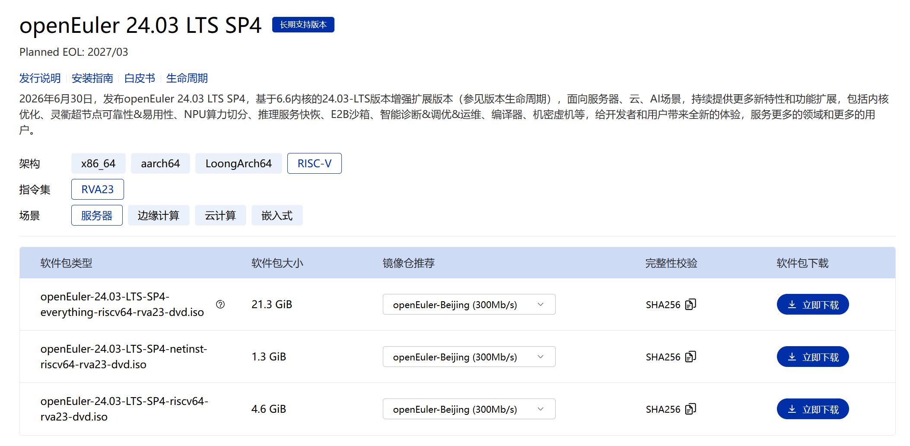

阅读原文：[openEuler 24.03 LTS SP4 RISC-V 正式发布：RVA23 持续演进，新增多款标准服务器平台支持](https://mp.weixin.qq.com/s/_LUpWJpcX84TNrE4cwZtIg)

### openEuler Witty 走进华东区高校，共探超节点 OS 的智能自治之路

9月12日，鲲鹏昇腾开源技术高校行·华东站在上海成功举办。近200名高校学子与来自各开源社区的技术专家齐聚一堂，围绕AI时代的技术创新与开源实践展开交流，共同探索算力基础设施与操作系统技术发展的新方向。

openEuler社区携面向超节点OS的系统智能自治解决方案Witty亮相，通过议题分享与Workshop实操，让同学们从"听懂"到"上手"，近距离感受AI时代操作系统运维的范式变革。

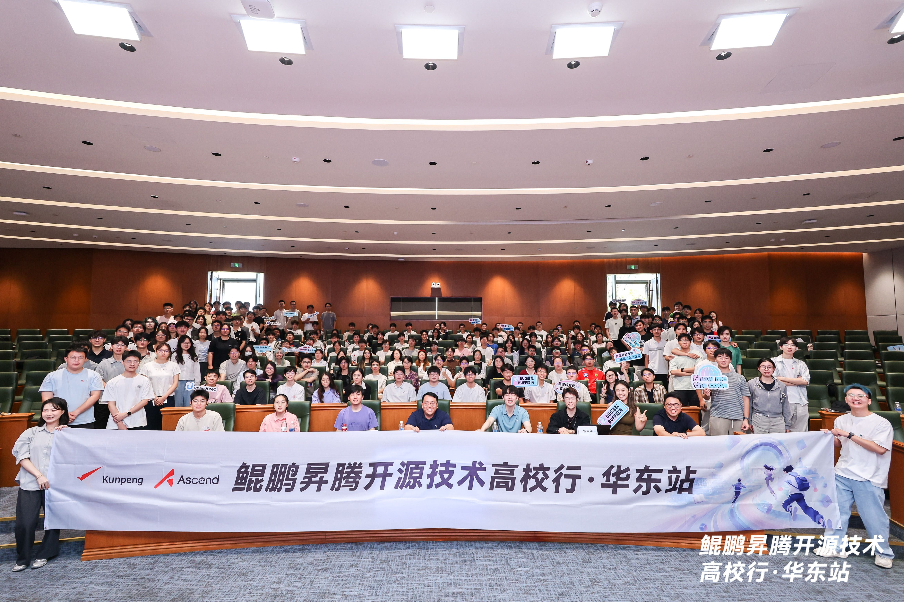

阅读原文：[openEuler Witty走进华东区高校，共探超节点OS的智能自治之路](https://mp.weixin.qq.com/s/hrv0unsFF0c0WEgdiJZc6w)

## 4、技术进展

### 在 openEuler 24.03 上实践 Agent Router：正确性提升约 5%

在双卡推理场景中，同时承载「对话」与「编程」两个模型时，如何让业务侧以一个统一入口访问不同模型，往往并不简单。通常有两种做法：要么维护两套模型地址，增加接入和运维成本；要么将所有请求交给同一个模型处理，但这样又容易出现能力偏科——通识任务表现不错，代码能力却有所欠缺，反之亦然。

针对这一问题，**基于 openEuler 24.03实践搭建了一个 Agent Router**：对外提供统一的 OpenAI 兼容接口，再根据请求意图，将流量自动路由至 Chat 专家模型或 Coder 专家模型，openEuler 24.03 在这里主要作为稳定的运行底座。文章重点围绕路由策略、部署过程以及评测方法展开，进一步验证自动路由能否真正带来可量化的效果提升。

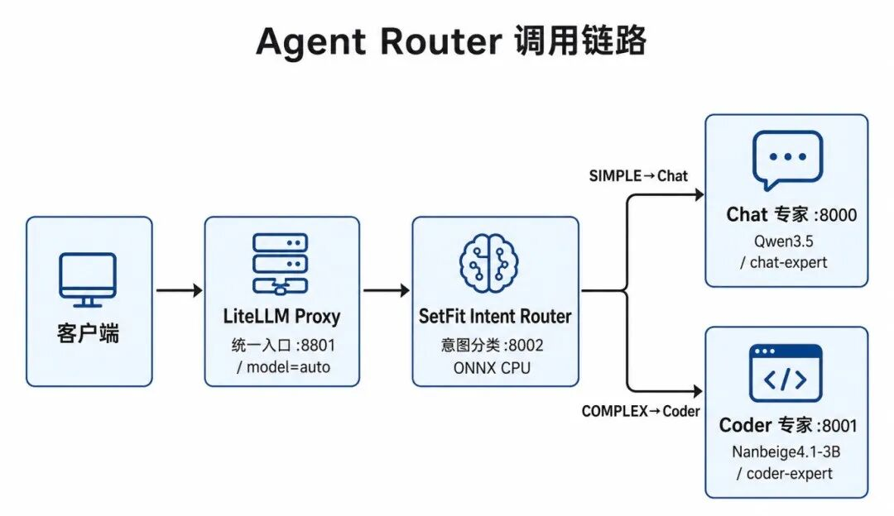

阅读原文：[在 openEuler 24.03 上实践 Agent Router：正确性提升约 5%](https://mp.weixin.qq.com/s/u49wPw3pPDiJjfYLOqPDDg)

### openEuler Ops Agent：SkillHub 中的可对话运维助手

openEuler Ops Agent 是面向 openEuler 的智能运维助手。用户无需提前选择具体菜单或运维场景，只需要使用自然语言描述当前遇到的问题，即可触发相应的处理流程。

目前，它覆盖 16 类常见工作：故障排查、日常巡检、CVE 漏洞修复、安全加固、性能调优、存储管理、网络管理、内核维护、高可用与集群、容器与虚拟化、系统升级回滚、备份恢复、账号权限、服务进程、日志审计，以及知识沉淀。

Agent 会根据用户描述中的关键信息进行场景匹配。当现有信息不足以判断具体问题时，会先通过一到两轮澄清补充必要信息，再进入对应的处理流程。

文章从能力介绍、Skill 体系、SkillHub 以及实际部署几个方面，带你快速了解 openEuler Ops Agent，并通过一个 CPU 高负载案例体验如何使用它完成故障排查。

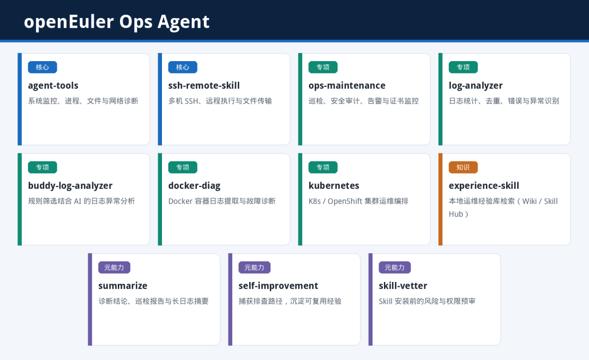

阅读原文：[SkillHub 中的可对话运维助手——openEuler Ops Agent 上手指南](https://mp.weixin.qq.com/s/WC0sJRabg1L3rODjdNeDag)

### KPBot：让鲲鹏性能优化从"专家经验"走向智能化

在鲲鹏处理器生态的应用开发场景中，应用性能调优往往依赖专家经验，代码优化门槛高，一直是开发者面临的痛点。为解决这一难题，基于鲲鹏处理器生态打造的性能优化智能体 KPBot 正式开源，项目托管于openEuler，为开发者带来自动化的性能调优与代码优化能力。

KPBot 聚焦鲲鹏架构下的应用性能优化，核心目标是提升应用调优与代码开发效率。通过 Skills 模块，将通用计算场景中的性能调优方法和专家经验进行沉淀，形成可复用、可调用的能力模块；同时结合鲲鹏架构特性，支持生成适配鲲鹏平台的优化代码，让原本依赖人工经验的性能调优流程逐步走向自动化。

代码仓地址：<https://atomgit.com/openeuler/KPBot>

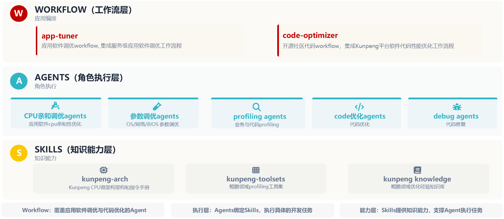

阅读原文：[KPBot：让鲲鹏性能优化从"专家经验"走向智能化](https://mp.weixin.qq.com/s/eEcLLoH0suvT2QI64o3Rdg)

### openEuler witty-agent-factory：高效开发和管理 Agent

随着大模型能力不断融入操作系统、云计算和开发运维场景，Agent 正在成为 openEuler生态中的一种新型软件形态。从内核数据采集、故障诊断，到智能运维、性能分析，openEuler 社区正在形成越来越丰富的 Agent 能力。与普通脚本相比，一个 Agent 通常还包含 Skill、工具、知识、运行依赖和安装配置，需要经过持续开发、构建、验证和发布，才能稳定交付给用户。

当 Agent 从一个变成一组，如何高效地开发和管理这些 Agent，就成为新的工程问题。为解决这一问题，**openEuler 社区设计了witty-agent-factory。它面向本地 Agent 生态，提供统一的可视化入口，帮助开发者和项目管理员完成 Agent 的查看、构建、验证、发布和过程追踪。**

代码仓地址：<https://atomgit.com/openeuler/witty-agents.git>

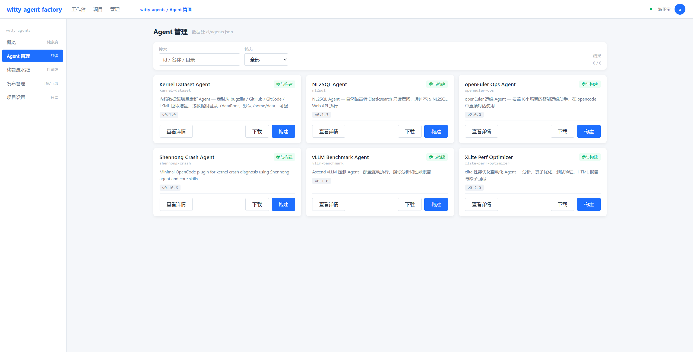

阅读原文：[Agent 越来越多，怎么管好？openEuler witty-agent-factory 给出答案](https://mp.weixin.qq.com/s/IdFccRJGS3sSqMeHc4pghQ)

### openEuler 24.03 上跑通 PP-OCR、PP-OCRv5 和 PP-OCRv6 Benchmark 数据出炉

当前Agent场景下，Agent经常要处理截图、拍照、扫描件，图中文字提取仍是关键一步。和直接让多模态大模型读字相比，专用OCR通常更快、更省算力，纯读字也更稳，CPU就能部署，所以在检索、票据、截图问答这类日常链路里更常见；复杂版面、表格和公式，再交给文档解析或VLM。

PaddleOCR有 PP-OCR、PP-Structure、PP-ChatOCR、PaddleOCR-VL等产线，通用OCR：PP-OCR先定位文字再识别，模型小，CPU就能部署；PP-StructureV3在OCR之上做版面、表格、公式，适合把扫描件整理成Markdown，硬件要求和通用 OCR接近；PaddleOCR-VL-1.6换成0.9B视觉语言模型，按页做文档理解，复杂版面更强，但推理走生成，需要NPU或GPU。

本文从PP-OCR开始实测，尝试在 openEuler 24.03 上，部署 PP-OCRv5和 PP-OCRv6，使用鲲鹏CPU，在同一套进程池、同一份数据集，测试批量吞吐和单页时延，关注PP-OCRv5和 PP-OCRv6的性能，不涉及准确率和具体环境配置细节，具体安装流程可以参考文末附带的官方教程。

阅读原文：[Agent 要读截图？先别上大模型，教你在openEuler 24.03上跑OCR更快！](https://mp.weixin.qq.com/s/dh_Xx2b1bHlWOplHe3QSeg)

### openEuler 24.03 上部署 PaddleOCR-VL-1.6：昇腾 NPU 单卡整页吞吐达 2.24 req_s

PaddleOCR-VL-1.6 是一款参数量约 0.9B（9 亿）的视觉语言模型，采用「整页理解、直接生成」的自回归解码路线：输入整页图片，直接输出 Markdown 结构化文本。该方案与传统 OCR 的检测、识别分阶段流程形成互补，适用于复杂文档结构理解等场景。

openEuler为这条新产线提供了从鲲鹏 CPU 到昇腾 NPU 的异构部署基础：CPU 侧可通过 vLLM CPU 后端拉起模型，NPU 侧可借助 vLLM + vllm-ascend 在昇腾 910B4 上运行。本文重点放在 PaddleOCR-VL-1.6 的部署验证、推理过程以及性能数据上。

阅读原文：[一文实测！openEuler 24.03 上部署 PaddleOCR-VL-1.6：昇腾 NPU 单卡整页吞吐达 2.24 req_s](https://mp.weixin.qq.com/s/HFTN8HyvgIm9CKGOYdSnjw)

### AgentCensor：一套为 Agent 而生的治理底座

当 Agent 开始直接操作你的系统，谁来给它配套的工程约束？把生产环境的钥匙交给 Agent 的时候，我们其实没给它配套的工程约束。人类工程师写代码有 Git、Code Review、CI、回滚；轮到 Agent 干活，往往只剩下一句「请你小心一点」。

openEuler项目AgentCensor 要补的就是这一段：不改动 Agent 本身，也不依赖它的自我约束，而是在它与运行环境之间加一层可管控的执行面——每一次写入都要先经过隔离、留痕与判定，再决定要不要真正落地。

AgentCensor 地址：<https://gitcode.com/openeuler/AgentCensor>

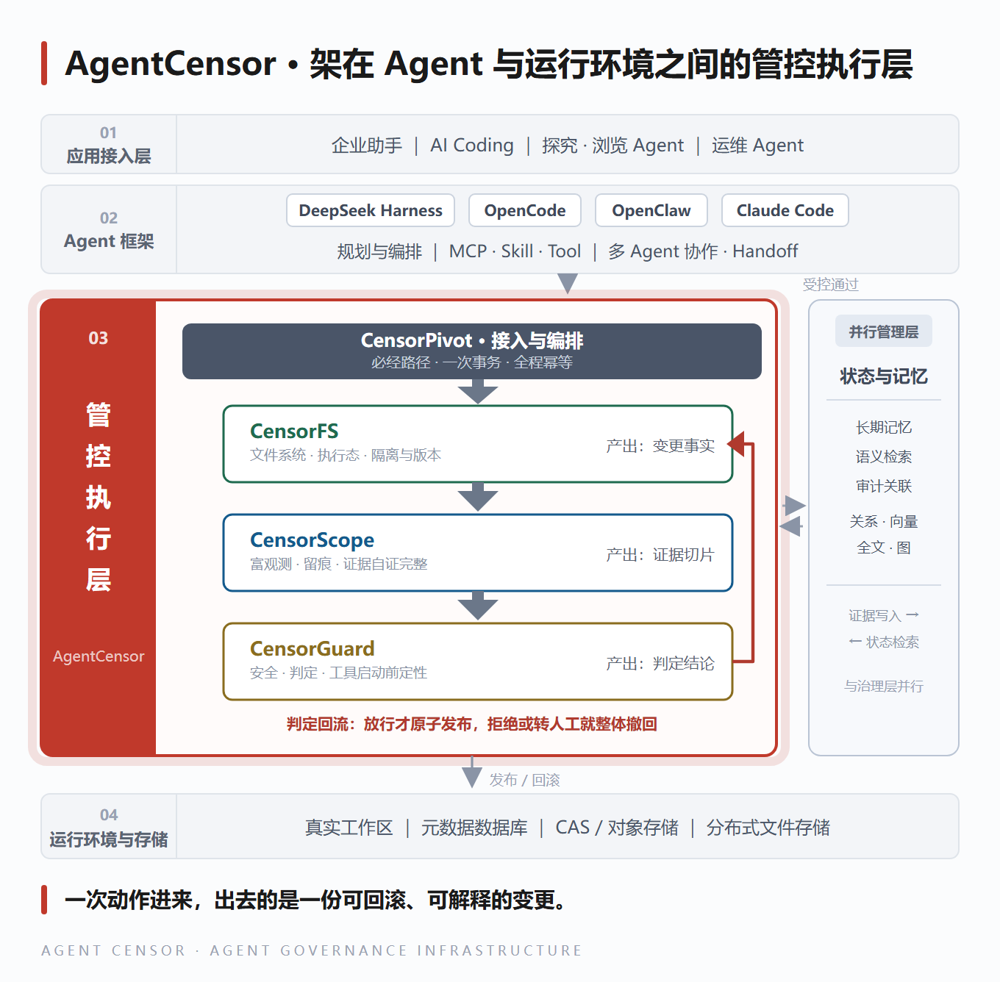

阅读原文：[Agent 可观测 & 治理系列 | AgentCensor：一套为 Agent 而生的治理底座](https://mp.weixin.qq.com/s/wrvf77xEHsbSXtut3pOX5w)

### SkillHub：面向数字基础设施的 OS-Native AI 技能枢纽平台

目前 AI Agent 的能力上限，正在从"模型本身"转向"模型 + 技能生态"。当越来越多的工程实践被封装为可被 Agent 调用的 Skill，如何让这些技能被统一发现、可信评估、便捷获取、持续贡献，成为生态能否真正跑起来的关键。

围绕这一需求，openEuler社区正式推出 SkillHub——一个面向数字基础设施的 OS-Native AI 技能枢纽平台。平台汇聚来自社区 SIG、企业组织及个人开发者的可复用 AI 技能，覆盖软件研发全生命周期，并通过自动化安全审查机制对上架技能进行安全检查，为开发者提供更加规范、便捷的 Skills 获取与复用方式。

SkillHub 地址链接：<https://skillhub.openeuler.org/>

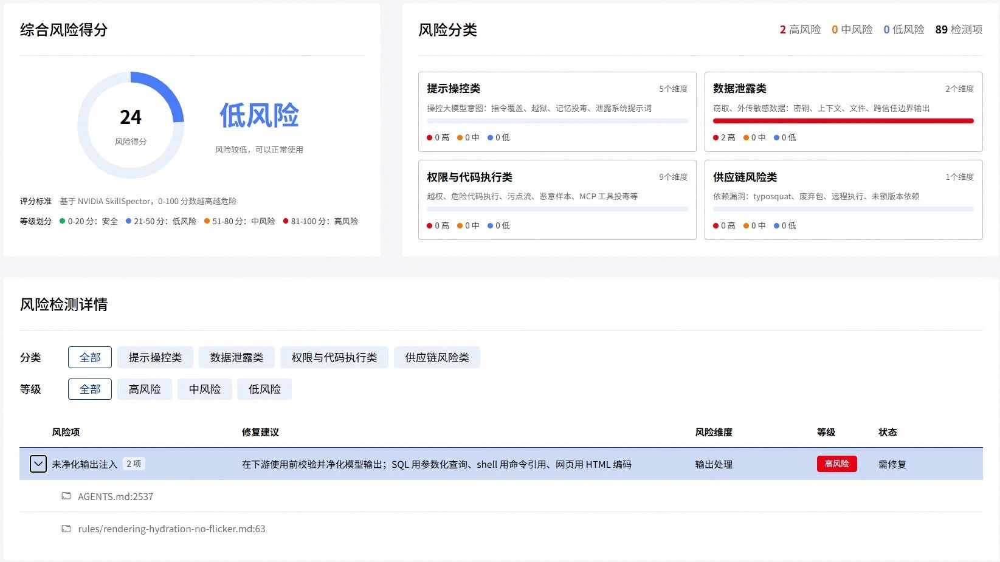

阅读原文：[openEuler SkillHub系列 | SkillHub：面向数字基础设施的 OS-Native AI 技能枢纽平台](https://mp.weixin.qq.com/s/R-RY1vpHPRDZmWr4Ll2UjQ)

### IB-Robot 具身智能开发框架

围绕具身智能机器人开发完成以下核心更新：

- 推理服务架构整体重构：以manifest驱动的统一执行管线取代全部历史运行时，支持Torch原生、Ascend ACL、RKNN（RK3588）、海思Worker、后摩HMM、ONNX Runtime六类后端与分布式云边协同
- PI0.5端侧部署全链路：VLM/Action-Expert拆分建模、ONNX导出与等价性验证、ATC OM转换、W8A8量化，torch_models独立成包并承载Ascend 310P运行时
- 具身Agent体系：25个技能目录、safety_guard安全防护、robot_skill_cli受控CLI网关及自然语言Agent（VLM场景理解与任务规划、多供应商模型路由）
- 语音全栈能力：voice_tts_service（ZipVoice ONNX）、声源定向（FullSubNet），ASR统一到本地sherpa-onnx，语音模型bundle化部署
- 感知与操作：RGB-D语义建图、开放词表感知（RAM++/GroundingDINO/SAM2）、闭环抓取与GraspGen抓取规划（Ascend 310P加速）
- 移动平台与导航：LeKiwi移动底盘全链路、MID-360激光雷达建图避障（FAST_LIO）、D435i+MID-360标定工作流
- 新增RTP视频传输（Ascend/NVIDIA硬件编解码）与ibrobot_tracing端到端追踪及Web性能分析工作台
- 工程基线：LeRobot受管补丁栈（基线v0.6.0）、CANN 8.1依赖基线、OpenHarmony板端发布流水线

## 5、容器镜像更新

**统计周期**：2026年9月1日 - 2026年9月30日

**数据来源**：<https://atomgit.com/openeuler/openeuler-docker-images>

9月，openEuler社区升级镜像194个，新增镜像54个。具体分类如下：

**升级镜像（194个）**

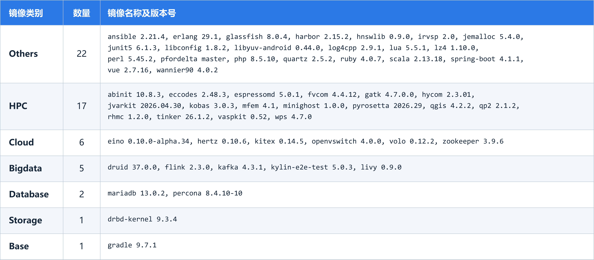

**新增镜像（54个）**

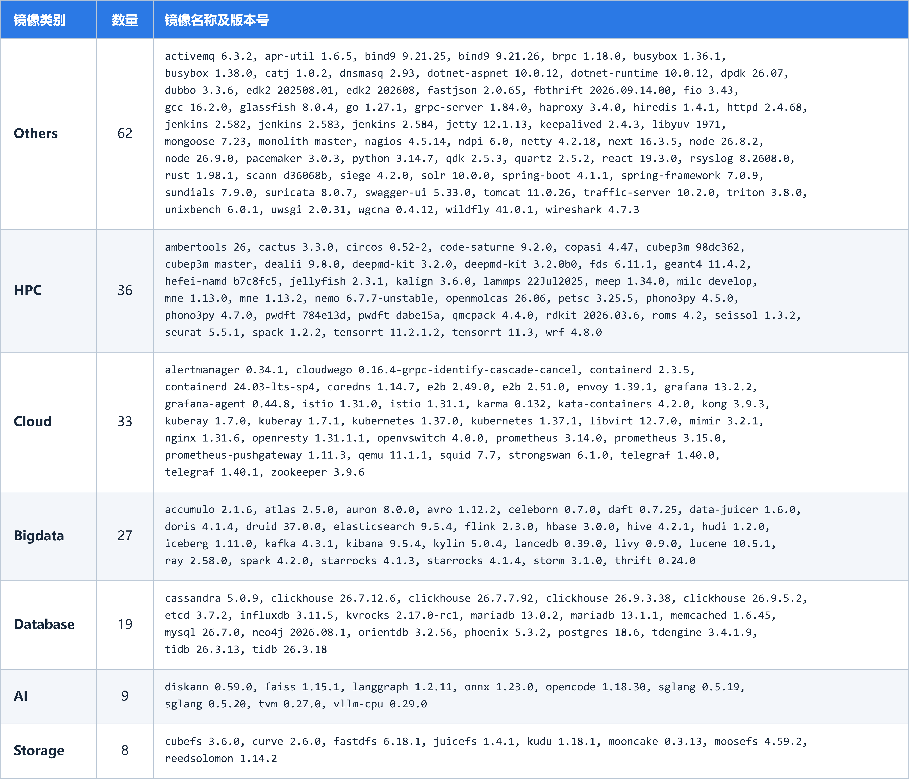

容器镜像可通过 Docker Hub 拉取使用，仓库地址：<https://hub.docker.com/u/openeuler>

## 6、软硬件兼容性测评

截至2026年9月30日，通过openEuler 软硬件兼容性测评的产品达2854款，9月新增41款，其中北向（ISV）新增24款，南向（IHV）新增16款，OSV 新增1款。

兼容性列表：<https://www.openeuler.org/zh/compatibility/>

OSV技术测评列表：<https://www.openeuler.org/zh/approve/>

## 7、安全公告

2026年9月，社区共发布安全公告643个，修复漏洞94个（其中 Critical 6个，High 27个，其它61个）。

**重点漏洞提醒**

如下漏洞评估影响较大，请重点关注。

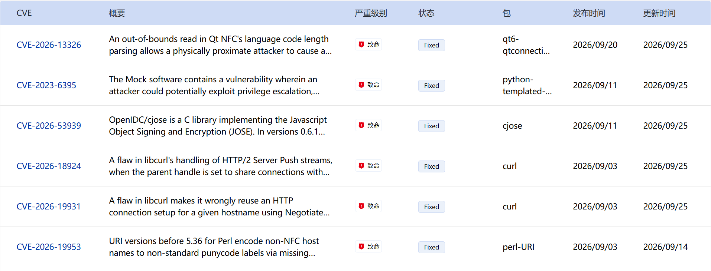

**漏洞防护**

openEuler社区针对在维版本例行修复漏洞，发布安全补丁。建议用户关注openEuler官网安全公告，及时安装漏洞补丁进行防护。

openEuler 安全公告：<https://www.openeuler.org/zh/security/security-bulletins/>

## 8、致谢

openEuler社区的成长，从来不是某一个人的努力，而是大家并肩同行、共同创造的结果。每一次提交、每一次讨论、每一次分享，都是社区前行路上的点点星光，汇聚成今天的成果与温度。

也正因为社区持续涌现出丰富的实践与成果，月报内容难免有所遗漏，如有未被记录的亮点与贡献，欢迎随时与我们联系补充，让更多努力被看见、被传递。

在此，向为本期月报提供资料支持的各 SIG 组以及广大开发者朋友们致以诚挚的感谢与敬意：

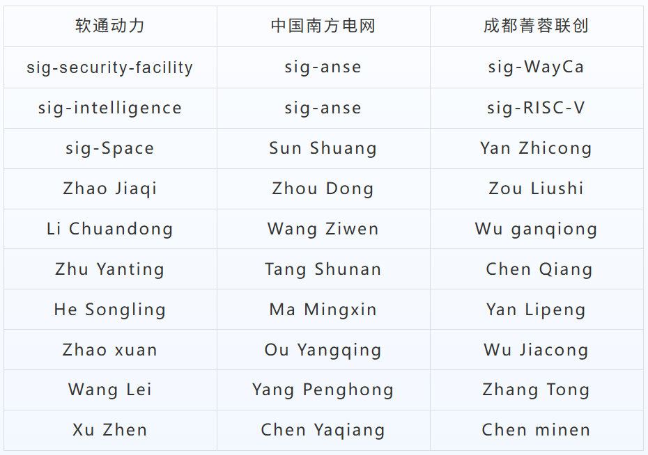

若您希望在月报中增加您的工作内容，或对内容有任何改进建议，请联系：contact@openeuler.io
