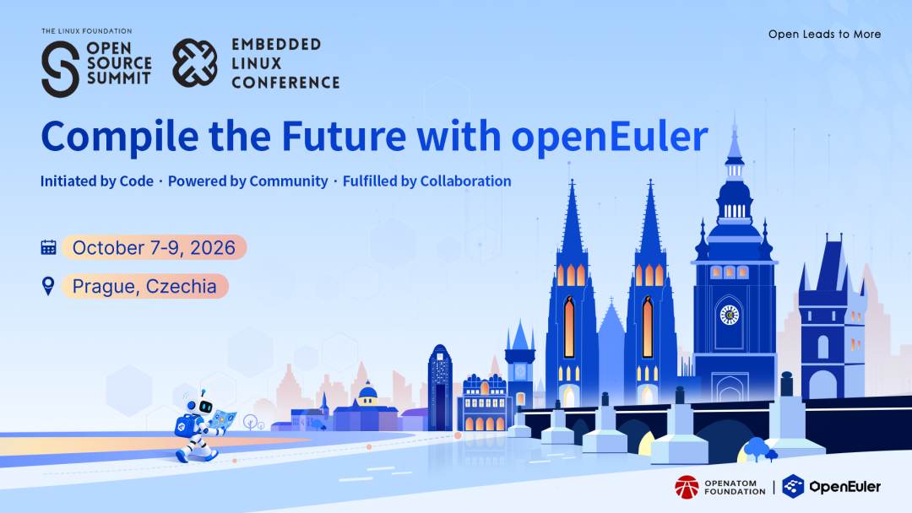
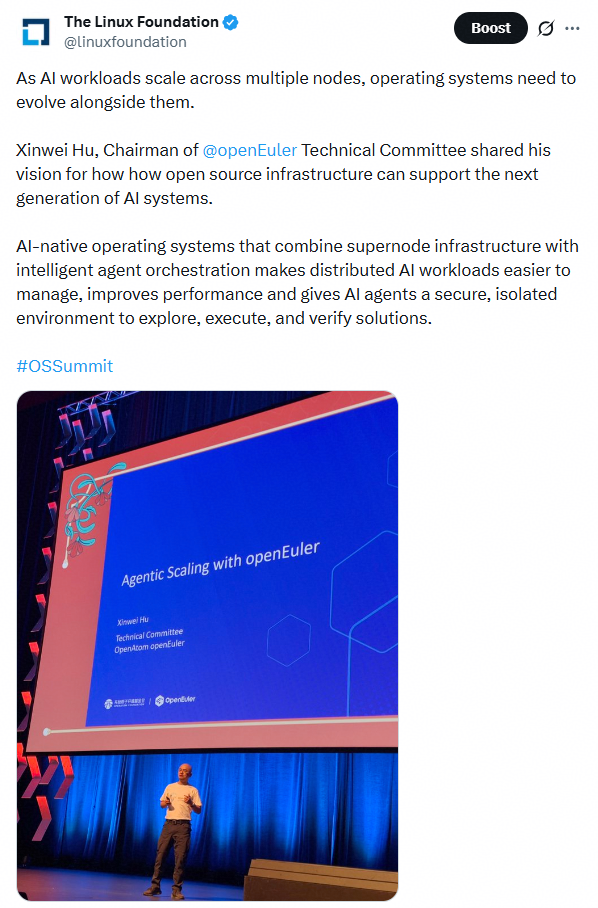
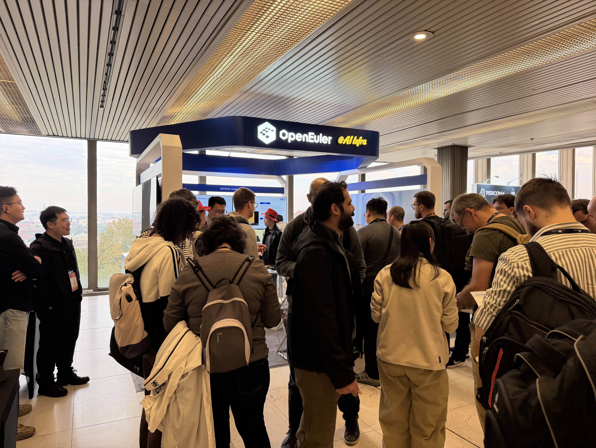
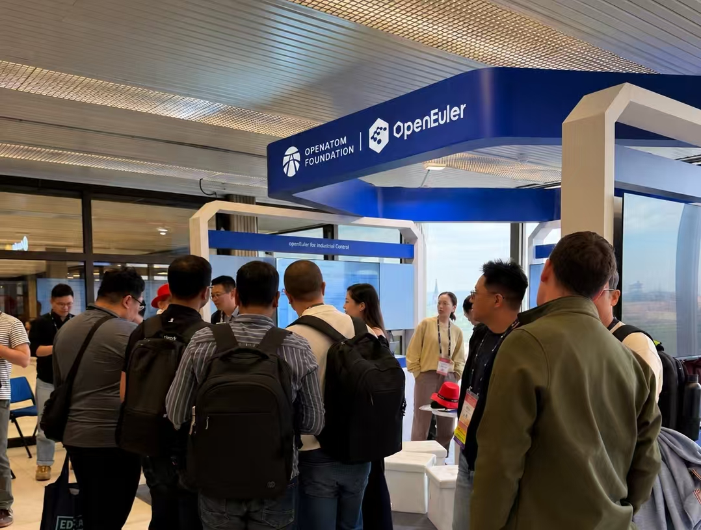

2026年10月7-9日，国际开源盛会 Open Source Summit Europe 2026（以下简称“OSSUMMIT EU 2026”）在布拉格成功举办。OpenAtom openEuler（简称：“openEuler”或“开源欧拉”）深度参与此开源盛会，全面展示 openEuler 在 AI 与国际化方面的最新进展。本次会议，openEuler 不仅在主会场进行 Keynote 分享，还设置了 openEuler 交流区，在大会现场与全球开发者深入探讨开源操作系统与 AI 的前沿趋势、与企业代表共探开源机遇，交流实践成果与生态发展思路， 携手为构建开放协同的全球开源环境聚力。

## 聚焦技术演进，探索超节点与 Agentic Scaling 新方向

Keynote 现场，openEuler 社区技术委员会主席胡欣蔚发表了主题演讲——《Agentic Scaling with openEuler 》。演讲中，胡欣蔚介绍了 openEuler 下一阶段的演进思路。面向 SuperPod 硬件的发展趋势，openEuler 致力于构建易用、可靠、高性能的超节点亲和服务器操作系统；面向 Agent 工作负载特征，openEuler 提出通过 Agentic Scaling 提升模型能力的新方向，探索操作系统与智能化应用深度融合的更多可能。

## 交流热度持续，技术实践引发广泛探讨

除了精彩纷呈的 Keynote，openEuler 交流展台同样吸引了众多开发者驻足交流。来自不同开源社区和企业的技术人员与 openEuler 社区专家围绕多个技术方向展开深入探讨，交流内容涵盖 openEuler 超节点 OS、Agentic Infra、Embedded 等领域，进一步促进了技术互动与经验分享。通过与国际开源社区及产业伙伴的交流，openEuler 持续拓展技术对话的广度与深度，推动开源技术创新与生态协作。

## 面向智能化未来，持续推进开源创新

openEuler 的成功离不开社区开发者的贡献和持续努力。经过7年的发展，openEuler 已成为一个充满活力和创新的社区项目。此次亮相 OSSUMMIT EU 2026，是 openEuler 与国际开源社区开展技术交流、分享实践成果的重要契机。

未来，openEuler 将继续围绕操作系统技术创新与多样化应用场景需求，深化国际开源交流与协作，携手全球开发者和生态伙伴，共同推动开源操作系统技术发展与生态繁荣，为智能化时代的基础设施建设提供坚实支撑。

