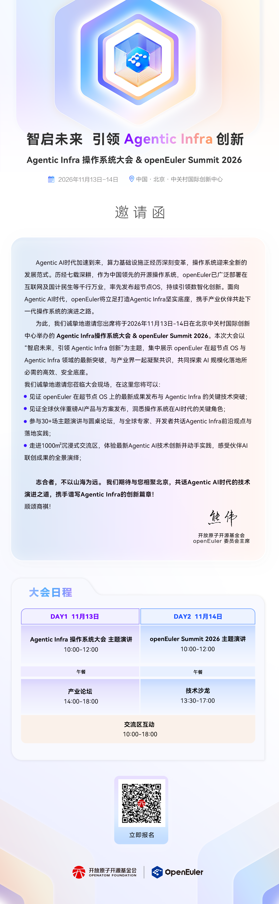

11 月 13 日–14 日，Agentic Infra 操作系统大会 & openEuler Summit 2026 将在北京中关村国际创新中心举行。本次大会以“智启未来，引领 Agentic Infra 创新”为主题，集中展示 openEuler 在超节点 OS 与 Agentic Infra 领域的最新突破，与产业界一起凝聚共识，共同探索 AI 规模化落地所必需的高效、安全底座。

- 报名链接：<https://openatomcon.openatom.cn/registration_mobile/?code=cw0o&activityNo=HD20261010110123>

