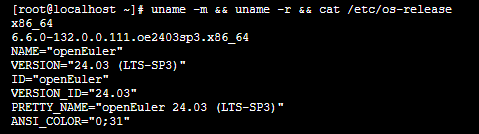
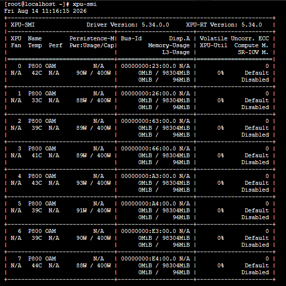

近日，OpenAtom openEuler（简称“openEuler”或“开源欧拉”）与昆仑芯P800系列产品完成兼容性互认证。双方围绕系统与设备识别、驱动及软件环境、链路与设备互联等关键环节开展验证，共完成7项子测试，全部通过。

此次互认证验证了openEuler与昆仑芯P800系列产品在基础软硬件运行环境层面的兼容性，进一步完善了AI算力硬件与开源操作系统之间的适配能力，为算力产品在开放软件生态中的部署应用提供实践支撑。

## 深化软硬件适配 推动算力生态协同发展

随着AI算力应用不断拓展，算力产品的实际落地不仅依赖硬件能力，也需要操作系统、驱动、软件环境及设备互联等基础设施的协同支撑。软硬件兼容性是保障算力平台稳定部署和应用运行的重要基础。

本次兼容性互认证围绕系统识别、软件环境部署及链路互联等环节展开，重点验证openEuler对昆仑芯P800产品的识别能力、驱动与SDK 部署情况，以及主机与设备、设备与设备之间的链路及互联能力。

测试首先对操作系统基础信息进行检查，确认openEuler运行环境正常可用：

驱动安装完成后，系统可正确识别昆仑芯P800，并确认设备已绑定对应内核驱动，设备状态正常：

> 测试结果显示：openEuler系统能够正确识别昆仑芯P800 ，驱动及SDK部署顺利，设备状态正常，设备互联相关测试均达到预期，7项子测试全部通过。

本轮验证覆盖基础运行环境中的多个关键环节，进一步打通AI加速卡与开源操作系统之间的软硬件协同通路，为算力产品融入多元化技术生态、拓展应用场景提供实践参考。

## 持续拓展主流生态适配 完善AI软硬件协同体系

AI产业的快速发展，对算力基础设施的软硬件协同能力提出了更高要求。芯片、操作系统、AI框架、模型及应用之间形成更加完善的适配体系，有助于降低用户部署和使用门槛，进一步释放算力基础设施的应用价值。

作为开放原子开源基金会孵化的开源操作系统项目，openEuler持续推进开放生态建设，围绕多样化计算架构、算力硬件及上层软件生态开展适配与协同，推动操作系统与产业伙伴形成更加开放、高效的技术协作体系。

此次与昆仑芯完成兼容性互认证，是openEuler持续完善AI算力生态适配能力的一项实践。通过对系统识别、驱动及SDK部署、设备互联等基础能力进行验证，进一步增强openEuler与AI算力硬件之间的协同基础，也为后续更深层次的软件适配和业务验证创造条件。

面向未来，openEuler社区将持续携手产业伙伴推进软硬件适配与生态协同，进一步丰富AI算力生态，推动操作系统、算力硬件及上层软件之间形成更加紧密的协作关系，为开发者和用户提供更加开放、便捷的算力应用环境，共同推动AI软硬件生态创新发展。