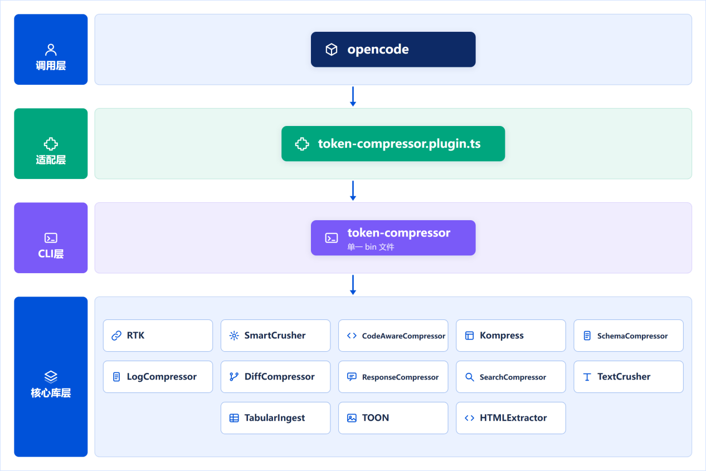
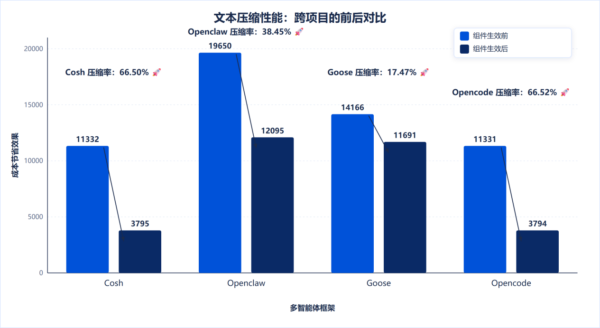
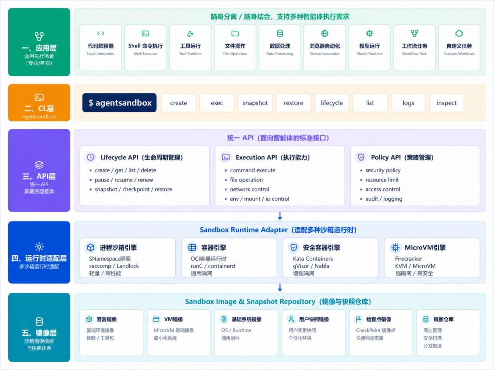
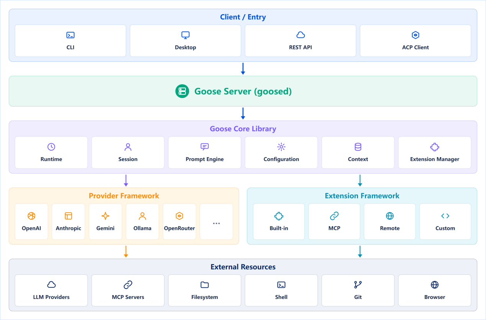

随着AI技术与操作系统深度融合，Agent正从单点能力验证，走向多Agent协同、复杂任务处理与企业级规模化应用。与此同时，上下文成本难以控制、安全运行体系碎片化、底层能力重复建设等瓶颈日益凸显，对服务器操作系统的AI原生支撑能力提出了更高要求。

对此，麒麟软件联合OpenAtom openEuler社区（以下简称"openEuler"），依托witty技术体系，将操作系统的原生安全与计算管控能力延伸至Agent运行时，打造面向多Agent的统一运行基础设施：以witty-token-compressor治理上下文膨胀，以witty-sandboxer保障安全执行，以witty-goose夯实运行基座——深度适配openEuler，补齐多智能体运行的共性底座能力，并将关键技术成果开源回馈社区，为Agent安全、稳定、高效运行提供坚实支撑。

## witty-token-compressor：治理上下文膨胀，优化推理成本

针对Agent长周期任务中上下文持续膨胀、无效信息挤占Token资源，进而影响推理精度、推高执行成本这一行业痛点，麒麟软件研发"witty-token-compressor"，把上下文压缩能力沉淀为Agent Runtime层的通用增强组件，支持无侵入接入现有Agent运行时，上层业务Agent无需任何改造即可快速获得上下文治理能力。

*图1：witty-token-compressor 处理流程*

该组件自身不引入额外Token开销，全部压缩逻辑在本地闭环执行，无需调用外部大模型。内置10余种压缩算法，可针对Schema、代码、日志、Diff、搜索结果等十余类Agent典型数据实施定向精细化降噪；采用插拔式架构，便于压缩算法持续迭代演进；配套标准化集成接口，兼容主流Agent开发框架。在完整保障业务任务执行有效性的前提下，高效过滤上下文噪声、提升关键信息密度，实现Agent推理成本与执行效率的双向优化。

在多款主流Agent框架上的标准化评测显示，组件在保障任务成功率的同时，取得了显著的上下文压缩效果：平均压缩率达47.24%，最高达66.52%。

*图2：文本压缩性能*

后续，麒麟软件将持续迭代压缩算法，面向代码、日志、表格等高频场景提升压缩率；完善端到端评测体系，支撑组件性能调优；拓展适配更多数据格式与Agent框架，持续扩大生态覆盖。

## witty-sandboxer：为Agent构筑安全受控的执行环境

Agent具备工具调用与代码执行能力后，不同任务对运行环境的安全要求差异很大；若由上层Agent逐一感知底层差异并自行适配，不仅增加开发负担，也难以按任务风险等级动态选择合适的防护级别。基于此，麒麟软件研发"witty-sandboxer"，提出统一沙箱启动器方案，通过统一接口与策略引擎，对多种隔离运行时进行统一编排与调度。

*图3：witty-sandboxer 架构*

witty-sandboxer可根据Agent任务场景与安全等级，动态选择最合适的沙箱运行时：上层Agent无需感知底层具体采用何种隔离技术，即可获得统一的安全执行能力；底层可适配Bubblewrap/Seccomp、Docker/runc、gVisor/Kata、Firecracker等多种隔离技术，向上提供Lifecycle API、Execd API、Checkpoint & Rollback、Sandbox Image等统一能力接口。

结合任务行为与风险等级，witty-sandboxer可自动匹配对应的隔离运行时，在保障安全的前提下兼顾执行性能：低风险的本地文件读取、简单计算，采用轻量命名空间隔离，实现微秒级启动；中等风险的脚本执行、常规工具调用，依托标准容器完成隔离；高风险的第三方插件、不可信代码运行，启用用户态内核隔离；极高风险的Shell执行、网络访问等操作，则启用MicroVM提供最强隔离防护。

| 任务场景 | 风险等级 | 推荐沙箱运行时 | 隔离特性 |
| --- | --- | --- | --- |
| 本地文件读取、简单计算 | 低 | Bubblewrap / Seccomp | 轻量命名空间，微秒级启动 |
| 脚本执行、常规工具调用 | 中 | Docker / runc | 标准容器隔离 |
| 第三方插件、不可信代码 | 高 | gVisor / Kata | 用户态内核隔离 |
| 高风险 Shell、网络访问 | 极高 | Firecracker | MicroVM 强隔离 |

*各场景选型与隔离特性*

在此基础上，麒麟软件将持续丰富底层隔离运行时适配，接入更多虚拟化与容器技术；迭代增强策略引擎，实现基于行为分析的动态风险识别，支持沙箱防护等级随任务风险自动升降。

## witty-goose：引入成熟Runtime，加速Agent落地

面对多Agent规模化落地，业务侧若重复开发会话管理、任务循环、工具调度、安全管控、可观测性等底层能力，往往面临研发投入大、版本维护成本高、实现标准不统一等问题。为此，麒麟软件引入Linux Foundation旗下Agentic AI Foundation（AAIF）的成熟开源项目Goose，打造witty-goose，聚焦openEuler深度适配与操作系统生态融合，打通Agent Runtime能力与操作系统原生能力。

Goose原生提供完整的Agent运行基础能力，覆盖会话管理（Session）、上下文管理（Context）、任务主循环（Agent Loop）、模型接入（Model Provider）、工具协议（Tool/MCP）、子智能体调度（Subagents）等核心功能；内置权限管控、沙箱对接、提示注入防护等安全能力，并提供基于OpenTelemetry的Trace、Metrics、Logs全套可观测能力。

业务侧复用这套成熟的Runtime基座，即可避免在底层能力上重复造轮子，将研发资源聚焦于操作系统适配、系统能力增强、生态集成与商业产品化等差异化工作。

*图4：witty-goose Runtime 架构*

witty-goose可支撑多种典型场景。在企业级可靠性保障方面，Goose已进入RHEL Extensions Repository，具备企业级Linux实践基础，依托上游社区的企业级积累获得稳定迭代保障，满足生产环境对可观测性、安全性与故障排查的要求；在降低开发门槛方面，上层业务Agent可直接复用会话管理、子Agent调度、工具调用、可观测性等标准化能力，大幅减少底层编码工作，加快业务Agent开发上线速度。

面向未来，麒麟软件将完成witty-goose与witty-token-compressor、witty-sandboxer三大组件的原生联动，并在openEuler社区持续沉淀标准化使用样例、开发文档与最佳实践，降低开发者基于witty-goose构建业务Agent的接入门槛，不断完善openEuler生态下的Agent Runtime开源共建体系；同时推动开源组件、操作系统能力与商业产品深度融合，让技术创新成果持续汇入银河麒麟高级服务器操作系统的AI能力体系，为千行百业构建安全、稳定、高效的AI原生服务器操作系统技术底座。
