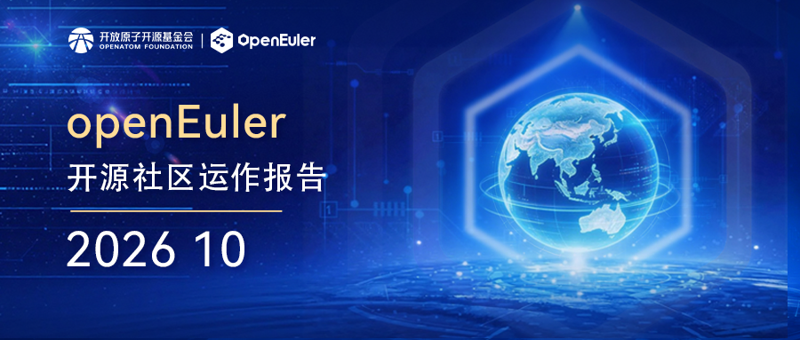

## 1、概述

2026年10月，OpenAtom openEuler（简称"openEuler"或"开源欧拉"）社区持续推进技术创新与生态建设协同发展，社区规模和活跃度稳步提升。截至10月底，社区用户累计超过1021万，开发者超过2.9万名，单位成员达2206家，SIG组112个，社区贡献持续积累。

在社区运营与生态建设方面，openEuler 深度参与 OSSUMMIT EU 2026，持续拓展国际开源交流与合作；亮相 RISC-V 中国峰会，展示 RVA23 服务器生态进展；与昆仑芯完成兼容性互认证，进一步推动开源操作系统与 AI 算力生态协同发展。此外，openEuler AI Agent 可靠性 & 软件工程 Meetup 西安站圆满举办，围绕 AI Agent 可靠性与软件工程开展技术交流，促进开发者互动与技术实践分享。

在技术方面，社区持续深化 AI 与操作系统融合，围绕 Agentic Infra、智能运维、Agent 开发与治理、AI 推理及虚拟化等方向推进技术创新。openEuler Developer CLI、SkillHub、Scout Agent 等项目持续完善社区 AI 技术生态，与美团共建Osclinic + Witty 智能诊断方案推动大规模集群内核故障诊断能力提升，StratoVirt、FlagOS 等技术实践不断拓展操作系统在 AI 与智能体场景中的应用。

整体来看，openEuler 社区持续推进技术创新与版本生态建设，深化国际开源交流和产业协同，不断丰富 AI 与操作系统融合的技术实践，推动开源操作系统生态向智能化、规模化应用持续发展。

## 2、社区规模

截至2026年10月31日，openEuler 社区用户累计超过1021万，超过2.9万名开发者在社区持续贡献。社区单位成员达2206家，SIG组112个，累计产生352.8K个PR、170.9K条Issue、6430.8K条Comment。

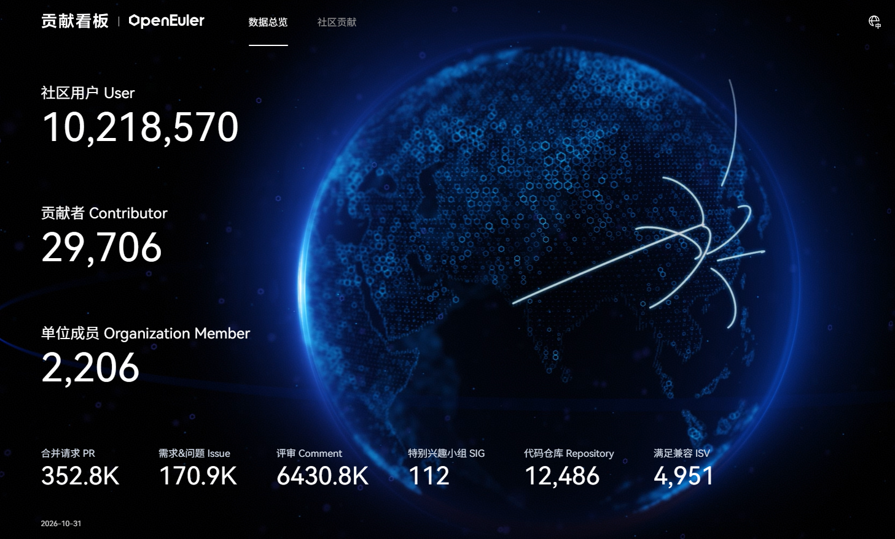

*社区贡献看板（截止2026/10/31）*

## 3、社区事件

### openEuler与昆仑芯完成兼容性互认证，持续拓展算力生态协同

openEuler与昆仑芯P800系列产品完成兼容性互认证。双方围绕系统与设备识别、驱动及软件环境、链路与设备互联等关键环节开展验证，共完成7项子测试，全部通过。

此次互认证验证了openEuler与昆仑芯P800系列产品在基础软硬件运行环境层面的兼容性，进一步完善了AI算力硬件与开源操作系统之间的适配能力，为算力产品在开放软件生态中的部署应用提供实践支撑。

阅读原文：[openEuler与昆仑芯完成兼容性互认证，持续拓展算力生态协同](https://mp.weixin.qq.com/s/F_Me4imxyWvi9okS4ZSX2g)

### openEuler 亮相国际开源盛会 OSSUMMIT EU 2026，持续推动智能化未来的实现

10月7-9日，国际开源盛会 Open Source Summit Europe 2026（简称"OSSUMMIT EU 2026"）在布拉格成功举办。 openEuler深度参与此开源盛会，全面展示 openEuler 在 AI 与国际化方面的最新进展。本次会议，openEuler 不仅在主会场进行 Keynote 分享，还设置了 openEuler 交流区，在大会现场与全球开发者深入探讨开源操作系统与 AI 的前沿趋势、与企业代表共探开源机遇，交流实践成果与生态发展思路， 携手为构建开放协同的全球开源环境聚力。

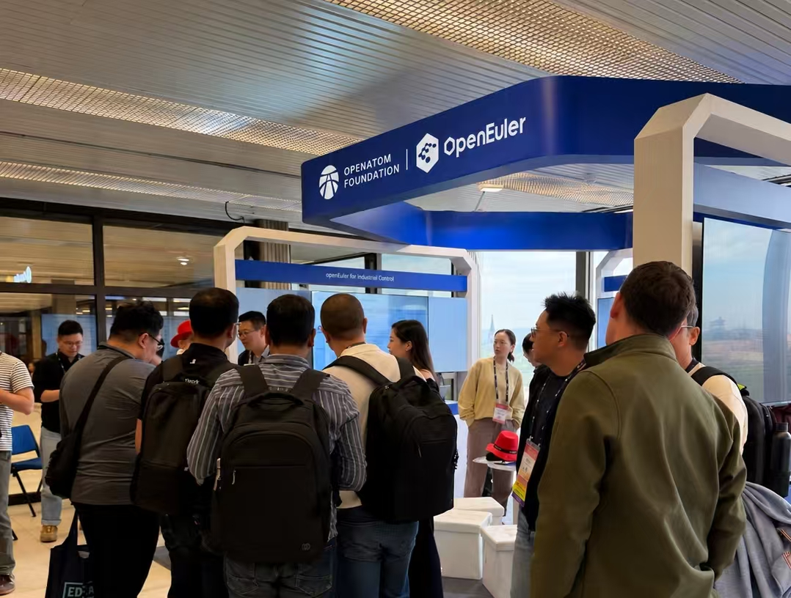

阅读原文：

[openEuler 亮相国际开源盛会 OSSUMMIT EU 2026，持续推动智能化未来的实现](https://mp.weixin.qq.com/s/Ns3tO3qbTu7dJjrBHv1e8Q)

### openEuler Embedded 深度参与 Open Source Summit Europe 与 Embedded Linux Conference Europe 2026

10月7-9日，openEuler Embedded 团队参加了在捷克布拉格举行的 Open Source Summit Europe 2026 与 Embedded Linux Conference Europe，并在 openEuler 展台展示 openEuler Embedded、MICA 混合关键性部署、实时系统及 IB_Robot 等内容，与200多位来自芯片硬件、工业自动化、汽车、能源、通信等领域的来宾展开交流。来访者普遍关注低时延、高确定性的嵌入式能力，对混合部署底座的开箱即用与统一接口尤为关注，并围绕 Linux 与 RTOS 协同、资源隔离、跨域通信、硬件适配与长期维护等实际集成问题深入探讨；芯片与硬件领域的工程人员则重点关注平台适配、异构计算资源支持及板级接入路径。针对具身智能场景，团队围绕IB_Robot项目与来访者交流了Inference Scheduler、IBMW、具身agent等关键技术，以及agentic开发基础设施，为 openEuler Embedded 后续技术方向与产品演进收集了宝贵的一线反馈。

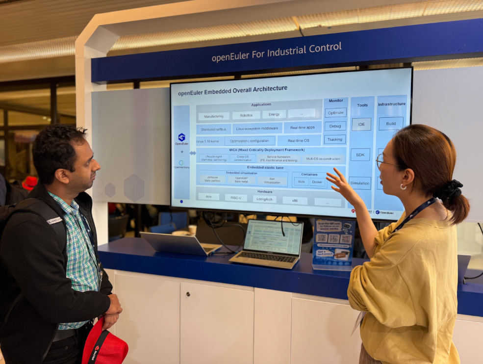

### openEuler 亮相 RISC-V 中国峰会，展示 RVA23 服务器生态进展

2026 年 10 月 18 日至 20 日，第六届 RISC-V 中国峰会在深圳会展中心（福田）举行。openEuler 社区 RISC-V SIG 以《面向 RVA23 新基线与 RISC-V 标准服务器系统：openEuler on RISC-V 进展与计划》为题进行 Poster 展示，呈现 openEuler 社区 RISC-V 架构侧在 RVA23 服务器基线适配、内核能力建设及生态协同方面的阶段性进展。

硬件适配方面，openEuler 24.03 LTS SP4 在 RISC-V 架构侧进一步完善 RVA23 服务器平台支持，新增进迭时空 V100、蓝芯算力 LX500 等服务器平台的基础支持。内核方面，社区基于 RVCK 持续推进 RVA23 相关适配与补丁反合，覆盖 KVM 虚拟化、IOMMU、RAS、ACPI 等关键能力；用户态方面，围绕 GCC、Binutils、LLVM、Go、OpenJDK、OpenSSL 等工具链、运行时与基础库持续开展适配和性能优化。

此外，社区 RISC-V SIG 还在香山昆明湖 RVA23 QEMU/FPGA 环境中开展系统验证，覆盖 Nginx、MySQL、Hadoop、Memcached、OpenBLAS 等 11 类服务器应用。后续，社区 RISC-V SIG 将继续面向 RISC-V Server Platform 与 RVA23 规范推进版本适配，持续完善 RISC-V 服务器操作系统生态。

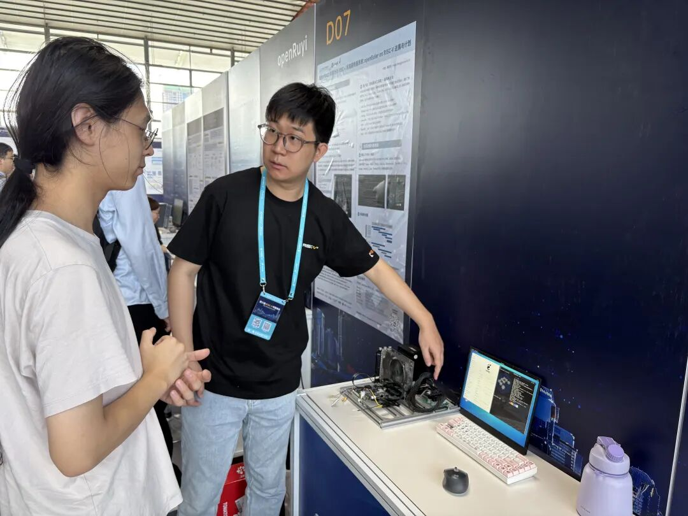

阅读原文：[openEuler 社区亮相 2026 中国 RISC-V 峰会：展示 RVA23 原生适配新进展](https://mp.weixin.qq.com/s/5tLKYpR4L0gjbJS0f53C_w)

### openEuler AI Agent 可靠性 & 软件工程 Meetup · 西安站圆满举办

10 月 31 日，openEuler 社区主办、西安电子科技大学计算机科学与技术学院协办的 openEuler Meetup 西安站在西安电子科技大学长安校区圆满举行。本次活动由西电计算机科学与技术学院副院长李瑞、ANSE（AI-Native Software Engineering，AI 原生软件工程） SIG 发起人王磊开场致辞。六位学术界和产业界专家围绕"AI Agent 可靠性 & 软件工程"主题，开展 6 场精彩分享。现场与会近 200 人，就这一主题进行交流研讨，共同探索 AI Agent 可靠性、AI 与软件工程的融合实践等领域方向。

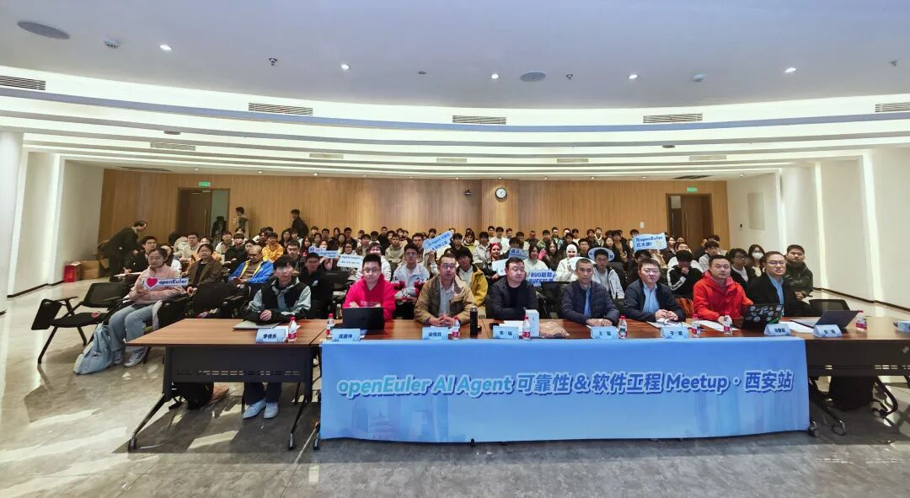

## 4、技术进展

### openEuler Developer CLI：支持 Agent 运行在权限一致、工具统一、调用可审计的安全底座上，实现"人 - 设备 - Agent" 三位一体的可信基座

openEuler sig-infrastructure 推出 openEuler Developer CLI（OED-CLI）——基础设施全场景统一工具：打通 openEuler 社区账号、应用身份，支持单点登录、令牌托管、权限策略下发；Agent 继承用户身份与权限，做到人、Agent 权限一致，支持权限流转、审计溯源，解决 Agent 代执行时身份不可信、权限越界问题；并且支持设备身份核验、设备侧权限绑定；区分设备身份、用户身份、Agent 身份，支持设备准入。

此外，OED-CLI结合社区基础设施统一中心网关，统一流量入口、工具路由与协议适配层；集中纳管社区工具集、API，提供请求鉴权、流量管控、限流熔断；所有 Agent 工具调用统一经过网关收口，实现工具统一托管、调用可审计、链路可追溯。

除pypi安装外，现已支持多种DeepSeek Harness，Qwen Code，Kimi Code CLI，Hermes等主流Harness框架，诚邀大家共同建设。

相关贡献地址：

https://atomgit.com/openeuler/oed-cli

### openEuler 与美团共建 Osclinic + Witty，大规模集群实现分钟级内核根因诊断

内核崩溃（Crash）诊断是运维领域门槛最高、耗时最长的环节：现场信息分散在 vmcore、dmesg、调用栈、硬件信息各处，人工逐条分析费时费力；故障案例持续积累却难以沉淀复用，同类故障反复排障。

Osclinic 是美团 MTOS 自研运维平台，承载大规模服务器集群，但内核崩溃诊断高度依赖专家经验。为此 openEuler 社区与美团联合打造 Witty 智能运维引擎：openEuler 贡献800万条多源内核知识（Linux commit/邮件/Bugzilla、openEuler commit/issue）与 rag_core 核心组件，美团提供大规模集群实战场景与 Osclinic 平台底座。Witty 以「Witty-智能诊断 Agent」驱动内核崩溃智能诊断，让排障不再依赖少数专家。

Witty-智能诊断 Agent 以**「检测→分析→关联→修复→沉淀」**为主线，按**「数据→知识→推理」**三层构建：

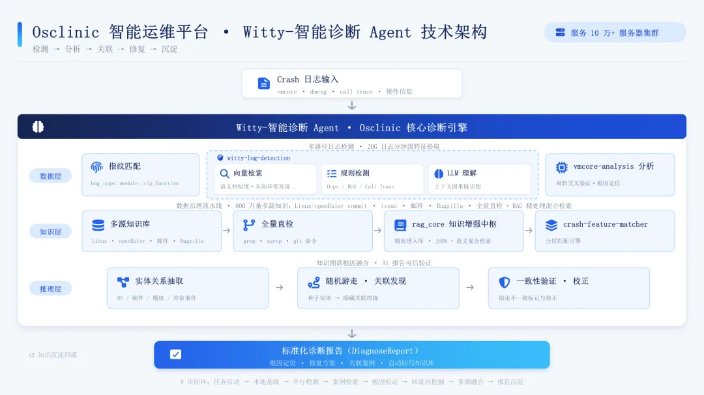

代码仓链接：

https://atomgit.com/openeuler/witty-agents

阅读原文：[降低内核排障门槛！openEuler 与美团共建 Osclinic + Witty，大规模集群实现分钟级内核根因诊断](https://mp.weixin.qq.com/s/ogdSk1ntmqQQAJr5J37a4w)

### 基于 StratoVirt 构建极速高密 Android 沙箱解决方案介绍

StratoVirt 是 openEuler 社区开源的 VMM，具备多元的虚拟设备生态，Linux、Android、Windows 三类负载都能撑住，同时通过深度编译优化，保持了极低的虚拟化内存底噪。其在社区保持着活跃的开发和维护状态，面向全场景持续完善功能和性能。

StratoVirt 特别的地方在于"一个 VMM、两种形态"。microVM 形态下，它把设备模型精简到最小，开销向 Firecracker 看齐（内存底噪 < 5M），适合最普通的 Linux 沙箱；通用 VM 模式下，它提供完整的 PCIe 设备体系、virtio-gpu、UEFI 启动、vsock，以及快照与内存复用能力，Android 和 Windows 走的正是后一条路。

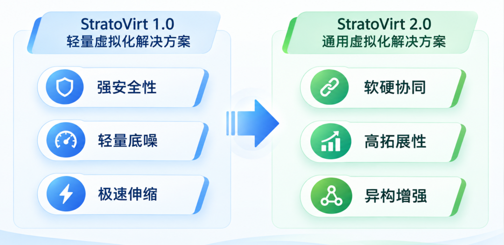

AArch64 上的完整支持也很关键。Cuttlefish 的实际部署大多跑在 AArch64 节点上，如果 VMM 在这块支持不到位，虚拟机内部应用的性能和兼容性都要打折扣。所以在需要同时覆盖 Linux、Android、Windows 的 Agent 沙箱场景里，StratoVirt 是一个既够轻、设备又够全的选择。

StratoVirt 仓库链接：

https://atomgit.com/openeuler/stratovirt

阅读原文：[基于 StratoVirt 构建极速高密 Android 沙箱解决方案](https://mp.weixin.qq.com/s/vYGWDgFA6q4PsHaCsrCMCg)

### SkillHub ：让社区的优质skill，被贡献、发布、复用

随着 AI Agent 技术的发展，Skill 正逐渐成为沉淀专业知识、复用任务流程和扩展智能体能力的重要载体。然而，目前 openEuler 社区的 Skill 以零散形式散落在项目仓库和个人仓库，缺少统一的组织与规范：版本各自为战、新旧难辨；检索缺乏统一入口，想用无从下手；缺少安全背书，使用者不敢贸然安装；运行环境依赖参差不齐，装上了也未必跑得起来。

这些问题不仅增加了 Skill 的发现和使用成本，也限制了已有技术成果的传播与复用。对于开发者而言，重复寻找、验证甚至重新开发相似技能，也会造成资源浪费。

openEuler SkillHub 通过统一的贡献与发布流程，将分散的 Skill 纳入规范化的检索与分发体系，并结合安全检测能力，降低技能共享与复用的门槛。 让优质 Skill 不再局限于单个项目或个人，而是能够在社区中持续流通、发挥价值。

SkillHub 地址链接：

<https://skillhub.openeuler.org/>

阅读原文：[openEuler SkillHub 系列 | SkillHub ：让社区的优质skill，被贡献、发布、复用](https://mp.weixin.qq.com/s/YDJv9tI9RtCGzXkcptlF2Q)

### 基于openEuler与FlagOS的MiniCPM5-2B推理部署与BenchMark

FlagOS 是 FlagOpen 开源社区推出的大模型开源软件栈，包含 FlagScale 分布式训推框架、FlagGems 通用算子库、FlagCX 通信库、FlagTree 统一编译器等组件，目标是让 AI 应用在多种芯片上"一次开发、处处运行"。面向昇腾算力，FlagOS 通过推理适配插件把 FlagGems 算子库接入 vLLM、SGLang 等主流推理框架，并由 FlagRelease 平台自动产出、发布"芯片 + 开源模型"组合的开箱即用容器镜像。

openEuler是面向数字基础设施的开源操作系统，在内核调度、驱动适配等层面对昇腾等 AI 算力提供支持，FlagOS 这类软件栈可以直接部署其上。

以 FlagRelease 发布的 MiniCPM5-2B 昇腾推理镜像为对象——镜像内置 SGLang 0.5.11、FlagGems 5.3.0 与 FlagOS 的 SGLang 适配插件，在 openEuler 24.03 与昇腾 910B4 组成的环境里完成了部署、冒烟验证与全档位压测，覆盖 8 组输入输出长度组合、最高 128 路并发、单卡与双卡张量并行（TP）两种形态。

阅读原文：[基于openEuler与FlagOS的MiniCPM5-2B推理部署与BenchMark](https://mp.weixin.qq.com/s/5M3jV99jhPLy_OKXyderlg)

### CensorGuard隐私保护：让 Agent 用好数据，守住隐私边界

CensorGuard隐私保护围绕任务的数据流转，构建出口覆盖、内容覆盖、传播控制三项核心能力。

出口覆盖：管住数据去向从模型调用、业务 API、远程 MCP，到子进程、文件上传、邮件与协作通道，按接收方和用途执行统一策略。运行环境与接入层共同建立受管路径，让数据在真正传出之前经过检查。

内容覆盖：理解任务携带的信息保护范围囊括输入、历史、工具参数与结果、检索片段和记忆，也延伸到文档、表格、图像、音频及元数据。通过结构化解析、OCR、转写和语义识别，将不同载体纳入同一套数据分级与保护规则。

传播控制：加工之后，约束继续有效敏感明细变成摘要、计算结果或子 Agent 输出后，来源标签与使用权限继续延续。跨 Agent 委托按子任务传递必要数据和最小权限；恢复后的内容再次进入模型、记忆或协作系统时，重新执行保护。

阅读原文：[Agent 可观测 & 治理系列 | CensorGuard隐私保护：让 Agent 用好数据，守住隐私边界](https://mp.weixin.qq.com/s/zUKPGIjJdR1HPLilm5K6AQ)

### Scout Agent：可从海量 Agent / Skill 中筛选适用于 openEuler 的运维能力

在 OS 上做运维，需要做相当多的事情。比如需要查看机器的负载、内存、磁盘，还有关键服务在不在。要是服务有问题，下一步通常就是去查 systemd 和日志。等到要装软件、做升级，就绕不开 RPM、依赖和升级日志了。如果构建或升级失败了，还需要查看 CI 日志也得翻。这都得花费不少时间。

然而这些工作，现在已经有不少被人写成 Agent 和 Skill 了，并且在 GitHub、AtomGit（GitCode）和openEuler SkillHub 上都能找到。不过，其中大多不能直接拿来用。有的并不是一条可以安装的技能，而是一个完整产品，或者只是一份清单。有的就算写成了技能，也常常是按别的环境写的，其中命令、软件包和日志位置对不上 openEuler。过多的混杂 Agent 和 Skill 依旧需要花费大量时间进行筛选和整合。

Scout Agent 正是为解决这些问题而设计。它能够从现有资源中筛选与 openEuler 运维场景相关的候选 Agent 和 Skill，并说明各项资源与 openEuler 运维需求的关联依据，帮助运维人员快速识别具有复用价值的能力。在此基础上，运维人员可以结合目标 openEuler 版本及具体业务环境，进一步完成适配、验证与整合，降低资源筛选成本，提升运维能力的复用效率。

项目仓库地址：

https://atomgit.com/openeuler/witty-agents/tree/master/scout-agent

阅读原文：[Scout Agent：如何从海量 Agent / Skill 中筛选适用于 openEuler 的运维能力](https://mp.weixin.qq.com/s/xqbjFzp9QzZkMf87FlESnA)

## 5、容器镜像更新

**统计周期**：2026年10月1日 - 2026年10月31日

**数据来源**：<https://gitcode.com/openeuler/openeuler-docker-images>

10月，openEuler社区升级镜像157个，新增镜像73个。具体分类如下：

**升级镜像（157个）**

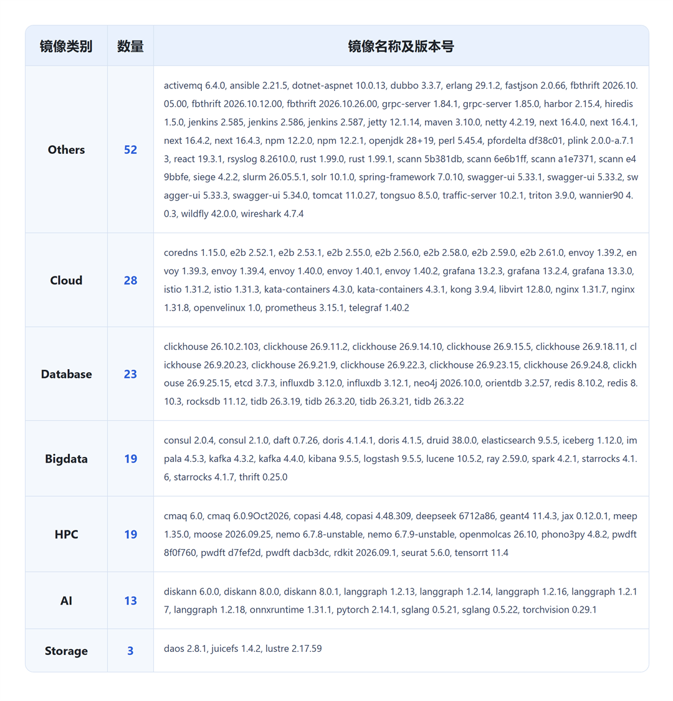

**新增镜像（5个）**

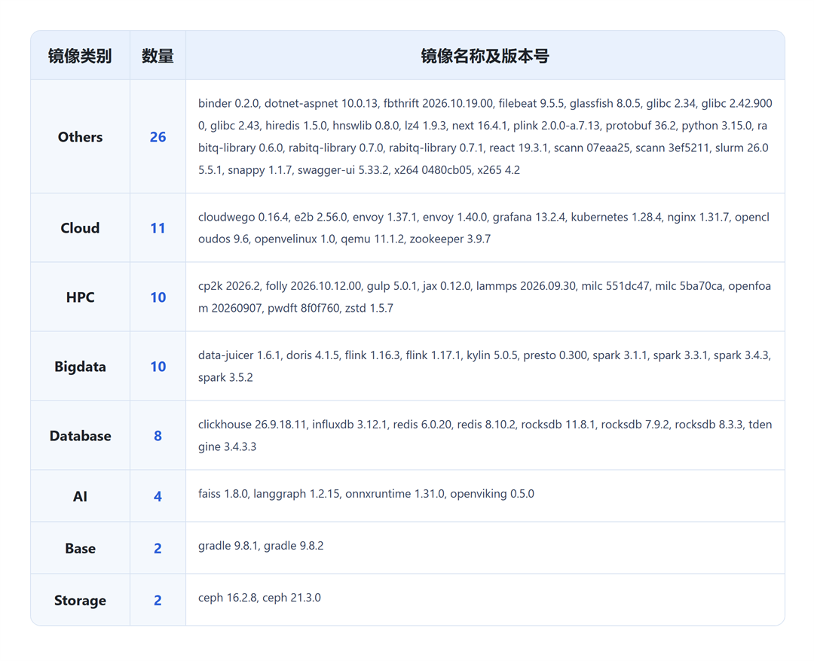

容器镜像可通过 Docker Hub 拉取使用，仓库地址：https://hub.docker.com/u/openeuler

## 6、软硬件兼容性测评

截至2026年10月31日，通过openEuler 软硬件兼容性测评的产品达2887款，10月新增33款，其中北向（ISV）新增25款，南向（IHV）新增8款。

兼容性列表：

https://www.openeuler.org/zh/compatibility/

OSV技术测评列表：

https://www.openeuler.org/zh/approve/

## 7、安全公告

2026年10月，社区共发布安全公告427个，修复漏洞93个（其中 Critical 14个，High 43个，其它36个）。

### ca-certificates 的 eMudhra 中间 CA 私钥泄露问题修复说明

10月20日，8个 eMudhra 中间 CA 证书的私钥（包括它们的 Sectigo 交叉签名）被披露泄露。持有私钥的攻击者能够为任意域名签发 TLS 证书，进而实施中间人攻击、冒充受信任网站并截获加密通信。

该事件属于第三方 CA 信任问题，非  openEuler代码漏洞，也不表示系统已遭受攻击。系统信任库中的相关根证书能够为涉事中间CA建立信任链，因此仍需处理证书信任风险。openEuler 社区已于10月22日已完成了 openEuler 在维版本 ca-certificates 的修复和发布，请用户尽快升级修复。

阅读原文：[【安全公告】ca-certificates 的 eMudhra 中间 CA 私钥泄露问题修复说明](https://mp.weixin.qq.com/s/VWg-2hK0p1bMqJsL7SlFfA)

### PHP 远程代码执行漏洞（CVE-2026-109618、CVE-2026-109619）openEuler在维版本均已修复

PHP 远程代码执行漏洞(CVE-2026-109618、CVE-2026-109619)，均与 PHP 请求生命周期边界上的状态管理缺陷有关：CVE-2026-109618 即内存耗尽（OOM）处理中的内存破坏。CVE-2026-109619 即跨请求的陈旧全局状态导致释放后使用（UAF）。两者统称为"PHP2Shell", 是 PHP 核心的严重未认证远程代码执行(RCE)漏洞。

鉴于该漏洞影响范围较大，**openEuler社区迅速开展应急响应，10月21日完成对社区全部在维版本的评估分析，并于10月22日完成了 openEuler 在维版本全系列 PHP 版本的修复与发布**，建议用户尽快做好自查并及时升级修复版本。

阅读原文：[【安全公告】PHP 远程代码执行漏洞（CVE-2026-109618、CVE-2026-109619）openEuler在维版本均已修复，请尽快升级](https://mp.weixin.qq.com/s/N_cVX4bj_yHTDkXM6_HVRA)

**● 重点漏洞提醒**

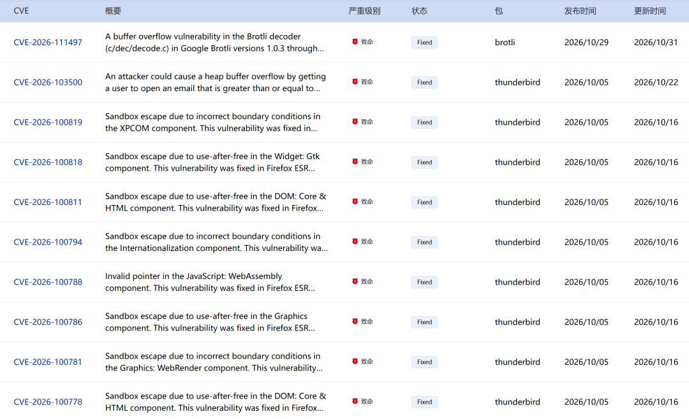

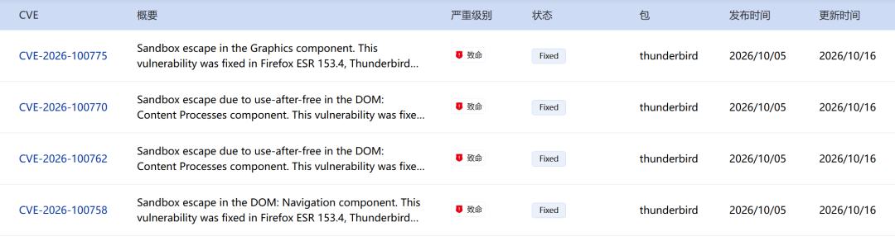

**● 漏洞防护**

openEuler社区针对在维版本例行修复漏洞，发布安全补丁。建议用户关注openEuler官网安全公告，及时安装漏洞补丁进行防护。

openEuler 安全公告：

https://www.openeuler.org/zh/security/security-bulletins/

## 8、致谢

openEuler社区的成长，从来不是某一个人的努力，而是大家并肩同行、共同创造的结果。每一次提交、每一次讨论、每一次分享，都是社区前行路上的点点星光，汇聚成今天的成果与温度。

也正因为社区持续涌现出丰富的实践与成果，月报内容难免有所遗漏，如有未被记录的亮点与贡献，欢迎随时与我们联系补充，让更多努力被看见、被传递。

在此，向为本期月报提供资料支持的各 SIG 组以及广大开发者朋友们致以诚挚的感谢与敬意：

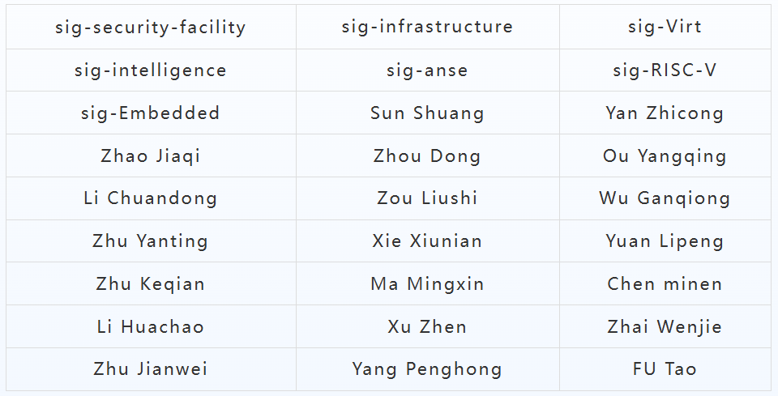

\*以上排名不分先后顺序

若您希望在月报中增加您的工作内容，或对内容有任何改进建议，请联系：contact@openeuler.io
