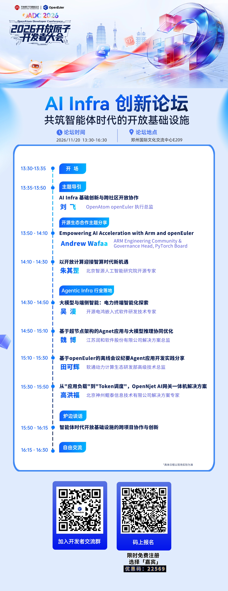

# 共筑智能体时代的开放基础设施｜2026开放原子开发者大会AI Infra创新论坛邀你来交流

大模型与智能体加速走向落地，算力底座、Agent 运行环境与开源协作如何跟上？

应用加速落地的背后，离不开稳定可靠的操作系统底座、高效的异构算力与推理软件栈，也需要 Agent 记忆、安全运行环境和开发工具的持续创新。如何让这些基础能力更开放、更易用，并通过开源协作加快技术与应用落地，已成为开发者和产业共同关注的话题。

**2026开放原子开发者大会将于11月20日至21日在郑州国际文化交流中心举办。** 大会期间，AI Infra 创新论坛以"共筑智能体时代的开放基础设施"为主题，汇聚开源社区、技术专家与产业伙伴，分享 AI Infra 前沿进展和行业实践，共同探讨开放基础设施的演进方向。

## 论坛看点

### 跨社区协作，汇聚全栈创新

openEuler 携手众智 FlagOS、开放原子电力行业开源社区等伙伴，共同探讨从操作系统、算力软件栈到 Agent 应用的 AI Infra 创新。

### 前沿技术，直击基础设施关键问题

围绕超节点架构、Agent 记忆、面向多元 AI 芯片的统一系统软件栈等方向，分享最新探索与实践，交流大模型推理和算力协同优化。

### 行业实践，呈现 AI 与 Agent 落地路径

从电力终端智能、离线会议纪要 Agent，到超节点上的 Agent 应用与大模型推理协同，了解 AI Infra 在真实场景中的应用进展。

### 炉边对谈，共议开放生态协同

来自openEuler、北京智源研究院、南方电网、润和软件、软通动力、神州鲲泰等嘉宾，将围绕智能体时代的开放基础设施与跨项目协作展开炉边谈话。

## 论坛信息

- 时间：2026年11月20日 13:30–16:30
- 地点：郑州国际文化交流中心 E209
- 承办单位：OpenAtom openEuler社区

如果你关注操作系统、AI Infra、大模型系统软件或行业应用，欢迎来现场与开发者、架构师、技术专家和开源贡献者交流。

限时免费报名：扫描海报右侧二维码，选择「嘉宾」，输入优惠码 **22569**。

期待郑州见！
